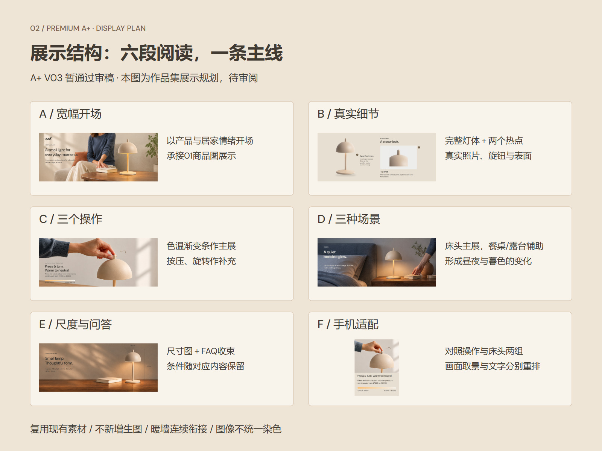
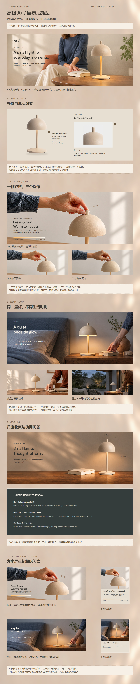
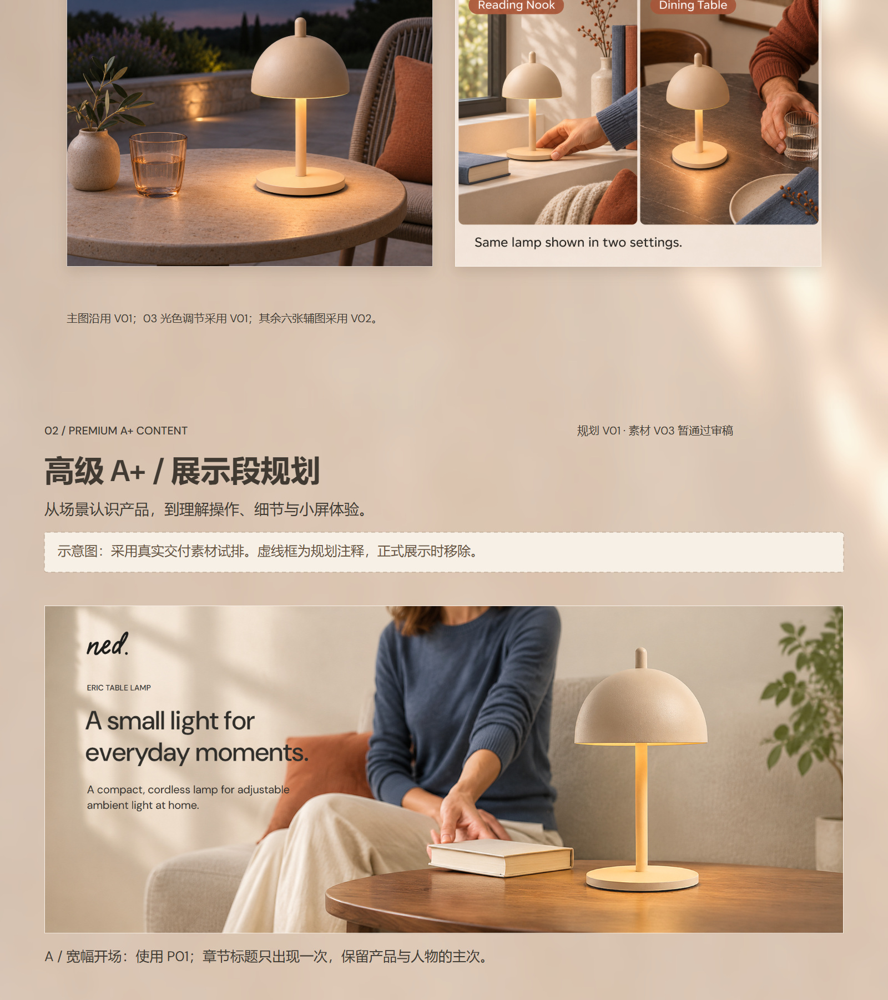

# 02_高级A+｜作品集展示规划 V01

2026-11-08。**用户已明确：高级 A+ V03 暂通过审稿。** 本次只制作作品集展示规划及示意图，展示布局待审阅；不是 A+ 正式定稿或上架。

- [高级A+ V03原交付（暂通过用户审稿）](../../制作交付/亚马逊A+内容/高级A+_V03/README.md) · [前段商品图展示](../../制作交付/作品集展示/成果展示/V04/01_商品图/README.md) · [项目入口](../../README.md)

## 看图入口

- [规划总览](01_示意图与预览/02_高级A+_规划总览_V01.jpg)：先看六段内容取舍。
- [长页规划示意](01_示意图与预览/02_高级A+_规划示意_V01.jpg)：使用真实 V03 素材，含虚线规划注释。
- [商品图至A+衔接示意](01_示意图与预览/商品图至A+_衔接示意_V01.jpg)：检查商品图尾部、背景接缝和下一章节入口。
- [可编辑SVG](02_可编辑SVG/)：规划标题、说明、边框和各图片对象独立；摄影与已有带字预览仍为位图。

## 展示目标与取舍

商品图段已经完整展示 Listing 与八张商品图，A+段转向页面叙事、交互状态与手机适配。推荐一条连续阅读路径，重点为操作设计和多场景体验。

不在开头完整缩放一遍整条 A+，随后又重复展示全部局部；完整桌面/手机长页留作附录链接。主线按 P01→P02→P03→P04→P05→P06 展开，再展示两组手机适配。P03/P04 的全部状态通过主次排布展开，避免三张带长文案宽幅硬缩为一排。

| 区段 | 展示内容与素材 | 版式与阅读任务 |
| --- | --- | --- |
| A 宽幅开场 | P01_PC | 居家开场，完整产品为焦点；章节标题只出现一次 |
| B 真实细节 | P02_PC，两个热点的既有字段 | 完整灯体＋旋钮窗口，对应①顶部旋钮②沙色表面；静态图保留对应关系 |
| C 三个操作 | P03C_PC 主展；P03A_PC/P03B_PC 无字素材辅助 | 色温渐变条作为记忆点；辅助图另排按压/旋转短标签，不挤小英文正文 |
| D 三种场景 | P04B_PC 主展；P04A_PC/P04C_PC 无字素材辅助 | 床头夜景带出光感，餐桌和露台补充场景变化，标明同一单灯多场景 |
| E 尺度与FAQ | P05_PC＋P06_PC | 完整尺寸图收束；FAQ保留现有三问，条件紧邻对应宣称 |
| F 手机适配 | P03C_PC/Mobile、P04B_PC/Mobile | 两组桌面/手机对应展示，解释独立取景、图下文案和阅读重排 |

示意图里的 A—F 是规划标记，不是另建六个商品模块。正式展示只保留必要标题与短说明，移除虚线规划框。

## 画布与衔接

- 外层作品集版本沿用 V04，素材版本标明高级 A+ V03；本次规划为 V01。
- 试排画布1600×7800 px，主内容宽1440、两侧80 px。高度是本次含注释的示意值，正式排版按文字与留白调整，不硬凑长度。
- 商品图段实际高4640 px。背景继续使用同一暖墙V02母版与提亮衍生逻辑，从商品图末端的连续坐标接续，不从母版顶端重贴。
- 原母版、商品图、A+成品全部保留。本轮仅生成规划用背景衍生图：15px柔焦、26%暖白混合；前120px修正旧渲染器边缘差异，第一行与商品图背景最后一行逐像素一致。
- 商品图末端至A+入口的留白在衔接预览中一起审阅。A+照片保留日夜色彩，不染成同一暖墙色。
- 延续深炭文字、DM Sans/微软雅黑、共同边距。无字辅助照片的动作标签与条件独立排版。

## 静态展示与交互入口

GitHub README展示JPG；点击可看原尺寸。静态示意不能执行热点、轮播，也不冒充Amazon后台页面。正式展示拟附可切换原审阅页的下载入口及全部状态原图；GitHub文件页不会直接运行HTML。

## 制作范围与检查

本次复用已有交付，不调用生图API，不修改V03的产品照片、功能参数或原文；仅生成规划背景、SVG、同版预览及说明。原图哈希记录在制作脚本生成的素材记录中。PNG示意由SVG同版渲染，JPG由其导出。

自检覆盖图片可解码、SVG唯一ID、无外部图片依赖、文字边界、同版导出、原素材哈希、背景首尾接缝和实际看图。预览正常不代表Illustrator/Inkscape导入已实测。

后续正式制作重点：B区两个热点的清楚对应；C区色温条与操作箭头；P02/P04/P05产品底部在缩放后有无新增描边或厚黑条；F区手机文字清楚且不被截断。不因V03暂通过审稿而省略作品集组合后的复核。

## 拟归档位置与后续交付

作品集正式展示：`作品集展示/成果展示/V04/02_高级A+/`。

本次规划：`项目规划/作品集02_高级A+_展示规划_V01_20261108/`。规划示意保持与正式展示段分开，避免把占位和注释当成最终成品。

正式制作交付拟含高清展示长图、缩略图、可编辑SVG、必要独立素材、商品图→A+连续预览和嵌图README。制作以本次用户对规划的反馈为依据。

## 长页规划示意

## 与商品图段衔接

