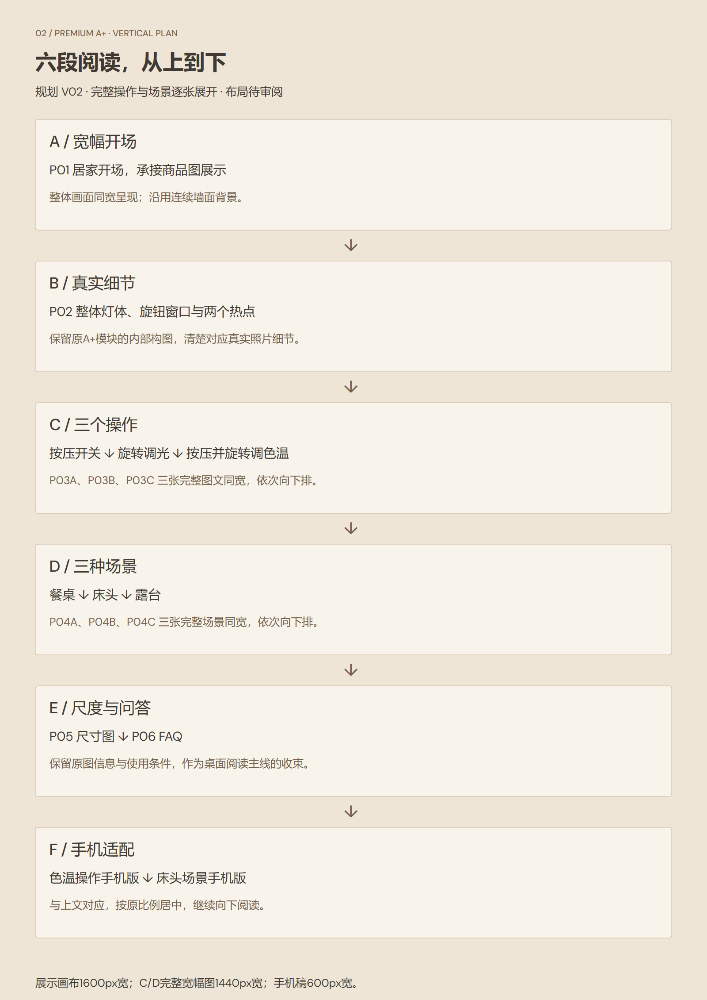
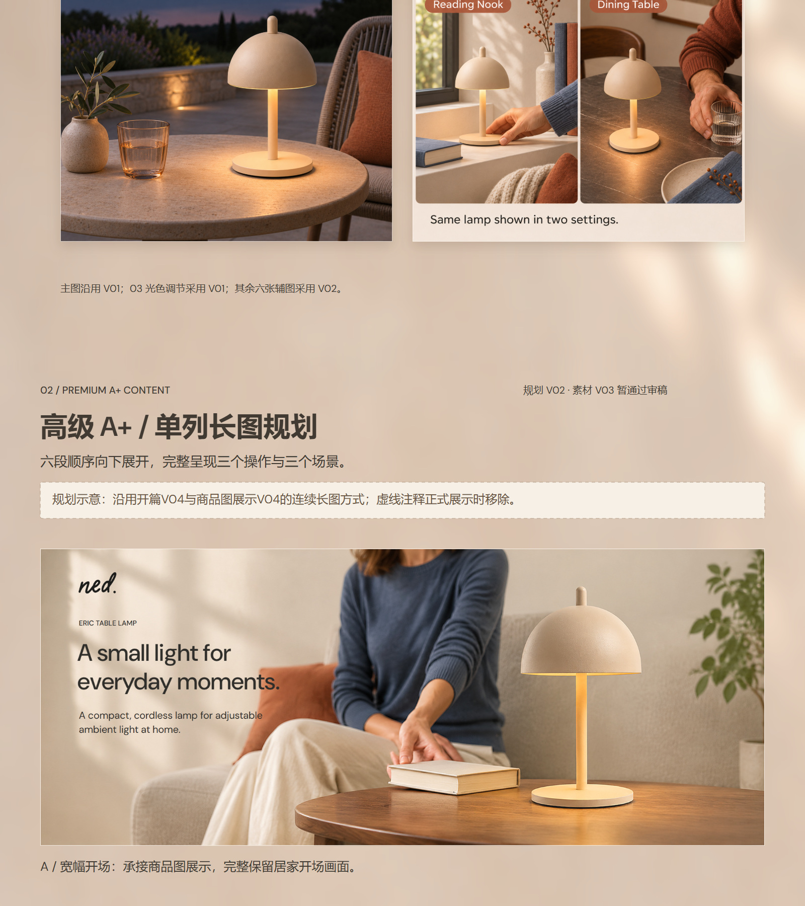

# 02_高级A+｜单列长图展示规划 V02

> 2026-11-08 手机展示修订：按用户反馈，[02高级A+展示V04 · 修订V02](../../制作交付/作品集展示/成果展示/V04/02_高级A+/README.md)已补齐11个手机图文状态，含三种操作和三种场景。展示长图1600×17280，商品图→A+连续预览1600×21920；原手机两例版保留。本说明更新实际交付范围，下面的旧尺寸及两例描述保留为历史记录。展示稿待审阅。

> 2026-11-08 制作进度：用户指示按本规划制作，已交付[作品集02高级A+展示V04](../../制作交付/作品集展示/成果展示/V04/02_高级A+/README.md)。正式展示稿移除规划注释，实际画布1600×9880，内容顺序保留；本规划作为执行依据保留，展示稿待审阅。

2026-11-08。**高级 A+ V03 暂通过用户审稿；本次作品集展示布局待审阅。**

按用户最新要求，参考作品集开篇 V04 和商品图展示 V04，采用六段依次向下的连续长图。三个操作、三个场景均使用完整图文逐张展示；手机段也顺序往下排。

- [高级A+ V03原交付](../../制作交付/亚马逊A+内容/高级A+_V03/README.md) · [前段商品图展示](../../制作交付/作品集展示/成果展示/V04/01_商品图/README.md) · [V01历史规划](../作品集02_高级A+_展示规划_V01_20261108/README.md) · [项目入口](../../README.md)

## 看图入口

- [单列长图示意（1600×11060）](01_示意图与预览/02_高级A+_单列长图规划示意_V02.jpg)
- [纵向阅读结构](01_示意图与预览/02_高级A+_纵向阅读结构_V02.jpg)
- [商品图至A+衔接示意](01_示意图与预览/商品图至A+_衔接示意_V02.jpg)
- [可编辑SVG](02_可编辑SVG/)

## 本次修改

1. 六段组成一个连续阅读栏，按A→F向下展开；结构总览也改为单列。
2. C区改为P03A按压开关→P03B旋转调光→P03C按压并旋转调色温，三张同宽完整带字画面逐张展开，色温渐变条保留。
3. D区改为P04A餐桌→P04B床头→P04C露台，三张同宽完整带字场景逐张展开，各自使用条件保留。
4. F区依次展示色温操作手机版、床头手机版，分别对应上文C03/D02；沿中轴居中排列。
5. V01完整保留作历史对照，当前执行以V02为准。

## 展示顺序与素材

| 区段 | 从上到下的顺序 | 展示尺寸与信息 |
| --- | --- | --- |
| A 开场 | P01_PC | 完整宽幅1440px宽，承接01商品图段 |
| B 细节 | P02_PC | 完整宽幅1440px宽，整体灯体、旋钮窗口、两个热点保留 |
| C 操作 | P03A_PC → P03B_PC → P03C_PC | 三张完整图文，每张1440px宽，依次下排 |
| D 场景 | P04A_PC → P04B_PC → P04C_PC | 三张完整图文，每张1440px宽，依次下排 |
| E 收束 | P05_PC → P06_PC | 尺度与FAQ连续向下展开 |
| F 手机 | P03C_Mobile → P04B_Mobile | 两张各600px宽，居中，原比例；对应上文桌面模块 |

“单列”约束作品集外层的阅读顺序。P02原模块内部的灯体与细节组合、手机稿自身图文结构均保留，不重新拆改V03成品。

## 画布、背景与阅读节奏

- 画布1600×11060px，主内容1440px宽，左右80px。高度为含规划注释的试排值，正式制作按留白调整。
- 摄影及已排好的英文图文保持原比例，整张嵌入；C/D六张完整图不会以小图形式挤在同一行。
- 三个操作采用按压→旋转→组合操作的顺序；场景采用日间餐桌→夜间床头→暮色露台的场景分组，不声称真实拍摄时间线。
- 暖墙背景从现有4640px商品图末端延展，沿用V01规划的衍生逻辑；背景首行与商品图背景末行逐像素一致。原母版及既有成品不覆盖。
- 延续开篇V04与商品图展示V04的深炭文字、暖墙、共同边距和纵向阅读方式；段内仅用必要小标题连接，正式展示移除虚线规划注释。
- 展示完整操作与场景会增加长图长度，本版优先保证图片与英文说明清楚。手机段通过对应上文模块说明适配关系。

## 版本与范围

外层作品集仍归V04；内容素材为高级A+ V03；展示规划为V02。用户对V03“暂通过审稿”的状态保留，本次不升级为正式定稿。

本轮只调整展示规划与示意，复用12份现有完整图文预览，不调用生图API，不修改产品、参数、原图配色或已有英文。SVG的规划标题、说明、边框和每张图片对象可编辑；既有图文中的照片与英文是位图。中文字体使用系统微软雅黑，未打包；DM Sans随附OFL许可。目标矢量编辑器导入未实测。

GitHub README直接嵌入长图，点击可查看原尺寸；静态图不执行热点与轮播，完整交互审阅页继续从V03原交付下载打开。

## 长图示意

## 纵向阅读结构

## 商品图段衔接

