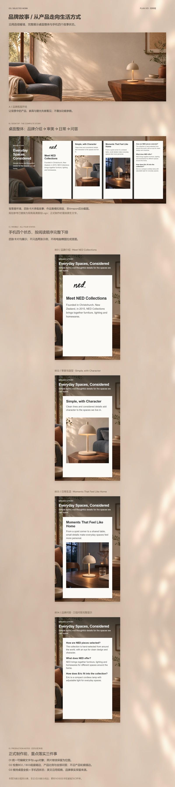

# 03_品牌故事｜作品集展示规划 V01

> 后续制作进度（2026-11-08）：用户已指示按本规划制作，现已交付[03品牌故事展示V04](../../制作交付/作品集展示/成果展示/V04/03_品牌故事/README.md)，正式展示长图1600×6600，桌面完整卡组及手机四状态全部保留，规划注释已移除。展示稿待用户审阅；下文“尚未制作”描述原规划时点。

2026-11-08。**本轮为规划与示意，待用户审阅；尚未制作正式03展示段。** 基于仓库已有品牌故事V01和当前作品集V04，沿用单列长图与连续暖墙。品牌故事V01在现有记录中仍为审阅稿，不沿用高级A+ V03的“暂通过审稿”状态。

- [完整展示规划](03_品牌故事_展示规划_V01.md)
- [长图示意 JPG（1600×7160）](01_示意图与预览/03_品牌故事_展示规划示意_V01_1600x7160.jpg) · [PNG](01_示意图与预览/03_品牌故事_展示规划示意_V01_1600x7160.png)
- [阅读结构总览](01_示意图与预览/03_品牌故事_阅读结构_V01.png) · [高级A+→品牌故事衔接示意](01_示意图与预览/02至03_衔接示意_V01.jpg)
- [可编辑规划SVG](02_可编辑SVG/03_品牌故事_展示规划示意_V01.svg) · [制作与检查记录](04_过程记录/制作与检查记录.md)

推荐顺序：**品牌氛围开场 → 桌面完整卡组 → 手机四个状态逐张下排**。四张故事卡均保留：品牌介绍、审美与造型、日常生活、品牌问答；最后一张含完整三组问答。品牌故事与高级A+是两个独立内容体系，这里不重复高级A+的11个手机状态。

## 长图示意

图末“正式制作前”三条说明属于本轮审阅注释，正式成品移除。示意SVG的外层章节和规划说明为原生可编辑文字，内部桌面与手机图文是已有HTML重渲染后的位图参考；**不宣称参考截图内部文字可编辑**。正式制作计划将这些文字重排为独立对象。

本轮复用现有素材，没有调用生图API，也未修改原品牌故事V01。
