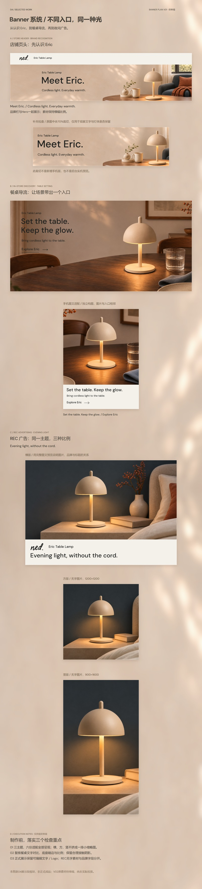

# 04_Banner系统｜作品集展示规划 V01

> 后续制作进度（2026-11-08）：已按用户指令完成[04_Banner系统展示V04](../../制作交付/作品集展示/成果展示/V04/04_Banner系统/README.md)，长图1600×6600，六份适配完整纵排，原生文字与独立Logo路径；当前待用户审阅。下文保留原规划时点记录。

2026-11-08。**当前为内容规划与长图示意，待用户审阅，尚未制作正式04展示段。** 以现有Banner V02为展示候选，接在03品牌故事之后；V02素材本身仍待审阅，不因本轮规划自动终审。

推荐顺序：**店铺页头 → 餐桌导流电脑／手机 → REC横／方／竖广告**。三个主题、六份图片适配均呈现，按单列长图纵向阅读，不并排压成小缩略图。页头中央裁切另作辅助检查，不计为第七份平台图片或独立手机稿。

- [完整内容与制作规划](04_Banner系统_展示规划_V01.md)
- [长图示意 JPG（1600×7040）](01_示意图与预览/04_Banner系统_展示规划示意_V01_1600x7040.jpg) · [PNG](01_示意图与预览/04_Banner系统_展示规划示意_V01_1600x7040.png)
- [阅读结构总览](01_示意图与预览/04_Banner系统_阅读结构_V01.png) · [03品牌故事→04Banner衔接](01_示意图与预览/03至04_衔接示意_V01.jpg)
- [可编辑规划SVG](02_可编辑SVG/04_Banner系统_展示规划示意_V01.svg) · [六份参考图片](03_参考素材/图片素材/) · [制作与检查记录](04_过程记录/制作与检查记录.md)

## 长图示意

本图末尾执行说明属于规划审阅注释，正式展示移除。外层标题和标签可编辑；内部图文预览为现有V02位图参考，不称其内部文字可编辑。正式制作计划复用原三份SVG，并补齐独立适配展示对象。未调用生图API、未改写原Banner文案、未修改V02素材。
