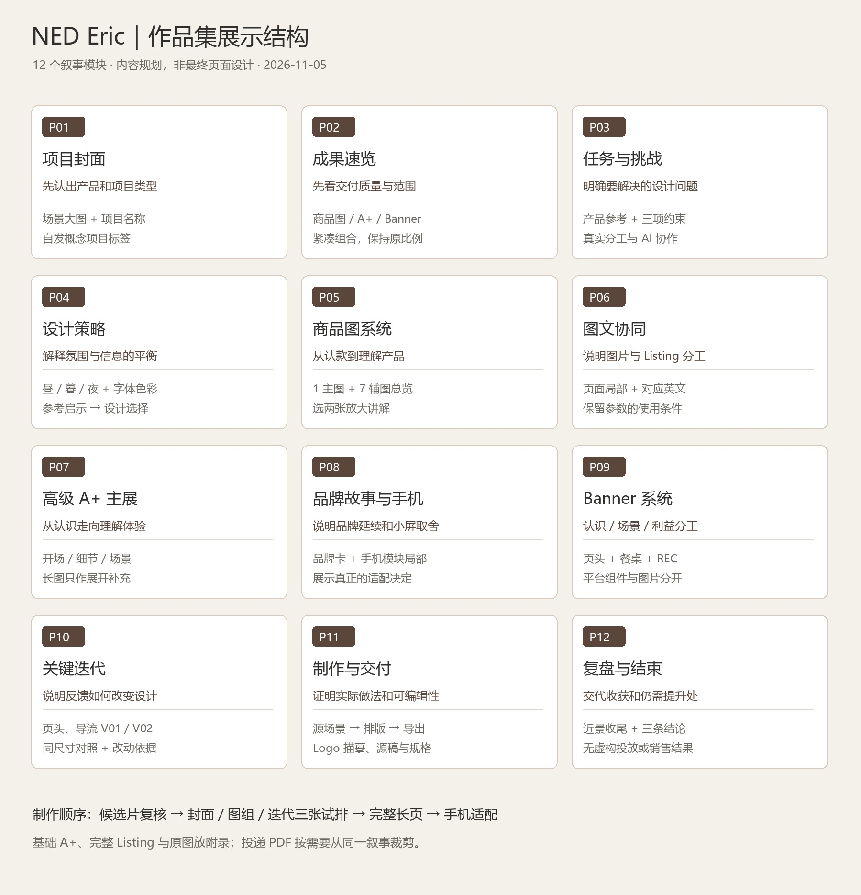

# NED Eric Lamp｜作品集展示规划 v0.1

> 2026-11-08 最新制作进度：[02高级A+展示V04](../制作交付/作品集展示/成果展示/V04/02_高级A+/README.md)已按单列长图规划V02制作并归档，1600×9880；原模块英文及标注在整页SVG中可独立编辑，附商品图→A+连续预览。展示稿待审阅；以下“尚待制作”为此前时点记录。

> 2026-11-08 最新修订：采用[02高级A+单列长图规划 V02](作品集02_高级A+_展示规划_V02_单列长图_20261108/README.md)。六段顺序下排，P03A/B/C和P04A/B/C均以完整图文逐张展开，手机版也纵向排列；本次仍为规划示意，待审阅。

> 2026-11-08 最新进度：用户明确高级 A+ V03 暂通过审稿；已完成[02高级A+展示规划 V01 与示意图](作品集02_高级A+_展示规划_V01_20261108/README.md)，安排开场、真实细节、三个操作、三种场景、尺度/FAQ及手机适配。当前为规划试排，正式展示段尚未制作；以下早期规划记录保留。

> 商品图展示更新：已归档[01商品图 V04](../制作交付/作品集展示/成果展示/V04/01_商品图/README.md)，采用Listing V01实际排版与当前选图组合，1600×4640；商品图、A+、Banner分段纵向展示，不再一屏合并。A+将采用现有高级A+，尚待展示排版。

日期：2026-11-05。状态：展示内容与排版规划，尚未制作最终作品集长页、PDF 或上线网站。依据截至提交 `4e40908708652dc5c7e6fd9790de6c372e173ef0` 的现有交付梳理；新增规划不代表旧交付已通过用户终审。

> 2026-11-06 V04 更新：当前两页以[开篇 V04](../制作交付/作品集展示/V04/README.md)为准，待审阅。封面缩短下缘渐变并减轻虚化；策略页以错落场景、配色、产品轮廓及局部放大、内容分工路径呈现。三条策略与连续墙面 V02 母版保持一致。下方 V03 记录保留作历史追溯；第三方案例详细分析仍只留本地。

> 2026-11-06 执行更新：已制作开篇 V01/V02，并新增[连续背景开篇 V03](../制作交付/作品集展示/V03/README.md)，两张均为 1600×1200（4:3），待审阅；完整长页仍未制作。背景/策略与成果速览沿[用户指定的连续墙面 V02](../制作交付/作品集展示/共享背景/V02/README.md)连续取图，替代下文纯色骨白起排建议。策略按[统一视觉规划 v0.2](统一主视觉与设计方向-v0.2.md)执行。阅读路径可合并为封面→简短背景与策略→商品图→A+/品牌故事→Banner→迭代/制作→收尾；原 12 模块为内容清单，不强制 12 张独立画板。下方素材表、封面 16:9 建议和结构图保留初始规划状态，当前两张以 V03 及本更新为准；第三方案例详细分析仍只留本地。

[展示素材映射（CSV）](作品集展示素材映射-v0.1.csv)

## 1. 展示目标与核心叙事

按当前上下文，本次规划对象为 **NED Eric 单个项目的完整案例页**，不是个人作品集全站改版，也不是只展示三张 Banner。以现有网站规划中的深圳 AIGC / 商业视觉求职用途为暂定目标；具体岗位尚未选定，内容可在投递时裁剪。

**推荐项目名：** NED Eric｜无线氛围灯电商视觉系统

**英文副标题：** E-commerce Visual Concept for a Cordless Table Lamp

**案例主线：** 围绕同一盏灯，将自然家居氛围与清晰的产品信息组织成商品图、A+ 与 Banner，并通过对照迭代改善展示。

读者应看懂三件事：

1. 成品：产品造型、场景和图文具有一致性；不同渠道的内容各司其职。
2. 判断：为什么这样构图、选场景、安排卖点，以及反馈如何改变设计。
3. 制作：真实使用了什么素材、工具和人机协作方式；什么可编辑，什么仍待核验。

不将素材数量当作主要卖点。主图组、A+ 和 Banner 不是三套孤立图片，作品集要呈现它们如何回答不同购物问题。品牌氛围与商业表达也不设未经验证的固定面积比例。

## 2. 内容取舍与版本采用

以下为展示候选，最终入选需按实际输出大小再做视觉检查。

| 内容 | 当前版本与事实 | 展示方式 |
| --- | --- | --- |
| 主视觉 / 封面 | 营销主视觉 V01 为 1254×1254 的带字 AI 概念图；Banner V02 采用已有无字场景重排 | 封面优先从 Banner V02 所用日间无字场景重新构图；旧方形主视觉不拉伸为全屏背景，作为方向来源可选 |
| 主图与辅图 | 近白底主图沿用 V01；辅图 V02 有 7 张 1254×1254 PNG，文字已合并 | 全组作总览；放大 02 操作、05 尺寸及 04 夜间图作为候选。尺寸端点和手势需先复核，不能直接写“上架合规” |
| 高级 A+ | 七模块、19 个图片栏位，部分复用基础版素材，有桌面/手机及互动预览 | 作为 A+ 主展；展示内容层级与一组互动状态，不把 19 栏位说成 19 张独立原创图 |
| 基础 A+ | 五模块，已有图文预览 | 放折叠补充或附录；主案例不再逐屏重复展示同类场景 |
| 品牌故事 | 电脑背景、手机背景和四张卡片，属于模拟 | 主展一组桌面背景与关键卡，手机只挑一个有代表性的状态；不把纵向四屏图误称实际页面长度 |
| Listing | V01 标题、五点和产品描述，有桌面/手机模拟 | 用一个画面说明图文如何协同，放大一条英文与对应图；全文进附录 |
| Banner | V02 三主题、六份适配图、三份 SVG，待审阅 | 三主题均展示；Logo/标题组件与无字素材分开。方/竖广告沿用 V01 可用构图，不声称全部重新制作 |
| Logo | 基于现有 ned. 字标轮廓描摹，黑白 SVG 与 4000 px PNG | 用于独立品牌组件；在制作细节中说明是既有标志高清重绘，不作为原创品牌设计项目 |
| 迭代 | Banner V01 与 V02 同尺寸对照已有 | 选页头与导流两组，讲清问题、改变与可观察结果；广告仅说明文案分工，避免重复 |
| 案例研究 | Flowerpot、Carrie、Edison 官方页面已读取 | 自己的设计结论为主；默认提供原站链接，公开长页不直接搬运整组竞品截图，必要引用另核范围 |

## 3. 页面结构：12 个叙事模块

“模块”指内容单元，不强制等于一个浏览器视口。桌面可合并相邻短模块，手机按信息顺序展开；避免为凑屏数制造大段空白。

| 编号 | 内容与回答的问题 | 画面编排 | 应准备的简短文案 / 注释 |
| --- | --- | --- | --- |
| P01 封面 | 这是什么项目？ | 一张完整产品与自然家居场景，项目名与小型类型标签；不使用总览展板缩略图当封面 | NED Eric / 无线氛围灯电商视觉系统；自发概念项目 · 美国站电商语境模拟 |
| P02 成果速览 | 这套设计覆盖什么？ | 一组主辅图缩略、一个 A+ 局部和三种 Banner 的紧凑拼接，保持各自原比例 | 从商品识别到场景导流，建立一致的产品与信息体验。列出实际交付类型，不堆大数字 |
| P03 任务与挑战 | 为什么需要这套设计？ | 产品参考与三条挑战相邻，小型角色/协作信息栏 | 既要保留沙色灯具的安静气质，也要解释操作、尺度与无线使用；已有低清素材、多版位比例和资料标称是制作约束 |
| P04 设计策略 | 视觉选择如何服务内容？ | 昼/暮/夜三张局部，配色样本和真实字体示例；用短句连接参考启示与本项目选择 | 自然材质建立氛围；可读轮廓建立产品识别；一个模块解释一个购买问题。配色为项目选择，非官方 VI |
| P05 商品图系统 | 用户先要知道什么？ | 1 张主图+7 张辅图全组总览；两张代表图另开大图，避免八张全部缩到不可读 | 从产品识别、旋钮操作、光色、续航、尺寸到场景；正文只挑两项解释信息层级 |
| P06 商品页图文协同 | 图片与文字如何一起工作？ | Listing 桌面局部+一条英文五点与对应辅图。用矩形内容框说明结构，不添加假价格/评分 | 图片先帮助理解，文案补足条件。资料标称保留“最长”“随亮度变化”等限定，不改写为实测 |
| P07 高级 A+ 主展 | 如何从认识产品走向理解体验？ | 一段宽幅开场+操作/细节局部+多场景缩略导航；整体长预览只作可展开原图 | 用七模块组织介绍、细节、操作、夜间使用、场景、尺寸与问答；作品集主屏不塞整条缩小长图 |
| P08 品牌故事与手机适配 | 同一气质如何在小屏继续？ | 一组品牌故事关键卡与高级 A+ 手机局部并置；注清是两个独立模块体系 | 保留产品与光线焦点；长句改为相邻原生字段。展示一个可解释的换行/裁切决定，不只把图片装进手机壳 |
| P09 Banner 系统 | 不同入口怎样分工？ | 页头全宽、餐桌导流大图、REC 图文组件依次出现；原图链接提供六种适配 | Meet Eric. 负责认识；Set the table. Keep the glow. 对应餐桌；Evening light, without the cord. 聚焦广告利益。REC 无字图与组件分开 |
| P10 关键迭代 | 反馈如何改变方案？ | 页头、导流各做同尺寸前后对照；用少量标记指出改动，不覆盖产品 | V01 白色覆盖与信息分散 → V02 连续场景、紧凑文字、单一主题。结果只写“移除覆盖、缩短标题”等可观察变化，不写转化率提升 |
| P11 制作与交付 | 哪些是生成、描摹与排版？ | 一组源场景→裁切/补景→文字层→导出；Logo 小型叠图示例；源文件与导出规格清单 | 已有场景复用、确定性摄影合成、SVG 文字排版；Logo 原样轮廓重建。说明照片为嵌入位图，不能把 SVG 称作 PSD 分层摄影 |
| P12 复盘与结束 | 这个项目证明了什么，还缺什么？ | 一张安静产品近景收尾，配三条结论、资料入口和可选下一项目导航 | 得到的是一套可追溯的视觉交付与迭代记录；待提升为高清产品母版、真实后台裁切和公开使用范围。无销量/投放结果 |

### 阅读路线

快速浏览：P01 → P02 → P05 → P07 → P09，先看到作品质量与交付范围。

进一步评估：P03/P04 解释判断，P10/P11 证明迭代与制作，P12 交代边界。

附录：全尺寸原图、完整高级 A+ 状态、基础 A+、完整 Listing 和来源记录；不占据主叙事。

## 4. 展示视觉规范草案

作品集外层网站可继续沿用既有“深色画廊”候选；**NED 案例内容本身优先采用骨白底、深炭文字和暖木场景**，不因网站外壳深色而把图片统一压暗。尚未确定全站最终风格，本规划不替代网站设计。

| 项目 | 起排建议 | 检查方法 |
| --- | --- | --- |
| 桌面案例排版母版 | 1440 px 宽，内容区约 1200 px；12 列、24 px 栏距；图片按内容可出血 | 仅为作品集设计网格，不改变亚马逊上传规格 |
| 标题与说明 | 项目标题约 56–72 px；模块标题 32–40 px；中文说明 18–20 px 起排 | 看实际展示尺寸；不要通过缩小文字容纳整篇说明 |
| 字体 | 项目英文延续 DM Sans；中文用有可用许可的清楚无衬线字体，起排可用系统微软雅黑 | 发布前选定实际嵌入字体及许可，不默认系统字体可重新分发 |
| 间距 | 模块间 64–96 px 起排；关联文字与图片保持更紧；少量大图承担节奏 | 不把所有区块做成等高白框；连续长空白若无叙事作用则收紧 |
| 手机 | 390 px 宽起排、边距 20 px、说明 16 px 起；图组改为顺序卡片或逐张查看 | 取消多列小字；对照用上下排列，轮播有可见提示且核心信息不依赖滑动才能发现 |
| 色彩 | 骨白 #F4F1EB、深炭 #2F302E，暖沙与木色来自实际图片 | 装饰色不能压过灯体；不改原 Logo 的形状、元素或加装饰 |
| 大图查看 | 概览看关系、局部看细节、原图看完整画面 | 商品图与 Banner 原比例展示；严禁拉伸和把插值当真实高清 |

不要大量使用斜透视设备样机。商品图、A+ 与 Banner 的排版质量应能直接看清；设备边框只在有必要解释手机适配时出现。平台模拟均标注，不把网页预览当真实后台截图。

## 5. 个人角色、AI 协作与事实写法

本项目已经有明确的人机协作记录，作品集不能默认所有生成、描摹与排版均由用户手工完成。

**角色说明草案：**

> 我选择 NED Eric 作为自发电商视觉项目，提供产品参考并提出视觉目标与迭代反馈。在 AI 协作下完成资料研究、内容规划、场景视觉、英文文案和多版位排版，并保留版本、来源与检查记录。具体生成、合成、描摹及导出由实际工具执行；人工制作部分按操作记录说明。

这段是待本人核对的候选文案，不是已经确认的技能归属。若用户后续亲自做 PS 修图、重排或源稿调整，再新增相应证据和描述。不要写未发生的“独立完成 PS 精修”“自主搭建 ComfyUI 工作流”“品牌客户项目”或“全流程独立原创”。

| 表达对象 | 推荐写法 | 避免写法 |
| --- | --- | --- |
| 项目性质 | 自发概念项目 / AI 辅助电商视觉探索 | NED 官方合作、真实上架项目 |
| 商品参数 | 依据品牌/经销商资料标称，附必要条件 | 本项目测试得到、保证所有美国版配置一致 |
| Banner V02 | 已制作、待审阅的展示候选 | 已验收终稿、投放通过、销量增长 |
| Logo | 基于用户提供字标的原样轮廓重建 | 原创 Logo 设计、官方矢量源文件 |
| 制作成果 | 3 个 Banner 创意、6 份图片适配；A+ 19 个图片栏位含复用 | 6 个全新创意、19 张完全独立生成图 |

公开主页面用一处清楚的模拟身份和协作说明；来源、尺寸限制与逐项依据放说明页或附录。保留必要事实，不在每张图片上重复盖免责声明。

## 6. 输出形式与文件组织

先完成一个案例展示母版，按实际需要导出，不同时重做三套独立叙事。

1. **主交付：** 12 模块的案例长页设计稿及按模块切片。整体预览用于审阅，网站展示优先分模块加载；不导出一张超长图片当正式网站全部内容。
2. **封面：** 16:9 作品卡封面一份、4:3 列表适配一份。建议起排 1600×900 / 1600×1200，但依据源图真实细节判断；不硬拉 1254 方图。不把 Banner 3000×600 直接裁作通用封面。
3. **投递备选：** 8 页横版 PDF：封面+概览 / 任务与策略 / 商品图 / Listing+A+ / 品牌故事与手机 / Banner / 迭代与制作 / 复盘。仅在需要邮件或面试投递版时制作，PDF 本身不包含可用互动。
4. **补充资料：** 原图、完整图文预览、版本对照与来源目录保留链接；不要求访客为理解主要成果先下载源稿。

建议未来交付目录：`制作交付/作品集展示/V01/`，包含 `README.md`、`展示切片/`、`封面/`、`排版源稿/`、`手机版/` 和按需制作的 `投递PDF/`。当前只写规划，不预建空成品。

## 7. 下一步执行顺序与缺口

| 优先级 | 工作 | 完成标准 / 成本与依赖 |
| --- | --- | --- |
| P0 | 逐张审阅候选素材与真实个人分工 | 确认 Banner V02 是否采用；核查辅图的手势、尺寸线及旧品牌故事 Logo 清晰度；角色文字与实际记录一致 |
| P0 | 制作 3 张排版试样：封面、商品图系统、V01/V02 迭代 | 同时检验大图吸引力、信息密度和说明方式；先锁风格再铺满 12 模块，减少整页返工 |
| P1 | 补案例文案与局部放大图 | 每模块一个观点；文字不遮挡画面；所有采用文件和链接可追溯。资产表附在本规划旁 |
| P1 | 排完整长页并做手机适配 | 核心图文无溢出，图组不缩小成不可读缩略图，平台素材与作品集预览区分清楚 |
| P1 | 校对和导出 | 图片清晰度、字形、英文、型号、来源与版本一致；原图不覆盖，切片不改变产品比例 |
| P2 | 按投递渠道裁成短版 | 目标岗位、附件体积和是否需要 PDF 待具体渠道确认；无明确需求先不增加工作量 |

现有素材总体足以开始展示排版，最主要成本是筛选、组织和重排；并不需要为每屏再生图。需要额外投入的可能是宽幅封面、细节不足的局部，以及旧模块的 Logo/手机适配。优先通过选片、缩减展示尺寸和现有无字源稿解决，确实不足再补素材。

公开发表前确认现有产品参考、品牌 Logo 与第三方图片的使用范围；内部规划与版式试样可继续。竞品研究图片不混入最终 NED 成品；参数条件、平台模拟身份及 AI 协作记录要保留。网站编写、上线和真实亚马逊提交不在当前规划任务内。

## 8. 验收标准

- 开场即可认出产品、项目类型和主要交付，不靠长篇背景才能理解。
- 大图足够展示产品和排版质量；重要说明在手机实际尺寸可读。
- 主辅图、A+、Listing、品牌故事和 Banner 各有展示理由，不重复堆同一场景。
- 有至少一组同尺度前后对照，说明反馈、改动与可观察结果。
- 角色、工具、AI 来源与可编辑性如实记录，不把模拟结果写成品牌或商业实绩。
- 案例页采用状态、图片版本与源文件索引一致；本规划不是成品验收。

## 依据与入口

- [项目首页](../README.md)
- [网站规划](../../../项目文档/site-plan.md)与[求职项目建议](../../../项目文档/portfolio-projects.md)：目标与全站现阶段边界。
- [Banner V02](../制作交付/独立Banner/V02/README.md)、[辅图 V02](../制作交付/亚马逊主图组/V02/README.md)、[高级 A+](../制作交付/亚马逊A+内容/高级A+_V01/README.md)、[Listing](../制作交付/亚马逊Listing/Listing_V01/README.md)、[品牌故事](../制作交付/亚马逊A+内容/品牌故事_V01/README.md)。
- [案例研究](../参考调研/Banner同类品案例分析-2026-11-05/README.md)、[Logo 重绘](../产品资料/品牌Logo/原样重绘_2026-11-05/README.md)。
