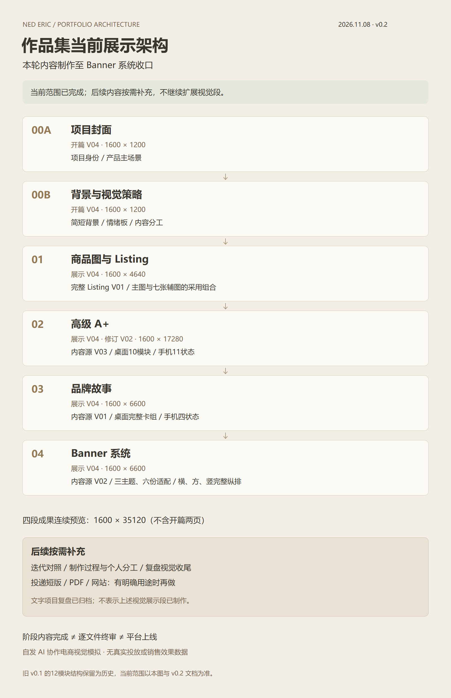

# NED Eric｜作品集当前进度与展示架构 v0.2

2026-11-08。**按用户决定，作品集本轮内容制作至04_Banner系统收口，现有版本作为当前展示；剩余内容以后按需要补充。** 本文件替代早期v0.1中的待制作清单，作为当前范围与阅读顺序入口。阶段内容完成不等于逐文件正式定稿、平台上线或真实商业效果验证。

[项目首页](../README.md) · [成果展示目录](../制作交付/作品集展示/成果展示/V04/README.md) · [全项目阶段复盘](../项目复盘/2026-11-08_阶段复盘.md) · [当前素材映射CSV](作品集展示素材映射-v0.2.csv)

## 当前展示架构

[PNG](作品集展示结构-v0.2.png) · [可编辑SVG](作品集展示结构-v0.2.svg)。这张图描述作品集内容顺序，所列像素均为展示稿尺寸，不是Amazon上传规格。

| 顺序 | 当前展示内容与版本 | 已呈现的范围 | 阶段状态 |
| --- | --- | --- | --- |
| 00A 封面 | [开篇V04](../制作交付/作品集展示/V04/README.md)，1600×1200 | 项目身份、Eric产品与家居氛围 | 已制作并归档，本轮保留 |
| 00B 背景与视觉策略 | 同一开篇V04，1600×1200 | 简短背景、视觉情绪板、参考配色与内容分工 | 已制作并归档，本轮保留 |
| 01 商品图／Listing | [商品图展示V04](../制作交付/作品集展示/成果展示/V04/01_商品图/README.md)，1600×4640 | Listing V01完整模拟；主图V01、03光色调节V01、其余六张辅图V02 | 已制作并归档，本轮保留 |
| 02 高级A+ | [展示V04·修订V02](../制作交付/作品集展示/成果展示/V04/02_高级A+/README.md)，1600×17280 | 内容源V03；桌面10模块、手机11状态，三操作和三场景两端均完整 | 已制作并归档；内容源V03暂通过用户审稿，展示稿未逐份正式定稿 |
| 03 品牌故事 | [展示V04](../制作交付/作品集展示/成果展示/V04/03_品牌故事/README.md)，1600×6600 | 内容源品牌故事V01；氛围开场、桌面完整卡组、手机四状态 | 已制作并归档，本轮保留 |
| 04 Banner系统 | [展示V04](../制作交付/作品集展示/成果展示/V04/04_Banner系统/README.md)，1600×6600 | 内容源Banner V02；店铺页头、餐桌电脑／手机、REC横／方／竖，共六份适配 | 已制作并归档，本轮在此收口 |

阅读形式为开篇两页后接四段单列长图；以连续暖墙、统一边距和标题连接，内部产品场景保留昼夜与材质差异。当前不再把高级A+与品牌故事并置，也不采用12张等权画板的初始设想。

## 当前可查看的完整范围

[01商品图→02高级A+→03品牌故事→04Banner系统连续预览](../制作交付/作品集展示/成果展示/V04/04_Banner系统/01_成品与预览/商品图至Banner系统_完整连续预览.jpg)为1600×35120；**不含开篇两页**。开篇连续预览在[开篇V04](../制作交付/作品集展示/V04/README.md)单独提供。本轮没有额外制作含开篇的全项目单张图片、PDF、网站或投递短版。

正文从各段README可直接看高清图；可编辑源稿、逐模块预览和制作记录跟随各段，原平台素材与作品集外层排版分别保存。不能用图片栏位数、互动状态数代替独立原创画面数量。

## 后续按需补充，不列为当前未完成任务

| 可选内容 | 当前已有依据 | 何时再做 |
| --- | --- | --- |
| 关键迭代的视觉展示段 | Banner V01／V02对照、A+ V02→V03问题映射、手机补齐记录 | 需要解释设计判断或用于面试讲述时，选少量同尺度前后对照 |
| 制作过程与个人分工展示段 | 生成输入／输出、局部修复、SVG和字体来源 | 目标岗位要求展示方法与分工时，按实际记录制作 |
| 复盘视觉收尾页 | 本轮新增项目复盘文档 | 需要案例结束页时再排版；文字复盘已完成，不代表视觉段已制作 |
| PDF／投递短版／网站 | 现有开篇与四段成果 | 有明确投递渠道、篇幅和加载要求后再导出或开发 |
| 高清补拍、后台裁切和效果验证 | 原照片、标称资料、平台研究记录 | 有新素材、实际后台或真实数据时再验证，不为凑完整度补造证据 |

恢复工作时先说明要补哪个内容、目标读者和用途；复用现有合格素材，只处理新需求。不自动启动生图、扩写视觉段或搭建网站。

## 版本与阶段口径

- 外层展示统一为V04，不意味着所有内层素材也是V04。高级A+内容源为V03，02展示自己的修订号为V02；品牌故事内容源为V01；Banner内容源为V02。
- 用户本轮决定的是当前内容范围收口；已有“暂通过审稿”“待审阅”的逐项记录保留，不推定全部正式终审。
- [展示规划v0.1](作品集展示规划-v0.1.md)、其12模块结构图和旧映射保留为历史。当前顺序、范围与后续触发条件以本文件为准；历史文档中的旧高度、并排和手机抽样建议不再用于当前展示。
- 项目仍为自发AI协作电商视觉模拟，未实测参数、未实际Amazon发布或广告投放，无转化／销量结论。
