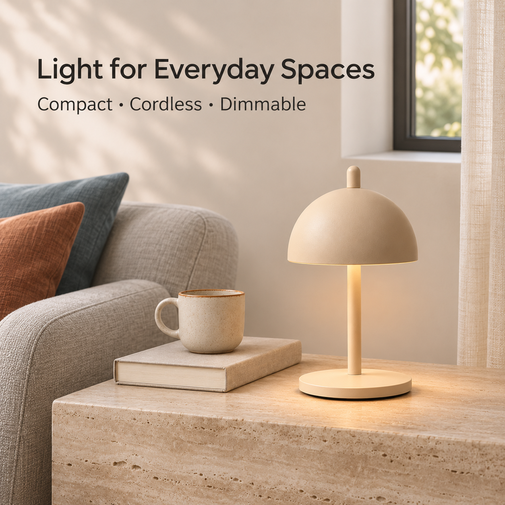
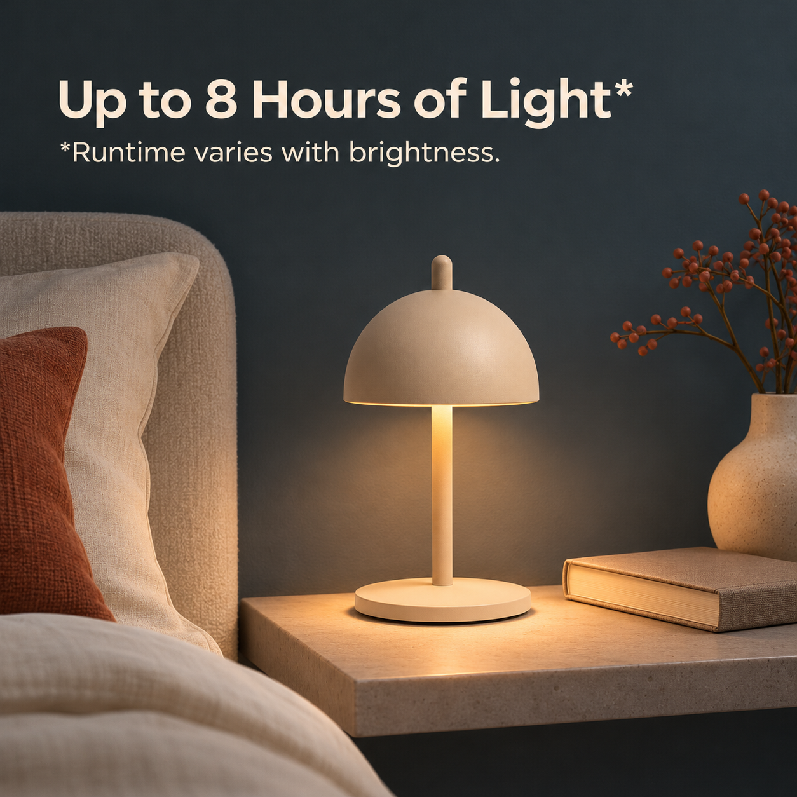
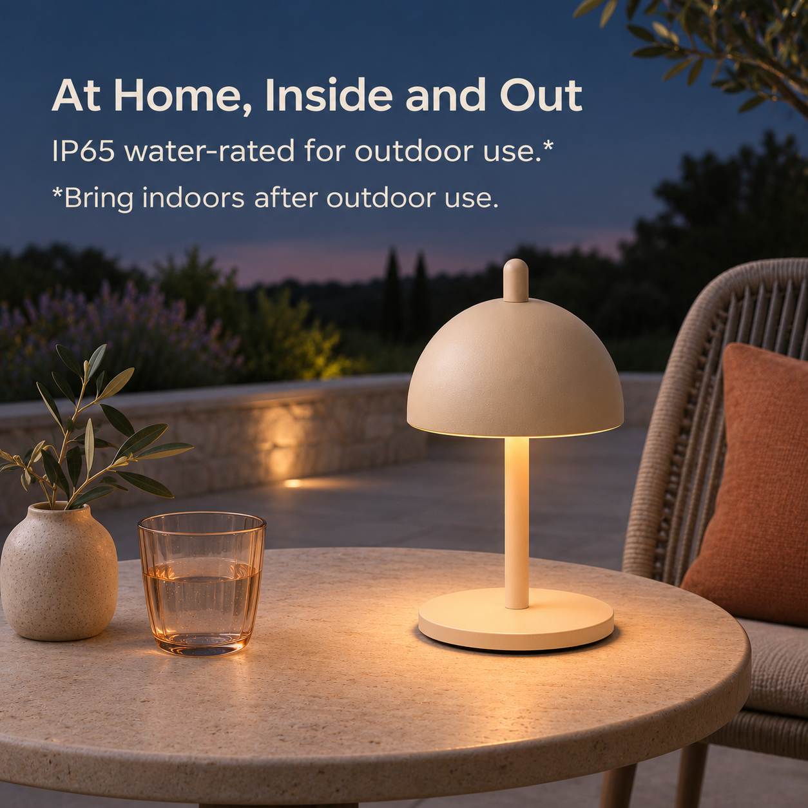

# NED Eric Lamp｜基础 A+ 内容制作方案 v0.1

规划日期：2026-11-04。适用于美国站作品集模拟；本文为**制作方案与英文文案草案**。已据此生成供审阅的[基础 A+_V01 图文预览](../制作交付/亚马逊A+内容/A+_V01/README.md)，尚未形成真实上架成品。它细化[亚马逊 A+ 规格与内容架构](亚马逊A+规格与内容架构-v0.1.md)中的 5 个基础模块；Brand Story 品牌故事另行制作。

**本版制作依据更新：** 用户指定旋钮的旋转、按压并旋转手势，以及尺寸线端点以辅图 V02 为参考；A+_V01 已按此执行。下文关于动作和测量端点未实物核实的说明，保留为参考依据状态，不影响本版制作。

## 一、目标与阅读顺序

**核心价值：** Eric 是一盏小巧的无线氛围灯，通过圆润造型、顶部旋钮和可调节的光线，融入床头、餐桌和户外等不同日常空间。

购物者的疑问按以下顺序解决：

```text
A01 这是什么灯，适合什么样的家？
  ↓
A02 开关、亮度和光色怎么调？
  ↓
A03 无线使用时，亮灯时间有多久？
  ↓
A04 同一盏灯可以放在哪里？
  ↓
A05 它有多大，是什么材质？
```

A+ 进一步解释产品和生活关系，承接方形主图组已介绍的卖点。每块有独立职责；不把 7 张方图简单拼成一张长图。用户需求与偏好属于设计假设，尚无实际购买行为数据。

### 现有视觉参考

| 日间客厅：参考光线与材质 | 夜间床头：参考明暗层次 | 傍晚露台：参考户外气氛 |
| :---: | :---: | :---: |
|  |  |  |

以上为已有 V02 **方形辅图**，用于参考视觉方向，并非本次 A+ 成品。文字已合入原图；新 A+ 素材应按所选模块的横图 / 方图重新构图，并优先将文案放在平台文字字段。

## 二、模块和素材总表

最低尺寸来源：[Amazon 基础 A+ 模块与字段](https://developer-docs.amazon/sp-api/docs/a-plus-content-examples)。表中工作画布是本项目制作建议；最终上传尺寸、字段和裁切以实际 A+ 编辑器为准。

| 编号 | 模块及图片栏位 | 最低尺寸 / 数量 | 建议工作画布 | 功能 |
| --- | --- | --- | --- | --- |
| A01 | Standard Image Header with Text | 970 × 600；1 张 | 1940 × 1200 | 产品与家居氛围 |
| A02 | Standard Three Images & Text | 300 × 300；3 张 | 各 600 × 600 | 按压、旋转、按压并旋转 |
| A03 | Standard Image & Text Overlay | 970 × 300；1 张 | 1940 × 600 | 无线、夜间与续航条件 |
| A04 | Standard Three Images & Text | 300 × 300；3 张 | 各 600 × 600 | 床头、餐桌、户外 |
| A05 | Standard Single Left / Right Image | 300 × 300；1 张 | 600 × 600 | 尺寸、材质与轮廓 |

合计 **5 个基础模块、9 张图片素材**；标题、正文和图片替代文字另按后台字段填写。作品集试排可先按上表制作；真实上架前按所选模板重新核对大小、格式及资格。建议 JPG / PNG、RGB、单张小于 2 MB，并检查导出画质。

## 三、统一的视觉与版式

- **配色：** 暖骨白 `#F4F1EB`、暖沙灰 `#D8CABC`、深炭灰 `#2F302E`；深胡桃棕 `#5A463B`、陶土棕 `#9B6B56` 和蓝灰用于局部差异。色值为项目起始参考，不是 NED 官方色值，也不作为灯具实物色号。
- **场景与光影：** A01 为日间室内；A03 为蓝灰夜间床头；A04 分别为床头、餐桌和户外露台。保持自然石材、木材和织物的关系，避免连续使用同一张米色墙面与同一张木桌。光落在灯罩下方和桌面，光效为氛围示意。
- **产品保真：** 所有素材保持浅暖沙色、圆顶灯罩、顶部小旋钮、细杆、圆形底座和约 20.1 cm 高的小灯尺度；每个场景中的产品外观一致。以产品参考图交叉对照，AI 生成画面不当作实拍。
- **文字：** 英文标题和正文优先放模块字段，条件紧邻对应功能；后台文字的字体、字号和实际位置由平台控制。若图片中确需使用标注，项目可优先采用 DM Sans，保持足够对比并在手机预览中检查，不强行将图片文字当成平台可编辑文字。
- **版式试排：** 下列像素坐标以各工作画布左上角为原点，格式为 `X / Y / 宽 / 高`。位置只供设计起排，并非 Amazon 安全区或固定展示结果；视素材与模块预览调整。

| 图片 | 建议范围 | 用途 |
| --- | --- | --- |
| A01，1940 × 1200 | 产品预留约 `1050 / 190 / 500 / 850` | 完整显示单灯，四周保留环境；平台标题 / 正文与图片分属不同字段。 |
| A03，1940 × 600 | 产品预留约 `1190 / 45 / 290 / 510`；另一侧保持安静 | 文字覆盖位置和遮罩以后台实际模板为准，勿让标题压住灯体。 |
| A02 / A04，600 × 600 | 主题距边缘约 35–45 px，按画面调整 | 操作近景看清旋钮与手势；场景方图中灯保持清楚，避免微小图内说明。 |
| A05，600 × 600 | 单灯及尺寸线占主要区域，左右预留标线间距 | 数据同步写在平台文字字段，图片缩小时仍能看清灯体。 |

## 四、逐模块制作卡

### A01｜产品与家居氛围

**购买疑问：** 这是一盏怎样的灯，放在家中是什么感觉？

**模块：** Standard Image Header with Text；1 张横图，最低 970 × 600；标题 / 正文使用模板字段。

**英文草案与中文意思**

- 标题：`A Small Light for Everyday Moments` —— 日常时刻的一盏小灯。
- 正文：`A compact, cordless lamp that brings adjustable ambient light to your favorite spaces.` —— 小巧无线，为日常空间提供可调的氛围光。
- 图片替代文字草案：`Sand-colored portable table lamp on a side table in a daylight living room.`

**画面设计：** 日间窗边客厅或餐边柜，石材边桌搭配深色织物、少量陶器；柔和自然窗光与局部暖光并存。以完整单盏灯为焦点，略带侧角；杯子或书只承担尺度参照，灯与道具的大小符合 20.1 cm 约高。图像中不预埋正文，模块字段承接标题和说明。

**可用参考：** [P09 正面单品](../产品资料/产品图/Simple_Form网站原图/09_单品正面近景_SimpleForm网站原图.jpg)交叉对照外形；[P12 正面近平视](../产品资料/产品图/12_单品正面近平视_用户上传.png)为主要轮廓参考；[V02 01](../制作交付/亚马逊主图组/V02/01_产品展示_V02.png)只参考配色和场景感觉。P12 的制作方式及与实物一致性尚未核实。

**手机检查：** 横图缩小时仍能辨认旋钮、灯罩、细杆和底座；平台标题与正文不要依赖图中隐藏的小字。

### A02｜顶部旋钮与光线调节

**购买疑问：** 这盏灯如何开关、调亮度和调光色？

**模块：** Standard Three Images & Text；3 张方图，各最低 300 × 300；每图有对应标题、正文与图片替代文字。

**总标题：** `Light, Just How You Like It` —— 按自己的需要调整光线。

| 顺序 | 英文小标题 | 英文说明草案 | 中文含义 / 对应画面 |
| --- | --- | --- | --- |
| 02A | `Press` | `Press the top knob to switch the lamp on or off.` | 按压顶部旋钮开关；用食指与旋钮接触的近景。 |
| 02B | `Turn` | `Turn the knob to dim the light from 5% to 100%.` | 旋转旋钮调节亮度；手指与旋钮的关系要清楚。 |
| 02C | `Press & Turn` | `Press and turn to adjust the color temperature from 2,700K to 4,000K.` | 按压并旋转调节光色；暖至中性白，以连续范围表达。 |

**图片替代文字草案：** 02A `A finger pressing the lamp's top knob.`；02B `A hand turning the lamp's top knob.`；02C `The top knob shown with a warm-to-neutral light illustration.`

**画面设计：** 三张同角度、同一沙色旋钮的中近景，每张只表达一种动作；背景以暖骨白、浅沙灰为主，少量蓝灰作为区别。02C 可用简洁光色渐变和旋钮示意强化“按压并旋转”，渐变为示意而非实测光色；不画成固定三档或蓝色彩光。

**可用参考：** [P11 按压动作](../产品资料/产品图/Simple_Form网站原图/11_顶部旋钮按压_SimpleForm网站原图.jpg)用于按压位置；[P14 斜俯视](../产品资料/产品图/14_单品正面斜俯视_用户上传.png)对照顶部比例；[V02 02](../制作交付/亚马逊主图组/V02/02_旋钮操作_V02.png)仅参考按压 / 旋转分组，不能把生成手势当作实物证据。

**事实与待核实：** 按压开关、旋转 5%–100% 调光和按压并旋转调色为用户确认同款的[经销商标称](https://www.thehotelspace.co.nz/product/ericmini-table-light/)；色温范围为 [NED 官网标称](https://nedcollections.co.nz/products/eric-mini-table-lamp)。目前有按压参考，缺少清晰的旋转操作特写或视频；02B / 02C 手势与旋钮接缝应在后续制作前核对。无需补造触摸面板或档位。

**手机检查：** 单张图里旋钮与动作仍清楚；三段文字分属相应图片字段，不依赖颜色或细小箭头区分操作。实际排列顺序和显示方式以后台预览为准。

### A03｜无线使用与夜间续航

**购买疑问：** 灯离开电线能用多久，夜间用起来是什么感觉？

**模块：** Standard Image & Text Overlay；1 张横图，最低 970 × 300。实际遮罩与文字位置依后台模块设定。

**英文草案与中文意思**

- 标题：`Light Where You Need It` —— 把光带到需要的位置。
- 正文：`On a full charge, enjoy up to 8 hours of cordless light. Runtime varies with brightness.` —— 充满电后最长约 8 小时，续航随亮度变化。
- 图片替代文字草案：`Sand-colored cordless lamp glowing on a bedside shelf at night.`

**画面设计：** 夜间床头的蓝灰空间，单灯放在稳定的浅石材床头架上；可用一本合起的书交代生活状态，暖光自然落在桌面。产品放在画面一侧并保留完整轮廓，另一侧留安静区域供模板放字。背景图不预埋标题、续航文字或小星号。

**可用参考：** [P12](../产品资料/产品图/12_单品正面近平视_用户上传.png)或 [P13 略仰视](../产品资料/产品图/13_单品正面略仰视_用户上传.png)对照灯体；[V02 04](../制作交付/亚马逊主图组/V02/04_夜间无线续航_V02.png)参考夜间氛围，须为宽横幅重新构图。

**事实与约束：** 最长约 8 小时及续航随亮度变化为官网标称，不写成固定 8 小时或保证整晚。只展示无电线使用状态，不绘制充电过程、接口或包装。

**手机检查：** 970 × 300 的横幅在手机上可能较矮，灯不能做成远景小点；将续航和条件放在同一个正文区域，缩小后同时可读。

### A04｜一盏灯，多处使用

**购买疑问：** 我可以把它放在哪里，室外是否能用？

**模块：** Standard Three Images & Text；3 张方图，各最低 300 × 300。

**总标题：** `One Lamp, More Places` —— 一盏灯，适合不同位置。

| 顺序 | 英文小标题 | 英文说明草案 | 画面 |
| --- | --- | --- | --- |
| 04A | `Bedside` | `A soft glow for your bedside table.` | 夜间床头近景，暖光与蓝灰背景区分。 |
| 04B | `Dining Table` | `Bring a little ambiance to the table.` | 室内餐桌略俯视，少量餐具或玻璃杯，局部手部可入镜。 |
| 04C | `Outdoor Table` | `IP65 water-rated. Bring indoors after outdoor use.` | 干燥露台或庭院边桌，傍晚自然环境清楚可见。 |

**图片替代文字草案：** 04A `The lamp on a bedside table in a dim room.`；04B `The lamp on a dining table beside a glass.`；04C `The lamp on a dry outdoor table at dusk.`

**画面设计：** 三图是同款单灯在不同时刻的使用示意；每张都让灯占主要视觉区域，人物只出现手部或局部衣袖。床头可用暖光与深色背景，餐桌用石材 / 餐具，户外用空气感与少量植物；避免三个相同的正面桌面场景。

**可用参考：** [P12](../产品资料/产品图/12_单品正面近平视_用户上传.png)、[P14](../产品资料/产品图/14_单品正面斜俯视_用户上传.png)对照产品视角；[V02 06](../制作交付/亚马逊主图组/V02/06_户外使用_V02.png)参考户外，[V02 07](../制作交付/亚马逊主图组/V02/07_多场景使用_V02.png)参考局部手部比例。

**事实与约束：** IP65 及户外使用后收回室内为官网标称；户外正文将两者放在一起。不表现浸水、持续暴雨或长时间留在户外；多场景不暗示售卖多只灯。

**手机检查：** 每张场景和文字能独立读懂，户外使用条件直接跟随户外图片，不把条件埋入其他模块。

### A05｜尺寸、材质与产品形态

**购买疑问：** 实物有多大，是什么材质，适不适合我的桌面？

**模块：** Standard Single Left / Right Image；1 张方图，最低 300 × 300；选图在左、文字在右的试排方向，手机实际排列以后台为准。

**英文草案与中文意思**

- 标题：`Small Lamp, Thoughtful Form` —— 小巧而克制的造型。
- 正文：`Approx. 7.9 in high × 4.3 in diameter (20.1 × 11 cm). Powder-coated aluminum in Sand Cashmere.` —— 约高 20.1 cm、直径 11 cm，粉末喷涂铝材质，沙色。
- 图片替代文字草案：`Front view of the Sand Cashmere lamp with dimension lines for reference.`

**画面设计：** 单灯正面完整展示，暖浅背景与底座阴影保证轮廓清晰。延续用户要求的高度、直径**细线段标注**；尺寸数值也放在平台正文中，不让手机端只依靠图片里的小数字。图中文字可用 `Dimensions for reference` 标明示意性质。

**可用参考：** [P09](../产品资料/产品图/Simple_Form网站原图/09_单品正面近景_SimpleForm网站原图.jpg)与 [P12](../产品资料/产品图/12_单品正面近平视_用户上传.png)对照灯体；[V02 05](../制作交付/亚马逊主图组/V02/05_尺寸材质_V02.png)参考线段与信息层级，不直接裁切其已嵌字的方图作为最终素材。

**事实与待核实：** 官网标称高度 20.1 cm、直径 11 cm；7.9 in、4.3 in 为约数。V02 把高度从底座底部画到旋钮顶部、直径横跨灯罩，这两个测量端点**仍待实物或官方尺寸图确认**；A+ 制作可先保留示意稿，最终标注按核实结果修正。粉末喷涂铝为官网标称，不延伸为每个部件都经过证实是同一材质。

**手机检查：** 灯体与线段有足够对比；完整尺寸和材质在平台正文中清楚呈现，不靠缩小后看不清的图内数字承担信息。

## 五、素材清单与可复用范围

| 文件代号 | 数量 | 需要准备的内容 | 可参考素材 |
| --- | --- | --- | --- |
| A01-Hero | 1 | 1940 × 1200 日间横幅，无嵌入正文 | P09、P12、V02 01 |
| A02-Press / Turn / PressTurn | 3 | 600 × 600 的三种旋钮动作或示意 | P11、P14、V02 02；后两种手势需补充依据 |
| A03-Night | 1 | 1940 × 600 夜间横幅，无嵌入文案 | P12 / P13、V02 04 |
| A04-Bedside / Dining / Outdoor | 3 | 600 × 600 三种场景 | P12 / P14、V02 06 / 07 |
| A05-Size | 1 | 600 × 600 单灯与尺寸线示意 | P09、P12、V02 05；端点待核实 |

P09 与 P11 为用户已允许参考的 Simple Form 网站图；P12–P14 为用户新增视角图，不能据此断言实拍。V02 为 AI 生成的风格参考，不代表无损产品母版。早前要求暂不调用的其他旧图继续不调用；所有作品集公开使用的素材范围仍需按项目资料核对。

## 六、制作及检查顺序

1. 先确认文案草案与五模块方向；整理 P09、P11、P12–P14 为产品外观和操作参考。
2. 补充或核对旋钮转动、按压并旋转的真实动作；尺寸线先作为示意稿，获得可靠测量端点后修正。
3. 按表分别制作 9 张横图 / 方图，保持图片内文字最少；在 A+ 模块字段中排标题、正文与替代文字。
4. 同时预览电脑与手机：检查产品轮廓、图片裁切、信息排序、字数、夜间和户外条件；真实编辑器中的排版可能不同于本方案示意。
5. 与[产品事实表](../产品资料/产品事实与素材检查-v0.1.md)核对旋钮、色温、续航、材质、尺寸和 IP65；未有后台与实机时标注“未实测 / 未平台预览”。

本方案未规划充电功能图、包装清单或接口图。品牌故事属于另一个 A+ 内容类型，详见[上一版规格与内容架构](亚马逊A+规格与内容架构-v0.1.md)。
