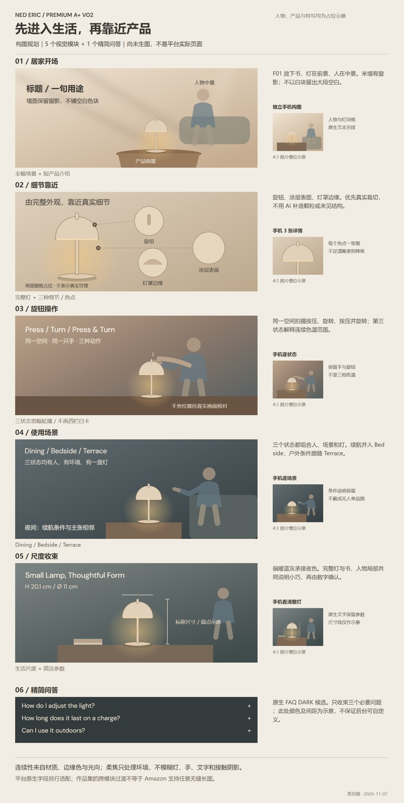

# NED 高级 A+ V02｜制作规划

2026-11-07 按用户指令归档。状态：V02 规划与占位示意，待后续制作及用户审阅；尚未生成 V02 商品成品，不代表已上架或终审通过。

- [完整制作规划](高级A+_V02_制作规划.md)：页面地图、六个模块执行卡、英文草案、人物场景、产品细节、过渡、素材量、执行顺序及缺口。
- [构图示意 PNG](V02_页面构图示意_1600w.png) / [可编辑 SVG](V02_页面构图示意_可编辑.svg)：示意占位，不是真实平台截图。手机为独立构图关系，不是桌面长图拉伸。
- [官方规格摘录](平台规格核验.md)：2026-11-07 读取的 Amazon 官方字段；不证明卖家资格。
- [规划记录](规划记录.json) / [版式检查](版式检查.json)：仅检查本次规划示意，不能代替后续商品图或后台验收。

结构：居家开场 → 细节靠近 → 旋钮操作 → 三种使用场景 → 尺度收束 → 精简问答。规划为 9 个桌面图片槽位、11 个手机图片槽位与原生问答；不等于需独立生成 20 次。

主要判断：V01 已是 Premium 模块方案，本次调整其模板化视觉。生活场景加入人物、空间、产品；细节图优先呈现可核实的真实外观，不强行放人或补造工艺。保留原 Logo、项目配色与既有人物设定，平台原生字段与作品集沉浸排版分别处理。

## 页面构图示意

[开场与细节局部预览](开场与细节_局部预览.jpg) · [项目入口](../../README.md) · [统一视觉规划](../统一主视觉与设计方向-v0.2.md)

字体：示意 SVG 内嵌 DM Sans，许可见 [OFL](DM-Sans-OFL.txt)；中文使用系统微软雅黑，不打包字体文件。SVG 为通用可编辑源稿，未实测所有目标编辑器兼容性。
