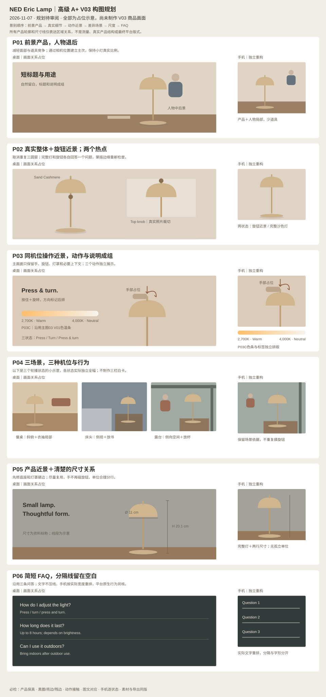

# NED Eric Lamp｜高级 A+ V03 制作规划

2026-11-07。**阶段：规划完成，待用户审阅；尚未制作 V03 商品画面。** 用途为美国站电商作品集模拟，未上架。

- [完整制作规划](高级A+_V03_制作规划.md)：模块画面、桌面/手机构图、文案、素材取舍、执行顺序和工具安排。
- [可编辑构图示意](V03_构图示意.svg)：展示区域关系与景别；图中人物、灯、手势和尺寸线均为占位，不是成品或测量依据。
- [V02 问题与 V03 修订映射](V02问题与V03修订映射.md)：包括用户指出的 P02/P04/P05 黑边问题。
- [修复与验收清单](修复与验收清单.md)：商品外观、边缘、动作、版式、手机与全版本导出检查。

核心变化：产品优先；操作转为手与旋钮的近景；P02 简化为两个有明确内容的热点；三场景通过机位和行为形成差异；黑圈、亮边与蒙版残边作为必修项。保留暖中性色、真实照片细节依据和有价值的现有素材。

2026-11-07用户补充：P03C加入主图03 V01的**胶囊形色温渐变条**，由暖黄连续过渡至中性白/米白；两端为`2,700K · Warm`和`4,000K · Neutral`。桌面/手机的放置要求、SVG独立对象和验收项已同步写入规划及示意图。

V03 计划使用用户指定服务的 `gpt-image-2.5-sunburst`。已验证认证及模型列表，尚未实际生图；模型标识不代表已独立核实后台模型实现。本轮没有发起图片生成，不包含 API Key。

[V02 审阅包](../../制作交付/亚马逊A+内容/高级A+_V02/README.md) · [V02 制作规划](../高级A+_V02_制作规划_20261107/README.md) · [当前统一视觉方向](../统一主视觉与设计方向-v0.2.md) · [项目首页](../../README.md)
