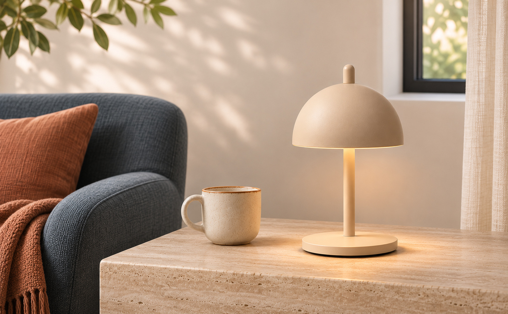
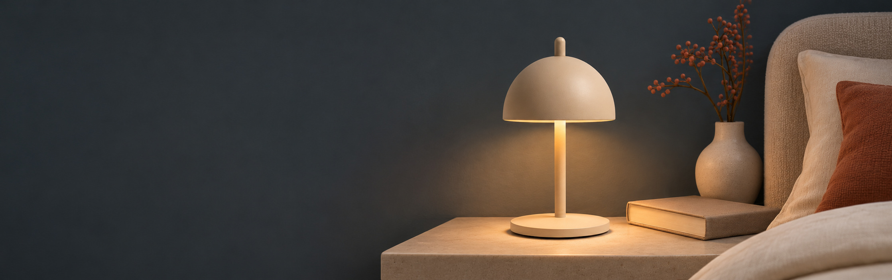
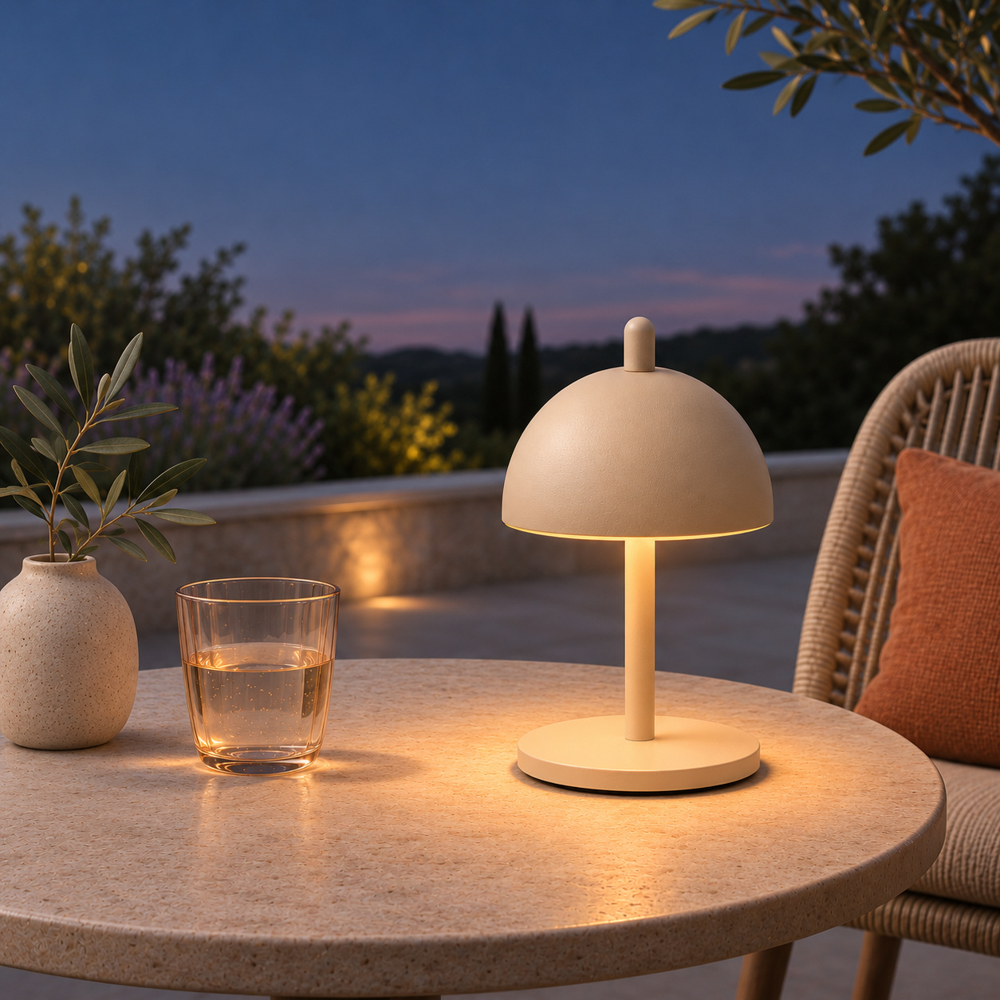

# NED Eric Lamp｜高级 A+ 内容制作方案 v0.1

规划日期：2026-11-04。以现有[基础 A+_V01](../制作交付/亚马逊A+内容/A+_V01/README.md)为起点，规划亚马逊美国站 **Premium A+** 的作品集模拟。本文件是制作方案和文案草案，尚未生成高级 A+ 图片、实际互动或平台页面。

## 一、升级目标与现有内容的关系

**核心价值：** 让顾客理解 Eric 是一盏小巧、可移动、可调节光线，并能融入不同日常空间的氛围灯。阅读顺序：认识产品 → 查看设计细节 → 学会操作 → 了解续航 → 选择场景 → 核对尺寸 → 解决疑问。

| 基础 A+_V01 已有内容 | 高级 A+ 优化方式 | 对顾客的实际帮助 |
| --- | --- | --- |
| A01 一张日间产品与空间图 | P01 分别构图的电脑宽幅和手机图 | 在两种设备上都能清楚看到灯与家居的比例。 |
| A02 三张旋钮操作方图 | P02 产品热点 + P03 四栏操作 / 光色说明 | 可按需查看细节，也能一屏对照不同动作；重要操作不只藏在热点里。 |
| A03 夜间续航横幅 | P04 电脑与手机独立构图的夜间大图 | 强化夜间场景，同时让续航条件紧邻数值。 |
| A04 三张场景图 | P05 床头、餐桌、户外导航轮播 | 每次聚焦一个场景，室内外画面和光线更有变化。 |
| A05 方形尺寸图 | P06 单图与文字组合 | 放大完整产品与尺寸标注，并保留可阅读的正文。 |
| 尚无产品问答 | P07 常见疑问 | 直接回答操作、续航和户外使用条件。 |

已有[品牌故事 V01](../制作交付/亚马逊A+内容/品牌故事_V01/README.md)独立承担品牌来源和选品故事，本方案的 7 个模块只介绍 Eric 产品。实际发布时，基础与高级产品 A+ 使用同一个产品内容位置；高级和基础模块不能在同一内容文档中混用。两版可在作品集内分别保留对比。[Amazon 高级模块说明](https://developer-docs.amazon/sp-api/docs/a-plus-premium-modules)

### 现有画面参考

| 日间客厅 | 夜间床头 | 户外露台 |
| :---: | :---: | :---: |
|  |  |  |

这些是已完成的基础版参考，**不是本方案已经制作出的高级版素材**。保持暖沙色、暖光和家居质感，同时加强夜间蓝灰、深木及户外环境差异，不让每个模块都是同一张米色桌面。

## 二、推荐的 7 个高级模块

| 顺序 | 模块与核心任务 | 具体变化 | 对应基础内容 |
| --- | --- | --- | --- |
| P01 | **全幅图文开场**：这盏灯适合怎样的空间？ | 日间宽幅大图，电脑和手机各一张，保留短标题。 | A01 |
| P02 | **交互热点**：产品有哪些值得关注的细节？ | 完整单灯 + 3 个可点击点，分别介绍旋钮、材质与整体尺寸。 | A02 / A05 |
| P03 | **四栏操作与光色**：怎么控制？ | 按压、旋转、按压并旋转、暖至中性光四张小图。 | A02 |
| P04 | **夜间与续航**：离开电线能用多久？ | 夜间大图与简短文案，续航和使用条件一起出现。 | A03 |
| P05 | **场景导航轮播**：放在哪里？ | 床头、餐桌、户外三屏，允许选择场景。 | A04 |
| P06 | **尺寸与材质**：放得下吗？ | 产品大图和正文分栏，保留高度及直径线段。 | A05 |
| P07 | **产品问答**：购买前还需要确认什么？ | 3 组文字问答，集中回答操作、续航和户外边界。 | 新增 |

此处使用 7 个模块是本项目的推荐方案，不是必须凑满 7 个。高级 A+ 可选视频、热点、轮播等形式；当前没有经核实的实拍操作视频，先用静态图与平台互动字段表达，不将 AI 模拟动作冒充真实演示视频。

## 三、模块、尺寸和素材数量

以下为所选模块在 [Amazon 高级 A+ 开发者模块文档](https://developer-docs.amazon/sp-api/docs/a-plus-premium-modules)中列出的图片**最低尺寸示例**，宽 × 高，单位 px；工作画布是本项目的起始建议，具体字段、比例、文件体积与可用模块以上传时的 A+ 编辑器为准。

| 编号 | 具体模块 | 图片栏位和最低尺寸 | 建议工作画布 / 数量 |
| --- | --- | --- | --- |
| P01 | Premium Full Background Text | 电脑 **1464 × 600**、手机 **600 × 450** | 2928 × 1200、1200 × 900；各 1 张。 |
| P02 | Premium Hotspot Image | 电脑底图 **1464 × 600**；每个热点的手机详情图 **600 × 450** | 1 张电脑底图 + 3 张手机详情图。 |
| P03 | Premium Four Column Images | 3–4 个栏位，每张 **300 × 225**；本项目选 4 栏 | 4 张 1200 × 900，电脑与手机共用。 |
| P04 | Premium Full Background Text | 电脑 **1464 × 600**、手机 **600 × 450** | 2928 × 1200、1200 × 900；各 1 张。 |
| P05 | Premium Navigation Carousel | 每屏电脑 **1464 × 600**、手机 **600 × 450**；本项目选 3 屏 | 3 张电脑图 + 3 张手机图。 |
| P06 | Premium Image Text | 单张图片 **800 × 600** | 1600 × 1200；电脑和手机共用。 |
| P07 | Premium FAQ | 2–5 组问答，无图片栏位 | 本项目先写 3 组。 |

按这个配置合计 **19 个图片栏位**：P01 2、P02 4、P03 4、P04 2、P05 6、P06 1；不含独立的品牌故事 Logo。**19 是栏位数，不等于必须从零生成 19 张不同照片**：可先复用已有素材，再针对构图与裁切导出；同一图片能否复用到多个栏位，以后台为准。

### 电脑与手机的关键区别

| 模块 | 电脑端 | 手机端 / 检查重点 |
| --- | --- | --- |
| P01 / P04 全幅图文 | 文字覆盖于横图一侧 | 官方模块说明为图片在上、文字在下，使用单独手机图片；不能预设文字始终覆盖画面。 |
| P02 热点图 | 在电脑底图上点击热点，显示标题与说明 | 每个热点需单独手机详情图；具体交互及排列以实际编辑器预览为准。 |
| P03 四栏 | 四列并排 | 官方模块说明为 2 × 2 排列；每个动作要能独立看懂。 |
| P05 导航轮播 | 宽幅场景与导航标签 | 使用每屏独立手机图；检查滑动、文字位置和户外条件是否易见。 |
| P06 图文模块 | 图片和文字左右排列 | 官方模块说明为图片在上、文字在下；共用同一图片字段。 |
| P07 问答 | 文字问答 | 不依赖热点或轮播即可读到重要答案；以后台实际展开方式为准。 |

## 四、逐模块制作卡

### P01｜全幅开场：产品与空间

- **购买疑问：** 这是什么样的灯，放在家里是什么感觉？
- **英文标题：** `A Small Light for Everyday Moments`  
  **英文说明：** `A compact, cordless lamp that brings adjustable ambient light to your favorite spaces.`  
  **中文：** 一盏小巧无线的灯，为日常空间带来可调氛围光。
- **画面：** 白天客厅或餐边柜，暖骨白墙面、深色家具和少量陶土色；完整单灯与周边家具比例可信。电脑图留较完整空间，手机图重新安排灯与家具的位置，不简单拉伸横图。
- **可复用 / 新制作：** 基础版 [A01 日间横图](../制作交付/亚马逊A+内容/A+_V01/上传用JPG/A01_产品与空间.jpg)可参考场景和产品外观；其 1594 × 987 虽达到该电脑栏位的最小宽高，但比例不同，须检查裁切或重新构图。手机图需单独适配。
- **文字和移动端：** 标题、说明放模块字段；电脑端文字框可放左侧、产品偏右，手机端按图片上、文字下的模块逻辑检查。

### P02｜交互热点：一眼理解设计细节

- **购买疑问：** 这盏灯有哪些核心细节？
- **模块：** Premium Hotspot Image；电脑底图配 3 个热点，每个热点有标题、说明和一张手机详情图。热点坐标和间距须在实际图片与后台中确认，不预设手机行为与电脑完全相同。
- **底图：** 电脑宽图内保持一盏完整沙色灯；柔和背景、较少道具，给热点留出可点击空间，不将灯压成小点。热点本身由平台添加，不把假按钮画进素材。

| 热点 | 英文标题 / 说明草案 | 手机详情图 / 事实边界 |
| --- | --- | --- |
| 顶部旋钮 | `One Knob, Three Functions` / `Press for power, turn to dim, or press and turn to change color temperature.` | 旋钮近景；按压与旋转的动作按用户指定的 V02 参考，经销商标称，未经实物验证。 |
| 材质与颜色 | `Sand Cashmere` / `Powder-coated aluminum in a soft sand-colored finish.` | 灯体及饰面近景；粉末喷涂铝为整体材质资料，不把每个局部零件都断定为相同材质。 |
| 产品尺度 | `Compact Form` / `Approx. 7.9 inches high and 4.3 inches in diameter.` | 完整单灯与可理解的空间比例；数值为官网标称约数，具体测量端点未核实。 |

- **素材参考：** [Simple Form 正面产品图](../产品资料/产品图/Simple_Form网站原图/09_单品正面近景_SimpleForm网站原图.jpg)、[用户新增正面略仰视](../产品资料/产品图/13_单品正面略仰视_用户上传.png)、[基础版旋钮图](../制作交付/亚马逊A+内容/A+_V01/上传用JPG/A02B_旋转调光.jpg)。手机详情图能否从既有图改构图，需逐张检查，不凭拉伸补细节。
- **无交互兜底：** P03 会把三种操作直接写出来，P06 会直接说明尺寸，避免关键事实只能点热点才能看到。

### P03｜四栏：操作与光线

- **购买疑问：** 按、转、按住并转分别有什么作用？光色有什么范围？
- **总标题：** `Light, Just How You Like It` —— 按自己的需要调整光线。

| 图 | 英文小标题 | 英文说明 | 画面 / 参考 |
| --- | --- | --- | --- |
| 1 | `Press` | `Press the top knob to switch the lamp on or off.` | 食指按压旋钮；参考基础版 A02A。 |
| 2 | `Turn` | `Turn the knob to dim the light from 5% to 100%.` | 手指旋转旋钮；参考基础版 A02B 与辅图 V02 02。 |
| 3 | `Press & Turn` | `Press and turn to adjust the color temperature.` | 手势与动作箭头按用户指定的 V02 / 基础版参考；不当作实拍证据。 |
| 4 | `Warm to Neutral` | `Adjust color temperature from 2,700K to 4,000K.` | 一盏灯与连续光色范围示意；不暗示固定三档或两盏装。 |

- **制作：** 四图统一近景、沙色和自然光，图内只保留必要动作或光色示意；标题和说明用对应平台字段。现有 A02A / B / C 为 1254 × 1254 方图，达到数值最低宽高，但目标栏位为 4:3 构图；裁切需保留旋钮、手指及箭头。A02B / C 的示意图形已经压入原图，需检查是否重做。
- **手机：** 2 × 2 网格下每张图和小标题仍应清楚；尽量不用细小文字标记动作。
- **依据：** 三种动作及亮度范围为用户确认同款的经销商标称；色温范围为官网标称。[产品事实表](../产品资料/产品事实与素材检查-v0.1.md)

### P04｜夜间与续航

- **购买疑问：** 无线使用时，灯可以亮多久？
- **标题：** `Light Where You Need It`  
  **正文：** `On a full charge, enjoy up to 8 hours of cordless light. Runtime varies with brightness.`  
  **中文：** 充满电后最长约 8 小时，续航会随亮度变化。
- **画面：** 蓝灰夜间床头、暖色局部光和稳定承托的小灯；电脑图保留完整卧室环境，手机图靠近灯与床头桌。只表现无线使用状态，不画充电过程或接口。
- **来源与约束：** [基础版 A03](../制作交付/亚马逊A+内容/A+_V01/上传用JPG/A03_夜间无线续航.jpg)为 2237 × 703，宽高虽超过电脑栏位最低值，但画面比目标横幅更宽，应重新构图或逐项检查裁切；手机图另作。最长 8 小时及随亮度变化为官网标称，不保证整晚使用。
- **版式：** 电脑标题与正文处于模板文字框，手机为图上文下；条件与数值处在同一文字区域。

### P05｜导航轮播：一盏灯，多处使用

- **购买疑问：** 在不同位置使用时，灯和空间会是什么关系？
- **总方向：** 三屏各为同一款单灯，既有整体空间也有近景；文字为模板字段。每一屏各需电脑图和手机图。

| 导航标签 | 英文标题 | 英文说明 | 画面方向 |
| --- | --- | --- | --- |
| `Bedside` | `A Quiet Bedside Glow` | `A soft glow for your bedside table.` | 夜间床头近景，蓝灰织物与暖光。 |
| `Dining` | `A Little Light at the Table` | `Bring a little ambiance to the table.` | 室内餐桌中景，深木和一两件餐具。 |
| `Outdoor` | `Outdoor Moments` | `IP65-rated for outdoor use. Bring indoors after outdoor use.` | 干燥露台或庭院桌面，傍晚环境可辨。 |

- **可复用 / 新制作：** 参考基础版 [床头](../制作交付/亚马逊A+内容/A+_V01/上传用JPG/A04A_床头.jpg)、[餐桌](../制作交付/亚马逊A+内容/A+_V01/上传用JPG/A04B_餐桌.jpg)、[户外](../制作交付/亚马逊A+内容/A+_V01/上传用JPG/A04C_户外.jpg)的产品与氛围；它们为方图，应分别适配电脑宽屏与手机 4:3，不直接拉伸。
- **规则：** 每屏导航、标题和说明分别填写；本方案的标签及说明保持简短。户外条件紧邻 IP65，不暗示浸水、长期户外或充电状态户外使用。三场景不暗示一套含三只灯。

### P06｜尺寸、材质与形态

- **购买疑问：** 这盏灯有多大，是什么材质？
- **标题：** `Small Lamp, Thoughtful Form`  
  **正文：** `Approx. 7.9 inches high and 4.3 inches in diameter (20.1 × 11 cm). Powder-coated aluminum in Sand Cashmere.`
- **画面：** 完整正面单灯与细线尺寸标注，浅暖背景和清楚的底座接触阴影；电脑图文左右排列，手机图片在上、正文在下。图片与正文都能表达尺寸，手机不只依赖小字。
- **依据：** 按用户要求延续[辅图 V02 05](../制作交付/亚马逊主图组/V02/05_尺寸材质_V02.png)和[基础版 A05](../制作交付/亚马逊A+内容/A+_V01/上传用JPG/A05_尺寸材质.jpg)的尺寸线关系：高度示意至旋钮顶部、直径示意跨灯罩。官网仅标称总高与直径，**具体测量端点尚未核实**；真实规格图需后续修正。
- **复用：** 基础版 A05 为 1254 × 1254，达到最小宽高但不是该栏位 4:3 构图；适配时要保留完整灯体与标线，不把方图拉伸变形。

### P07｜产品问答

本模块为文字字段，先规划 3 组；以下是项目草案，不代表真实用户提问或实测结果。

1. **How do I adjust the light?**  
   Press the knob to switch on or off, turn to dim, and press and turn to adjust color temperature.  
   **中文：** 按压开关、旋转调亮度、按压并旋转调光色。
2. **How long does the lamp last on a charge?**  
   Up to 8 hours on a full charge, depending on brightness. Charging takes approximately 6 hours.  
   **中文：** 充满电后最长约 8 小时，随亮度变化；充电约需 6 小时。
3. **Can I use it outdoors?**  
   NED lists an IP65 rating and recommends bringing the lamp indoors after outdoor use.  
   **中文：** NED 标示 IP65，建议户外使用后收回室内。

## 五、统一视觉与试排参数

- **视觉调性：** 延续项目主视觉的暖骨白 `#F4F1EB`、暖沙灰 `#D8CABC`、深炭灰 `#2F302E` 和深胡桃棕 `#5A463B`；日间窗光、夜间蓝灰和户外暮色交替。色值用于项目试排，不作为产品实物色号或品牌官方色板。
- **产品保真：** 浅沙色半球灯罩、顶部小旋钮、细杆、圆形底座与小灯尺度统一；单灯为主体。手部和场景按参考图创作，AI 示意不能冒充实拍。可调整场景、视角、构图和自然光影，不改变功能结构。
- **文字：** 标题、正文、热点说明和问答优先使用所选模块字段，便于后续修改；模块字段的字体和位置由平台决定。图内只保留必要的动作或尺寸标线，项目试排可使用 DM Sans，条件不能埋成手机端看不清的小字。
- **空间与人物：** 主体以灯为视觉焦点；可使用局部手部或衣袖辅助操作，不让人物盖过产品。餐桌与户外道具只作环境陪衬，不能暗示附送。

以下是设计起排范围，不是 Amazon 安全区；以画布左上角为原点，格式为 `X / Y / 宽 / 高`，单位 px，后续需按图片与实际后台调整。

| 栏位 | 产品 / 信息范围起点 | 说明 |
| --- | --- | --- |
| P01 电脑 1464 × 600 | 灯体约 `900 / 70 / 300 / 450`；左侧保留安静区域 | 电脑文字框与人物、灯具避让；实际文字框由模板控制。 |
| P01 手机 600 × 450 | 灯体约 `320 / 35 / 190 / 365` | 手机图单独构图；文字在模块字段中。 |
| P03 单图 300 × 225 | 主要手势 / 旋钮先放在 `15 / 12 / 270 / 201` 内 | 是视觉起排，最终按手势轮廓调整。 |
| P06 图片 800 × 600 | 单灯先放在 `110 / 35 / 350 / 520` 内，旁边预留标线 | 保留顶端旋钮、底座与两条标线；标注端点仍为示意。 |

## 六、素材准备与交付方式

1. **先锁定产品依据：** 使用用户允许的 Simple Form 单品及按压图、用户新增视角和现有 V02 为参考；不调用此前要求暂不使用的其他旧图。已指定旋钮手势及尺寸线参考 V02，不重复要求用户确认。
2. **先试做关键三项：** P01 电脑 / 手机开场、P02 一张热点底图与对应手机细节、P03 一张操作图。检查产品轮廓、手机可读性和整体色调后，再制作剩余栏位。
3. **按 19 个栏位整理素材：** 对每个栏位标注“已有可适配 / 需重新构图或生成”，另保存参考原图、导出图、英文文案、替代文字与模块位置；不把扩展画布当成新增实拍细节。
4. **交付直观预览：** 同时提供电脑端、手机端的完整图文组合预览；热点和轮播另用标记或可点击模拟展示各状态。静态预览不是实际可操作的亚马逊模块，也不是整张长图上传。
5. **逐项检查：** 电脑 / 手机裁切与阅读、平台文字覆盖、热点间距、轮播其他屏是否易发现、户外条件与续航条件、单灯数量、颜色与比例一致性。

## 七、事实、权限与仍需确认

- 已按用户要求将旋钮旋转 / 按压并旋转手势及尺寸线端点参考 V02；**参考关系不等于已完成实物测量**。产品功能与数值均以[产品事实表](../产品资料/产品事实与素材检查-v0.1.md)中的官网及同款经销商资料为准。
- 当前不绘制充电功能图、包装清单或接口；不虚构阅读照度、护眼助眠、防护测试、认证、售后、销量或评价。
- 本项目已有品牌故事 V01 和基础 A+_V01 **模拟作品**，不代表亚马逊账号已经发布或获得高级 A+ 权限。Amazon 的资格说明通常涉及品牌备案、品牌故事发布范围和近期获批 A+ 内容记录；不同官方资料对记录计数措辞有差异，实际资格以 A+ Content Manager 当前提示为准。[Amazon 资格说明](https://sellercentral.amazon.com/seller-forums/discussions/t/f0000277-bbe4-4c5f-b1b7-9a542ae116b1)
- 本版只完成规划；真实提交前检查当前模块与格式要求、桌面 / 手机后台预览、品牌素材使用许可及实际美国销售版本。具体字段和尺寸可能随平台更新。
