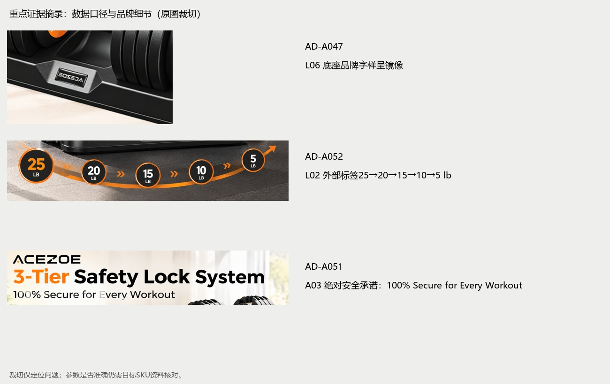
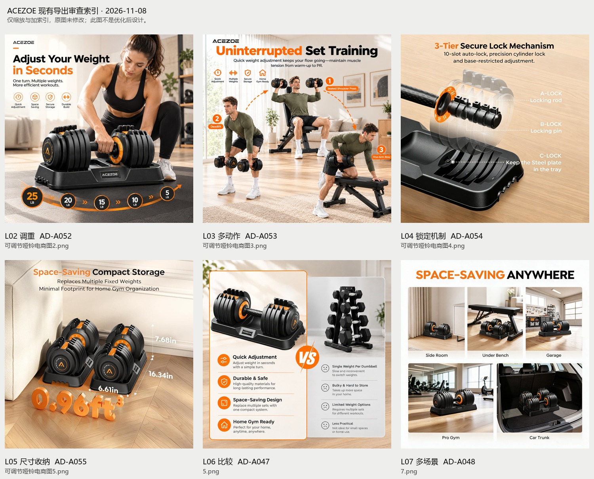
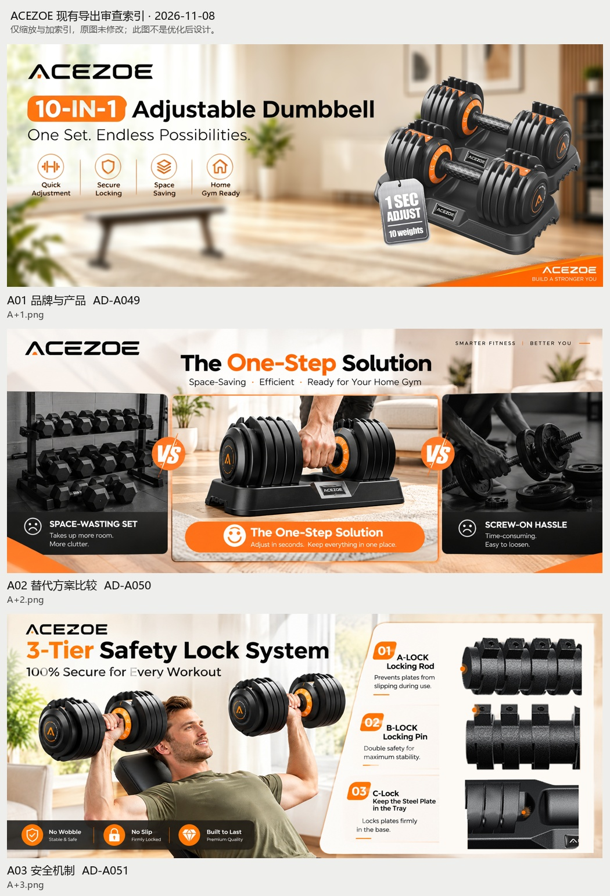
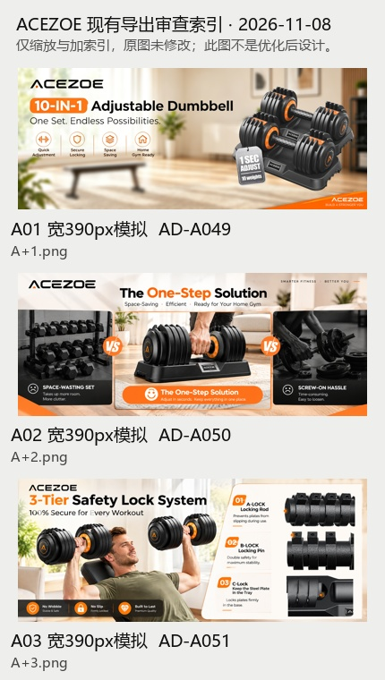

# ACEZOE可调节哑铃｜Design Audit Report V01

2026-11-08。审查基线：GitHub `main`提交`6f0abc7a080a4b8412632890598278f60f93fa0e`中的57份原始资料，以及本轮用户确认。**结论：已有可保留的系列视觉与六张次图／三模块A+，当前尚不足以作为规格可信、交付完整的最终Amazon案例。优先解决SKU与重量、无证安全承诺、最终主图及源稿关联，再做视觉细化。** 这是基于资料和画面的专业判断，无转化实验或销量数据。

用户本轮已确认“保留ACEZOE，优化现有产品的电商视觉”；目标链接／ASIN、单只范围与套装数量回答“待确认”。本报告按此方向审查，不推定具体站点，不将BowFlex等竞品资料转为本品。原始文件未改动；本轮只新建审查材料并更新管理记录，未生成优化设计、定稿或发布。用户已明确授权将本轮审查文档提交推送，实际同步结果以Git历史为准。

[返回项目首页](../../../README.md) · [产品与竞品研究核对](../../../01_Product_Research/Research_Review_V01.md) · [文件关系](../../../00_Project_Admin/Asset_Relationships.md) · [分阶段优化路线图](../../Optimization_Plan/Optimization_Roadmap.md)

## 1. 项目资料完整性与实际检查范围

| 范围 | 实际执行 | 限制与缺口 |
| --- | --- | --- |
| 57份原件 | 逐文件路径／大小／哈希与类型复核，原件保持原位和原内容 | 这是当前上传批次，不代表用户没有其他资料 |
| 7页PDF | 全部渲染并逐页查看；全7页提取文本为空，属图片页，不能将空文本当空白文档 | 页内事实按人工读图记录，未把OCR当真值 |
| Excel 5工作表 | 完整读取368个非空单元格、表名、隐藏状态、公式与超链接字段；本表未检出公式、单元格超链接或嵌图 | 研究来源依赖表外截图，未找到对应评论原截图／ASIN |
| 42张PNG/JPG | 全部解码与素材概览；九张`05导出`逐张查看，另看关键主图候选、历史研究图与参数图 | 并非每张参考都做同等深度审稿；小尺寸原始参考不作高清事实依据 |
| 13份PSD | 均通过Pillow读取保存的合并画面并查看概览；A01/A03等与导出做像素核对 | 未在Photoshop打开，未验证图层/字体/外链/智能对象或目标软件可编辑性 |
| 平台 | 2026-11-08读取Amazon公开A+介绍；图片及A+后台帮助页需要登录 | 未取得当前类目主图细则、实际槽位尺寸和账号资格；不报告平台合规通过 |

已明确缺口：最终白底主图、当前SKU／规格表、单只与成对口径、可追溯评论原件、外部来源及公开使用范围、若干独立设计源稿、实际A+模块与手机预览。缺口只阻塞相应结论，现有画面仍可审查。

## 2. 产品信息准确性

ACEZOE品牌方向由用户确认；“10-IN-1、1秒、3层锁定、耐久、防滑、实际尺寸”目前主要出现在营销图片，不能升级为已独立核实。产品功能线索为旋转手柄选重、底座放置与家庭训练；具体范围、档位、机制和性能需目标SKU依据。

重量冲突和体积推导逐项见[事实与冲突表](../../../01_Product_Research/Research_Review_V01.md)。特别是：L02列五档5–25 lb；A01写10档；PDF p6写5–50 LB / PAIR；Excel ACEZOE为3–25 lb截图款。它们可能来自不同型号或数量口径，不能无依据选择一个。体积算术支持“两只外包络相加约0.96ft³”的可能，但不证明尺寸来源或可用净空已核实。

## 3. 竞品研究质量

研究已有“价格基准／直接竞品／体验标杆”分层、评论→需求→机会、视觉表达拆解，这是本案例优势。Excel也明确少量评论不能称高频痛点，矩阵为研究者主观分，值得保留。

主要不足是研究范围未统一：PDF p3分析Power Systems、BYZOOM、BowFlex、PowerBlock、NÜOBELL；Excel还有Amazon Basics与ACEZOE；历史[P03.jpg](../../../%E5%8E%9F%E5%A7%8B%E8%B5%84%E6%96%99/04%20%E7%B4%A0%E6%9D%90/P03.jpg)又把ACEZOE作为比较对象。本轮目标已确定，ACEZOE应单列本品相关资料，不能继续当独立竞品。各集合可以作为研究迭代保留，需要注明版本与选择理由。

Excel评论表共15条摘要：Amazon Basics 2、ACEZOE 1、BowFlex 2、PowerBlock 6、NÜOBELL 4，均为4或5星。没有原始样本链接、评论ID、对应ASIN与采集口径，无法核验转述、重复、时间／型号混合和选择偏差。当前只能形成探索信号，不能统计成市场痛点比例或优胜评分。价格也无同期、单只／成对／扩展包说明，不能直接划当前市场价格带。

仓库能具体比较若干白底产品图，但缺少可明确归属各竞品的完整次图与A+页面。故本轮对竞品A+结构写为“资料不足”，没有虚构其整页布局。详见[逐品牌证据与可借鉴方式](../../../01_Product_Research/Research_Review_V01.md)。

## 4. 主图设计审查

`05导出`的九张均为带信息的次图或横幅A+；未找到被指定为当前最终主图的独立导出。主图候选在素材中：[产品主图3.jpg](../../../%E5%8E%9F%E5%A7%8B%E8%B5%84%E6%96%99/04%20%E7%B4%A0%E6%9D%90/%E4%BA%A7%E5%93%81%E4%B8%BB%E5%9B%BE3.jpg)为单只／1500×1009，[竞品二主图.jpg](../../../%E5%8E%9F%E5%A7%8B%E8%B5%84%E6%96%99/04%20%E7%B4%A0%E6%9D%90/%E7%AB%9E%E5%93%81%E4%BA%8C%E4%B8%BB%E5%9B%BE.jpg)为单只／1409×1500，[竞品二主图1.jpg](../../../%E5%8E%9F%E5%A7%8B%E8%B5%84%E6%96%99/04%20%E7%B4%A0%E6%9D%90/%E7%AB%9E%E5%93%81%E4%BA%8C%E4%B8%BB%E5%9B%BE1.jpg)为成对／1500×1242；文件名中的“竞品二”不改变其可见ACEZOE品牌，本轮将其标为本品相关参考、具体SKU待确认。

这些参考具有较好的黑色表面层次、轮廓高光和产品识别，可作拍摄／合成基准；但单只与成对、不同旋钮刻度不能混用。图片中的“1 SEC ADJUST／10weights”吊牌可能是营销辅助展示，是否为真实销售物件待核对；竞品这样做不等于当前主图获准使用。未指定销售SKU与最终文件前，不给最终主体占比、真实颜色或合规结论，也不将包围盒像素当产品实物准确性。

后续指定主图后逐项检查：销售内容、实际配件与数量→可靠本品结构/比例/颜色→背景与主体占比→高光/暗面/接触阴影→当前站点类目要求→最终尺寸和解码。主图不沿用带文案家居海报容器。H05为缺口，H06为当前可见品牌错误。

## 5. 六张次图逐张审查

L02–L07是本报告的稳定内容ID；L06对应文件`5.png`，与`可调节哑铃电商图5.png`不同。ID不代表确认了后台排序。当前每张图均有明确意图：调重、多动作、机制、收纳规格、比较、场景，毋须全部推翻。

| 审查ID | 原文件／资产ID | 实测像素 | 当前职责 | 专业判断与保留建议 | 问题ID |
| --- | --- | --- | --- | --- | --- |
| L02 | [可调节哑铃电商图2.png](../../../%E5%8E%9F%E5%A7%8B%E8%B5%84%E6%96%99/05%20%E5%AF%BC%E5%87%BA/%E5%8F%AF%E8%B0%83%E8%8A%82%E5%93%91%E9%93%83%E7%94%B5%E5%95%86%E5%9B%BE2.png) · AD-A052 | 1254×1254 | 调重与效率 | 保留女模特、底座和左上留白；确认档位后再改操作说明。 | H02、M01 |
| L03 | [可调节哑铃电商图3.png](../../../%E5%8E%9F%E5%A7%8B%E8%B5%84%E6%96%99/05%20%E5%AF%BC%E5%87%BA/%E5%8F%AF%E8%B0%83%E8%8A%82%E5%93%91%E9%93%83%E7%94%B5%E5%95%86%E5%9B%BE3.png) · AD-A053 | 1254×1254 | 适用训练动作 | 三种动作有信息增量；保留人物场景，调整编号和无证训练承诺。 | M02 |
| L04 | [可调节哑铃电商图4.png](../../../%E5%8E%9F%E5%A7%8B%E8%B5%84%E6%96%99/05%20%E5%AF%BC%E5%87%BA/%E5%8F%AF%E8%B0%83%E8%8A%82%E5%93%91%E9%93%83%E7%94%B5%E5%95%86%E5%9B%BE4.png) · AD-A054 | 2048×2048 | 锁定机制 | 整体加局部的策略可用；先有结构证据，再处理白字对比。 | H04、M03 |
| L05 | [可调节哑铃电商图5.png](../../../%E5%8E%9F%E5%A7%8B%E8%B5%84%E6%96%99/05%20%E5%AF%BC%E5%87%BA/%E5%8F%AF%E8%B0%83%E8%8A%82%E5%93%91%E9%93%83%E7%94%B5%E5%95%86%E5%9B%BE5.png) · AD-A055 | 2048×2048 | 收纳与规格 | 家居尺度有方向；0.96不是直接判错，先说清两只口径。 | H07、M04 |
| L06 | [5.png](../../../%E5%8E%9F%E5%A7%8B%E8%B5%84%E6%96%99/05%20%E5%AF%BC%E5%87%BA/5.png) · AD-A047 | 1254×1254 | 与固定重量组合比较 | 两列可扫描；镜像品牌和维度错位应先处理。 | H06、M05 |
| L07 | [7.png](../../../%E5%8E%9F%E5%A7%8B%E8%B5%84%E6%96%99/05%20%E5%AF%BC%E5%87%BA/7.png) · AD-A048 | 2048×2048 | 不同放置空间 | 墙角/凳下有价值；减少泛化场景，核对品牌和尺度。 | M06 |
| A01 | [A+1.png](../../../%E5%8E%9F%E5%A7%8B%E8%B5%84%E6%96%99/05%20%E5%AF%BC%E5%87%BA/A+1.png) · AD-A049 | 3072×1248 | 品牌与本品利益 | 暖色家居和黑色产品识别明确；减少同时抢眼的多项承诺。 | H02、H03、M07 |
| A02 | [A+2.png](../../../%E5%8E%9F%E5%A7%8B%E8%B5%84%E6%96%99/05%20%E5%AF%BC%E5%87%BA/A+2.png) · AD-A050 | 1959×803 | 替代方案解释 | 中间大图/两侧辅助的层级可保留；重写不公平比较。 | M08 |
| A03 | [A+3.png](../../../%E5%8E%9F%E5%A7%8B%E8%B5%84%E6%96%99/05%20%E5%AF%BC%E5%87%BA/A+3.png) · AD-A051 | 1959×803 | 安全机制与细节 | 人物与技术信息形成证据意图；绝对保证、细节证据和小字需处理。 | H03、H04、M09 |

## 6. A+整页审查

当前A01品牌／产品→A02比较→A03安全，商业逻辑有起点，但“快、省空间、安全”出现于多处图标和比较，解释深度不足。应优先补清楚真实的选重操作、单只/成对规格及到手内容，减少无依据比较和安全保证。品牌故事材料不足，本轮不编造研发背景或服务承诺。

A01主次可保留，需解决产品与背景承托关系以及多项标签争主次；A02中心主图可保留，比较维度和负面判断要重写；A03具有“场景＋机制”的好意图，但应先核实结构，拿到高清细节再安排文本。三张均非单凭换色能解决。

上图将每张现有横图等比缩到390px宽，模拟直接缩小的阅读风险；不是Amazon后台、实际手机或独立手机交付。A02副文、A03右栏和图标副文非常小；后台有原生文字字段时可优先利用；仅在实际模块支持独立手机图时制作对应稿，不能承诺任意纵图可上传。

## 7. 整体视觉一致性与专业度

黑／白／橙强调色、暖木／浅色居家环境、黑色产品高光及粗标题已形成系列；PDF p5也将其明确为策略。没有证据要求全部改成深色健身房或更换主色。差异化应更多来自解释清楚的产品身份、操作细节和可信家居尺度，而非再加橙色装饰。

系列内部仍需统一图标词汇（Secure Storage与Secure Locking含义不同）、标注样式、Logo安全区与信息层级。L06镜像Logo优先级高于装饰统一；L04低对比优先级高于图标线宽。照片里的型号、刻度和部件应跨图保持同SKU；生成或合成痕迹按可靠参考逐处核对，不因文件名含ChatGPT便认定所有图细节都错误。

文件专业度有一项已确认优势：4组源／导出在RGB合并画面上逐像素一致，关系清楚；但这不证明图层可编辑。A02和L02/L03/L04/L05未找到独立对应PSD，P07是整页展示拼贴，不代替独立图层交付。实际像素多种规格也需要用途索引。详见[资产关系与缺口](../../../00_Project_Admin/Asset_Relationships.md)。

## 8. 商业转化表达与问题清单

下列影响均为基于阅读和商品表达的专业推断，不是已测量转化损失。高：事实、核心交付、品牌和无证强宣称；中：理解、比较、公信力、手机与交付关联；低：不妨碍核心理解的统一。每个问题都给出位置、原因、影响、动作和限制；不以主观总分代替证据。

| 问题ID | 优先级 | 位置与证据 | 问题描述及原因 | 理解／商业影响（推断） | 建议动作与复查重点 | 状态／限制 |
| --- | --- | --- | --- | --- | --- | --- |
| H01 | 高 | 项目身份／PDF p2、p6；Excel 01!A3:I3、00!B7 | Excel仍将ACEZOE列为直接竞品，并提到重新定义产品；本轮用户已确认保留ACEZOE做视觉优化。 产品研发与现有商品的传播优化混在一起，可能让作品集把提案当实物改良。 | 审核者难以理解本人做了什么；消费者文案也可能引用不存在的新功能。 | 保留历史研究，另立ACEZOE本品事实表；将研究机会转成可证实的信息任务，删除新稿中的虚构改良叙事。 | 品牌方向已解决；SKU、规格仍待确认。 |
| H02 | 高 | L02底部、A01吊牌与10-IN-1、PDF p6、AD-A029/041旋钮 | L02只列25/20/15/10/5 lb五档；A01写10档；PDF写5–50 LB / PAIR；本品参考旋钮出现不同标称。 单只范围、套装总量、档位与历史型号未区分，不能自行按÷2或换算补全。 | 可能买错重量或误解调节步进。 | 取得目标SKU及档位表，逐处核对最大最小值、步进、是否单只和套装数量；同步旋钮、图标、标题与PDF。 | 事实缺口；不宣称已证明某个值错误。 |
| H03 | 高 | A03标题下方及底部三个承诺；A01吊牌 | 存在100% Secure for Every Workout、No Wobble、No Slip、Built to Last和1 SEC等承诺，未找到对应测试或技术原件。 营销图与用户评论不能证明普遍安全、无滑动、寿命或准确操作时间。 | 容易产生过度承诺；也有待核对的平台宣称风险。 | 先移出绝对保证，按已证实机制具体描述；1秒需相应方法和依据，否则采用不承诺精确时间的表述。 | 已观察文字；产品能力未验证，未判后台必然拒绝。 |
| H04 | 高 | L04全部内部结构；A03右侧三处机构 | 透视结构、10-slot、precision cylinder、A/B/C锁定关系只有营销画面，缺少目标SKU技术依据。 示意图不等于拆解事实；C-Lock把底座内保留片与使用中锁片混写。 | 消费者可能误解安全机制和操作顺序。 | 取得说明书或结构原件，逐点对应实际部件和条件；证据不足时改为可见细节，不继续美化虚构内部。 | 机制待核；不能仅靠AI画图补证。 |
| H05 | 高 | 05导出目录；主图候选AD-A029/040/041 | 导出目录有六张次图与三个A+模块，没有单独指定的最终白底上架主图。 素材目录的白底参考、PDF封面和拼贴不能替代最终销售SKU主图。 | 作品集交付范围不清，主体占比、销售数量和主图规范无法最终验收。 | 明确单只或成对销售，指定最终主图文件；核对真实配件、轮廓、背景与当前站点类目要求，另存优化稿。 | 交付缺口；不称参考图已获准上架。 |
| H06 | 高 | L06底座Logo；PDF p1；AD-A031合并预览 | 底座品牌字样呈水平镜像，PDF封面也保留了反向字样。 镜像改构图会反转实物品牌和旋钮刻度。 | 削弱品牌可信度和成图专业度。 | 优先恢复正确方向的真实商品素材，再重排；如局部修Logo，还需检查所有警示和刻度，不能只修一个字。 | 已观察错误；本轮未改图。 |
| H07 | 高 | L05三根尺寸线与0.96ft³；PDF p6 | 未注明单只/双只、含底座范围；体积数字与Minimal Footprint混用。 按显示尺寸算单只约0.48ft³、两只约0.96ft³；体积是立方单位，地面占用是平方单位。 | 难以判断是否能放入现有空间，易误读单只尺寸。 | 核实尺寸源后标明对象和数量；把一对包络体积与单只尺寸分开，收纳以实际长宽高/净空说明。 | 算术可复算，尺寸本身未独立实测。 |
| M01 | 中 | L02握柄旋钮附近及底部弧形重量带 | 人物和产品主次清楚，但底部弧线表现重量变化，手部缺少清楚的旋转方向/在底座操作关系。 装饰读数不能说明如何选档；五档是否为节选也未标。 | 知道可以调，却不一定知道怎样调、提起时剩余片在哪里。 | 保留女模特与底座场景；依据说明书加一处准确旋转指示和简短动作关系，标签显示完整档位或注明节选。 | 等待H02/H04后细化。 |
| M02 | 中 | L03上方文字、三个人物与1/2/3虚线箭头 | 编号1在中央、2在左、3在右；动作切换没有展示归位/调节，文字称maintain muscle tension from warm-up to PR。 多动作示意被包装为不间断训练流程；并无保持肌肉张力或训练成果证据。 | 可能把三种适用动作看成已验证训练程序。 | 保留多动作素材，先改为适用训练举例；用自然阅读顺序和中性文案，需要流程时显示真实调重步骤。 | 内容与阅读问题，未评价动作安全或训练效果。 |
| M03 | 中 | L04右侧白字与引线 | 浅木色背景上白字、透明结构及虚线对比不足，390px等比缩放时更难辨识。 机制图需要准确对应部件，小字与明暗相近让图失去解释作用。 | 只能看到精细结构感，读不清实际机制。 | 在已核实结构上用深色文字、独立图例/有依据的引线；减少一屏细节，保留产品识别。 | 已看原图与窄屏模拟。 |
| M04 | 中 | L05前景0.96ft³、产品上方空区与尺寸线 | 立体数字占较强视觉重量；尺寸标注部分白字落在浅底，单位与总量关系不紧邻。 装饰比真实收纳条件更抢眼。 | 读者先看到体积口号，难快速获取单只宽度与需要的空间。 | 保留家居收纳主题；核实后使用平面规格标签和清晰箭头，必要时只保留一个核心尺寸结论。 | 信息表达建议；不因美观要求重生场景。 |
| M05 | 中 | L06两列四行的行对应与负面描述 | Durable & Safe对Bulky & Hard to Store，行内维度错位；固定哑铃被笼统称Slow、Less Practical。 固定哑铃可以直接更换，是否更慢或更不实用取决于重量组和场景；现图无同条件证据。 | 比较显得偏颇，削弱可信度。 | 对齐同一维度与等效重量组合；用有依据的收纳/选重方式说明，删泛化贬低和无依据强弱判断。 | 需先修H06；不是证明固定哑铃更优。 |
| M06 | 中 | L07五场景、底座Logo及Car Trunk格 | 三种健身空间外加车后备箱扩大了居家收纳主题，部分底座文字不清或反向；比例亦需逐图对照。 多场景缺少新信息，放在车内不等于有安全运输/固定证明。 | 焦点从家庭有限空间转向泛化anywhere。 | 优先保留墙角/凳下等有用场景；核实净空与尺度，修正确品牌；车载场景没有用途证据时移出本轮，而非暗示随意运输。 | 不认定已验证任何场景适用性。 |
| M07 | 中 | A01产品下方、重复Logo/图标及副标题 | 抠图组与背景地面缺少清楚接触关系；大Logo、10-IN-1、吊牌与四图标同时争信息。 卖点焦点多，且10-IN-1含义需要规格支撑；品牌重复不自动增强辨识。 | 首屏知道品牌，却不易判断单只范围/成对数量。 | 保留黑白橙与明亮家居基调；先定义一个核心利益与真实套装信息，减少重复元素，选择可信承托或明确的展示区。 | 创意展示可保留，不能当作自然实拍证明。 |
| M08 | 中 | A02两侧灰黑比较格、下方文案与笑脸 | SPACE-WASTING SET、SCREW-ON HASSLE及Easy to loosen泛化他类产品；与L06重复“替代多套”的结论。 没有同条件比较或松脱试验；笑脸/哭脸不能替代证明。 | 重复篇幅减少解释本品操作、规格与选择条件的空间。 | 优先将该模块改为真实归位/选档/提起的解释，或中性同口径收纳对照；保留中心实物主次结构。 | 涉及A+可用比较表达仍需后台规则。 |
| M09 | 中 | A03右侧三格机制细节、底部图标条 | 机构细节显著比主体画面软，窄屏下右栏和底部副文难读。 低清素材放大不会增加细节；三小格同时占窄栏降低辨识。 | “安全”被看见，依据却无法被读懂。 | 取得真实高清细节；用与后台支持一致的模块/独立手机槽位重排，不支持时拆信息或改用原生文字字段。 | 未取得真实Amazon手机预览；390px仅是等比风险模拟。 |
| M10 | 中 | A01→A02→A03整页 | 三模块形成介绍→比较→安全，但缺乏清楚的SKU规格、完整调重关系及到手内容；多次重复快/省空间/安全图标。 缺少从利益到证据、再到选择的完整链条。 | 用户浏览多屏后仍可能不确定买到什么。 | 保留已有可用三屏素材，调整任务分工；新增规格/内容仅在事实充分且模块允许时安排，不强凑固定屏数。 | 见优化路线图中的建议顺序。 |
| M11 | 中 | 全部九份导出、A+源稿与手机状态 | 尺寸实际为1254/2048方图及3072×1248、1959×803横图，非历史1600/1464×600；无已识别独立手机稿/模块配置。 画幅变化本身不是错误，但未建立目标容器与同版母稿、导出的关系。 | 可能被裁切或使用旧图；交付与适配状态无法追踪。 | 按真实站点、模块与用途列画布/实际输出；新稿从母版导出，裁切必须复查；不用插值称提高真实清晰度。 | 未机械规定统一尺寸，也未证明后台能接收现有图。 |
| M12 | 中 | Excel评论表、体验矩阵与PDF p3–p5 | 15条中文评论摘要均4/5星，原截图/链接/ASIN未能在本批定位；主观评分缺每分锚点。PDF和Excel竞品集合不同。 样本选择和SKU混合会影响痛点优先级，评分不能当消费者测量。 | 作品集可能夸大研究严谨度或差异化。 | 保留为探索底稿；补可定位来源、样本选择、单只/套装与时间；使用“反馈信号”，统一同一研究范围或说明迭代。 | 不把缺原始凭证等同于证明评论虚构。 |
| M13 | 中 | PDF p1/p6、L06、A02、A03及缺源稿项目 | 研究建议“传统手感/湿手防滑/底座导向”等多为产品改良，现有图并未证明本品实现；A02及四张次图未找到独立对应PSD。 研究机会、视觉传达和已实现产品能力需要分开；拼贴源不等于逐张可编辑源。 | 个人贡献和交付能力可能被高估。 | 在案例中明确已做研究/设计、未做工业设计与测试；补源稿或如实标明位图编辑范围。 | 源文件缺口按已接收文件范围判断，不断言用户没有其他源稿。 |
| L01 | 低 | 跨图图标、Logo间距、标题断行与PDF封面标签 | 图标线形/圆框有变化，局部字体/Logo留白缺少统一规则；6 product images未说明是六张次图。 系列识别与作品集阅读存在小摩擦，优先级低于事实和可读性。 | 增加审阅成本，对核心购买理解影响较小。 | 定义少量共享字级、Logo安全区、图标词汇；清楚写六张次图+三份A+，主图状态单列。 | 保留已有风格，不以全套模板抹平每图职责。 |

## 9. 当前项目优势与应保留内容

1. 有研究、策略、视觉和交付的初步链条，PDF不是单纯的效果图堆叠。
2. 六张次图已有不同主题，A+主场景和技术说明有商业任务；可以选择性优化。
3. 家居浅背景与产品橙色构件相呼应，配色有商品依据；人物尺度与生活语境比纯器械罗列更易建立使用想象。
4. 已有多份真实PSD和可读预览，部分源与导出同像素，具备继续编辑的起点；不需要为“更专业”全部重生成。
5. 研究底稿主动承认样本与主观评分限制，这条证据习惯应进入最终案例。

## 10. 最优先的改进与执行边界

先闭合三个任务包：①锁定本品SKU、销售单位与档位／尺寸来源；②处理机制／安全宣称、镜像品牌和不公平比较；③指定最终主图与源→导出／实际模块及手机覆盖。之后再统一视觉细节并重写作品集贡献说明。工作量按需要补证、局部排版、源稿重建分别估计，当前无工时数据，不报虚构小时数或提效比例。

[路线图](../../Optimization_Plan/Optimization_Roadmap.md)列明顺序、依赖与验收；需要用户确认优化范围后才制作。当前可以完成资料核对、图层/导出梳理及纯版式方案；依赖未知型号的重量、结构和承诺停在候选说明，不能通过设计让未知值看似确定。

### 本轮平台来源与核验限制

- 2026-11-08已读取[Amazon官方A+介绍](https://sell.amazon.com/tools/a-content)，确认Basic/Premium有不同模块与功能。公开介绍不提供本项目后台资格或全部槽位规格，页面中的泛化销量宣传数字不作为本案例效果证据。
- 同日请求[官方产品图片帮助G1881](https://sellercentral.amazon.com/help/hub/reference/G1881)与[A+帮助G202102950](https://sellercentral.amazon.com/help/hub/reference/G202102950)，均转入登录，未读取正文。尝试的公开摄影文章返回404。故本轮没有完成“对应站点/类目现行主图规则”和“A+完整内容禁限”的核验，不复述旧经验作为已验证现规。
- 目标站点、具体SKU与实际模块未确认，所有平台适配结论保留待核。上架之前需官方后台材料或当前可访问规则；本报告不是上架通过证明。

本报告基于[7页项目PDF](../../../%E5%8E%9F%E5%A7%8B%E8%B5%84%E6%96%99/%E4%BA%9A%E9%A9%AC%E9%80%8A%E5%8F%AF%E8%B0%83%E8%8A%82%E5%93%91%E9%93%83%E4%BA%A7%E5%93%81%E7%A0%94%E7%A9%B6%E9%A1%B9%E7%9B%AE.pdf)、[5表研究Excel](../../../%E5%8E%9F%E5%A7%8B%E8%B5%84%E6%96%99/%E5%8F%AF%E8%B0%83%E5%93%91%E9%93%83%E7%AB%9E%E5%93%81%E5%88%86%E5%B1%82%E5%88%86%E6%9E%90%E8%A1%A8.xlsx)、本轮全部图像与合并预览及用户确认；具体证据位置见正文与研究核对表。未编辑原始PDF、Excel、PSD或位图。
