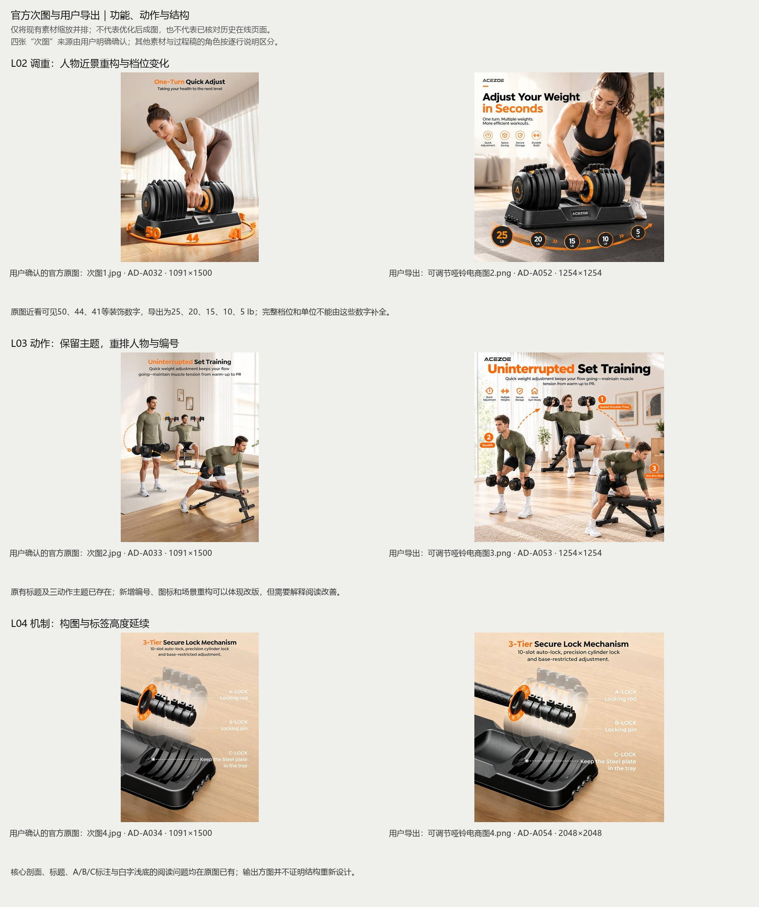
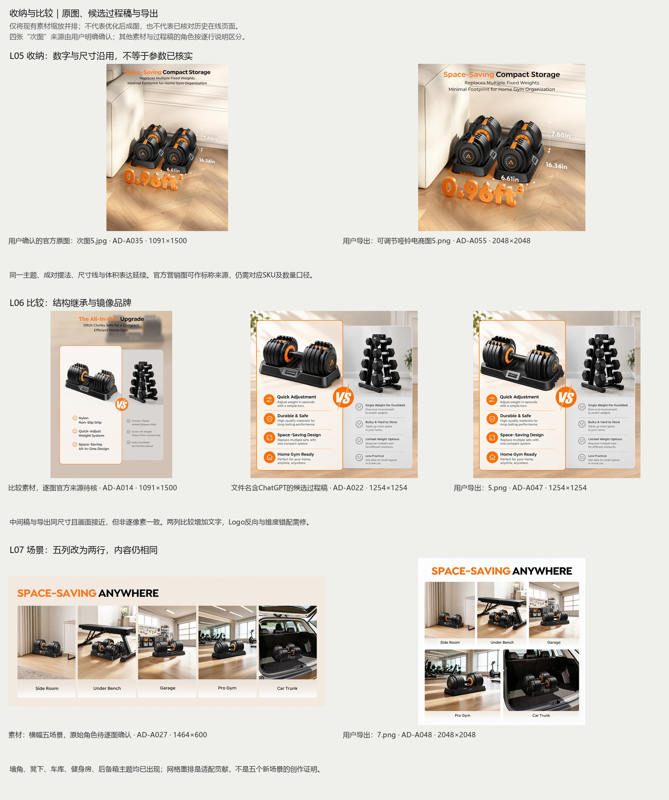
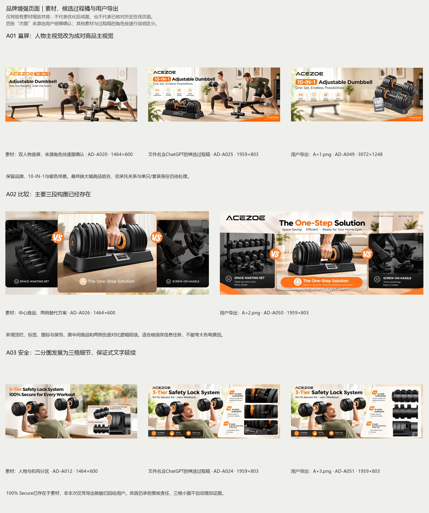

# ACEZOE官方素材改版项目｜可行性分析 第01版

2026-11-08。**结论：项目值得继续，适合作为“基于官方素材的Amazon电商视觉改版／AI辅助设计练习”。现有九张导出可作为改版过程，尚不适合直接包装成从零原创的品牌全案或已验证转化提升的商业项目。** 判断依据是逐组图像对照、用户来源确认和只读PSD结构检查，未采用虚构评分或成果数字。

[项目说明](../../../项目说明.md) · [对应清单](素材与导出对应清单.csv) · [既有审查报告](../../设计审查/第01版/设计审查报告_第01版.md) · [优化路线图](../../优化计划/分阶段优化路线图.md)

## 1. 本轮新增事实与分析边界

- 用户明确说明：当初直接使用官方Amazon商品图和部分A+，通过AI和Photoshop改版。随后逐文件确认`次图1.jpg`、`次图2.jpg`、`次图4.jpg`、`次图5.jpg`四张竖图均为官方原图（AD-A032–035）。这是用户提供的来源确认，不等于本轮重新访问了历史页面。
- 其他本品素材可记录“用户说明使用过官方素材”，但哪张是原始下载、哪张是AI过程稿仍需按图对应。尤其带ChatGPT字样的文件不能再统一标为官方原图，也不凭文件时间断定制作顺序。
- 已将四张确认原图、其余相关素材/候选过程稿与全部六张次图、三份A+导出逐组对照，检查42张位图素材概览，并沿用首轮7页PDF、5表Excel的研究结果。本次未取得B0H5QHT2DJ的商品正文，未核实历史页面对应哪个变体。
- 对13份PSD读取图层记录数量、名称及可识别标记；重点查看L06/A01/A03/P07的结构。未在Photoshop打开，未执行图层渲染、嵌套智能对象解包、字体/外链/软件兼容性检查。
- 本次仅分析和建立对照图。对照图只将现有画面缩放并排，不是重新设计；原始素材、PSD、PDF、Excel及九张导出均未修改。新报告与管理更新尚未提交推送。

“原始资料”是接收时保留的历史文件集合，不表示目录内每张图都是品牌官方原件。用户确认的四张已在资料清单单列来源，其余角色保持区别。

## 2. 需要修正的原判断

| 原判断可能造成的误解 | 本次对照后的准确结论 | 对项目的影响 |
| --- | --- | --- |
| 黑白橙、浅色家居与全部内容主题可算本人的原创策略 | 确认的官方竖图已使用相同配色/暖色空间；多动作、机制、尺寸收纳主题亦已存在 | 可写“继承品牌语言并优化组织”，不能将原图创意全部算自己的贡献 |
| L04内部机构、L05体积或A03保证都是用户新增 | L04剖面/标注、L05尺寸和0.96在确认原图已有；100% Secure在AD-A012素材中已有 | 问题仍需处理，但不能把继承问题全归因于用户或AI编造 |
| 没有官方来源，所有规格都只是未知图片信息 | 四张已有用户确认的官方营销来源，能作为商家标称的依据 | 来源状态改善；但尚未绑定当前ASIN、单只/成对或测量条件，不等于全部规格已核实 |
| 有PSD，就能直接改文字、只需少量局部编辑 | L06/A01/A03顶层未检出文字层标记，主要是图像合成记录 | 需预留文字重建和局部背景处理，不以PSD后缀保证全图可编辑 |
| 作品集必须先做全新白底主图才可成立 | 只有声称“完整上架套图”时，独立主图是完整性要求；聚焦次图/A+改版可明确不含主图 | 主图可作为后续可选交付，不必为凑全案额外重做 |

先前21条审查问题保留为历史基线；本报告补充来源和归因，不将新确认直接变成“画面无误”或“事实全部通过”。

## 3. 官方原图与导出：九组判断

| 内容 | 素材→导出 | 可确认的设计变化 | 仍需解决／是否优于原图 |
| --- | --- | --- | --- |
| L02 | AD-A032→AD-A052 | 人物/服装、场景、标题、图标及重量带明显改变 | 原图外圈50/44/41等装饰数字，导出五标签25/20/15/10/5 lb；当前ASIN档位未核。重构较明显；需证明产品和参数保持正确 |
| L03 | AD-A033→AD-A053 | 三动作主题及标题沿用；人物场景重构，新增图标、编号及动作标签 | 原图已有不间断训练/肌肉张力表述，导出延续；编号阅读不自然。可呈现动作信息重排，不声称原始训练概念原创 |
| L04 | AD-A034→AD-A054 | 竖图变方图，核心剖面与A/B/C标注高度延续 | 低对比白字与结构宣称来自原图，改版未解决；不证明结构由用户编造。当前主要是画幅适配；独立设计增量有限 |
| L05 | AD-A035→AD-A055 | 成对摆法、尺寸线、标题及0.96ft³延续，画幅与画面范围变化 | 0.96与三尺寸均在原图已存在；商家标称有来源，但单只/成对/底座口径仍不清。适合作为信息设计重构案例；现有稿增量有限 |
| L06 | AD-A014、AD-A022→AD-A047 | 两列比较与固定哑铃架主题延续，文字/图标增加；中间稿与导出非同像素 | 镜像Logo和比较轴错位仍可见；不能凭文件名推完整生成历史。可做修正案例，现稿不能证明所有元素均原创 |
| L07 | AD-A027→AD-A048 | 五列横幅改为上三下二网格；五种场景名称延续 | 没有五个新场景创作的证据；后备箱用途、尺度与品牌仍需核。属于适配贡献，可辅助展示，不宜作为核心创意 |
| A01 | AD-A020、AD-A025、AD-A041→AD-A049 | 人物主视觉转成大幅商品组合，场景及黑白橙延续，品牌/图标保留 | 产品承托不清；商品是否成对销售待核；3072宽不证明细节新增。合成方向与层级有明显变化，效果并非自动优于原图 |
| A02 | AD-A026→AD-A050 | 中心商品与两侧替代方案结构沿用，增加顶栏、副文、橙条及图标 | 新增Easy to loosen等描述无依据；原负面对比也未证实。目前以包装与排版调整为主，设计差异不足 |
| A03 | AD-A012、AD-A024→AD-A051 | 原二分人物/结构图发展为三格细节；补品牌与底部承诺条 | 100% Secure在AD-A012已存在；No Wobble等在AD-A024/导出存在，不能凭成图确定首创人。有信息重排工作，但小图变多不代表证据更强 |

L02原图外圈近看可见50、44、41等数字，导出是25/20/15/10/5 lb；这证明两者信息发生变化，**不证明原图外圈就是完整正确档位，也不证明导出五标签一定全错**。还需检查旋钮、单位、完整档位与目标SKU。不能为图形整齐把参数改成常见的5lb步进。

L04/L05的原图为1091×1500，导出为2048×2048。画幅扩展、裁切或重新生成都不自动产生更多真实细节，也不能仅凭相似画面倒推具体工具操作。这两张目前更适合归为适配/沿用，不宜作为最强原创设计例证。

A01让商品变大、A03把机构拆成三格，是清楚可见的方向变化；但A01承托不清、A03细节过小，说明“变化更多”不等于“效果更好”。L07从横幅五列转为两行网格有适配价值；是否实际改善手机阅读，仍要检查最终模块。

## 4. 技术可行性与真实修改成本

只读解析PSD标准结构，统计图层记录并查找`TySh`文字标记与放置对象标记。它可以说明保存的顶层结构，不证明所有嵌套对象内容或原软件编辑效果。

| 文件与资料编号 | 顶层记录数 | 检出的顶层文字标记 | 对后续制作的判断 |
| --- | --- | --- | --- |
| 5.psd／AD-A007 | 2 | 0 | 有一张全画布记录及局部商品范围记录，适合尝试替换局部商品；无法据此认为两列全部文案能直接编辑 |
| A+1.psd／AD-A010 | 6 | 0 | 存在不同范围合成记录；可尝试重组，文字与图标是否分离尚未通过PS验证 |
| A+3.psd／AD-A011 | 7 | 0 | 背景、三处局部和小形状记录可见；去旧字和重排可能需重建文字层，不能仅靠改字号 |
| P07.psd／AD-A009 | 11 | 0 | 多个成图名称有放置对象标记；嵌套内容未解包，不判定其中一定含或不含独立源稿 |
| P01–p06研究板／AD-A001–006 | 15/12/34/36/45/33 | 7/7/26/29/34/31 | 研究展示板有顶层文字标记，与商品成图的编辑结构不同；字体与可编辑效果仍待原软件验收 |

**可执行方式**：先检查原软件可定位的实际图层和智能对象；能复用的真实商品图继续复用。对已烘焙文案重建独立文字、图标、尺寸线和引线；AI主要处理背景或场景候选，Logo、刻度、板片和技术细节以可靠同款图为准。

成本主要来自参数核实、商品保真修复、缺失独立源稿和文字重建；比统一颜色/字体更值得优先投入。没有记录，不预估具体小时数、报价或AI提效比例。若没有同SKU结构资料，不继续投入精细内部剖面；转向有依据的外观/操作说明更可行。

## 5. 四个专业角度的可行性

| 角度 | 已有可保留价值 | 当前瓶颈 | 继续做的条件 |
| --- | --- | --- | --- |
| 商业转化表达 | 功能、训练、机制、收纳、比较、场景已有主题覆盖 | 数量/档位不清、信息重复、比较不对齐；没有实际转化数据 | 用清楚的选择与操作问题组织信息；结论写为设计假设，不写实测提升 |
| 视觉传达 | 有画幅适配、人物重构、图文组合和产品合成实践 | L04/L05增量较少；A01/A03部分改动引入承托与阅读问题 | 用原图→改版→本轮修正对照展示层级/可读性变化，少量代表图做深 |
| 品牌一致性 | 沿用ACEZOE黑橙产品及暖色场景，系列方向有依据 | 镜像Logo、刻度与数量口径跨图不同；原风格继承与本人贡献未分清 | 固定同SKU基准素材；正确继承品牌语言，保护真实细节 |
| 设计专业度 | 已有研究文档、PS文件和成图，可复盘真实制作过程 | 研究来源、独立编辑结构和个人贡献需说明；不能倒写当初研究驱动设计 | 如实记录哪些是原素材、AI候选、PS调整；补证据并展示一轮可解释的优化 |

## 6. 按使用目标给出结论

| 项目目标 | 当前可行性判断 | 建议做法 |
| --- | --- | --- |
| 个人AI＋PS改版练习 | 可行，已有真实过程基础 | 保留原图和过程稿，记录错误、选择与修复；不需要声称原创摄影或新产品研发 |
| 专业作品集中的一个电商改版案例 | 有条件可行，值得继续 | 明确独立练习和素材来源，把信息重构、保真、版式和适配作为个人贡献；补2–3个能证明问题解决的代表图 |
| 完全原创品牌全案／工业设计案例 | 当前证据不支持这种定位 | 不将官方布局、配色、产品机制与素材摄影归为本人原创；研究机会不等于本品真的实现改良 |
| 可直接供卖家上架的交付包 | 当前未达到可验收状态 | 核实SKU/数量/档位、实际模块、规则与素材使用范围；清楚指定采用源稿及导出，必要时补主图 |
| 已提升销量或转化的商业成功案例 | 当前没有数据支持 | 有真实实验或后台证据再分析；只做可读性/理解检查时说明其范围 |

素材由用户说明来自官方商品页，这改善来源解释，但不自动证明已取得商业使用许可。公开作品集需明确品牌及第三方素材来源、本人工作范围，确认适用的使用范围；署名或练习说明本身不替代授权，也不在本报告作权利归属或合理使用的法律判断。

## 7. 推荐定位与诚实的贡献说明

建议题名：**ACEZOE可调节哑铃｜Amazon商品图与A+改版练习**。

可按实际情况使用以下说明，未完成的项不得提前列入已完成贡献：

> 本项目为个人电商视觉改版练习，使用ACEZOE官方Amazon商品图及部分A+作为基础素材。已进行AI辅助场景/画面改编与Photoshop合成、排版调整；后续将核对参数、优化信息层级并记录前后对照。官方原始摄影、品牌标识、产品设计与原图既有创意不归为本人原创。当前未取得真实品牌委托、上架或销售效果证明。

最终作品集按“使用的官方图及原问题→我选择解决什么→AI候选与PS处理→保真和参数检查→最终图/适配→局限”组织。无需罗列每次生成，也不要只放九张导出。解释至少一处取舍，例如为何删去装饰读数、为何减少机构小图，能比“AI换风格”更好地证明设计判断。

研究可以标为后续复盘和补充研究。若当初并未先完成Excel研究再制作，不能把它倒写为全部画面的前置决策依据；评论样本仍按首轮局限处理，不将历史主观矩阵变成真实市场验证。

## 8. 建议怎样继续，何时缩小或暂停

以下为本轮可行性建议，不代表用户已采用，也未执行改图。原首批四张计划保留，在其顶部增加本报告提示，避免悄悄替换决策。

1. **先固定改版范围与同款基准**：用已确认的四张官方竖图作为历史对照起点，补充它们对应的款式和ASIN关系。官方图中有参数也不默认每张同型号。锁定后保留可靠外观，不让AI自由重画哑铃。
2. **代表图优先做L02、L05、A03**：L02体现真实档位与操作解释，L05把尺寸/数量/体积说清，A03把保证式口号转成有依据且可读的细节。这三处比单纯换人物或扩画幅更能证明设计能力。
3. **L06品牌与比较错误同步修正**：属于基本质量修正，不必将基础纠错包装成创新；具体错误在哪一步引入仍需过程稿对应。A01、L03/L07和A02按采用价值选择性修整；不为凑九张全重生成。
4. **MAIN01作为范围选项**：若目标仍是次图/A+改版作品集，可明确不含新主图；若要声称完整Amazon上架套图，则补同SKU最终主图及验收。此前H05是完整交付缺口，不是作品集成立的绝对门槛。
5. **验证并决定扩展**：完成代表图后检查参数有依据、产品结构/Logo未漂移、大小图可读、源稿编辑范围清楚，并能说明比原图改进什么，再扩成整套。可请读者回答“几只/怎样调/需要多大空间”，记录真实理解反馈；这不是销量或转化试验。

若始终无法确认款式或操作，只继续不含未知参数的版式练习，不交付可上架承诺。若只能得到低清且烘焙文字的素材，应选择少数代表图重建，而非全套修补。若目标是证明原创品牌策略，可把本项目保留为辅助改版案例，再用其他有原创资产的项目承担主案例角色，不必推翻本项目全部积累。

## 9. 本轮交付与未做事项

- 本报告、九组素材与导出对应清单、三张对照图；更新资料来源、PSD结构状态、项目说明、问题和路线图。
- 57份原始资料保持内容和名称不变；素材清单只更新分类、来源和检查记录，不改原始校验值。
- 未生成优化商品图，未修改原PSD/PDF/Excel，未执行原软件验收、平台发布或本轮提交推送。

### 关键原件入口

- [次图1.jpg（AD-A032）](../../../原始资料/04%20素材/次图1.jpg)
- [次图2.jpg（AD-A033）](../../../原始资料/04%20素材/次图2.jpg)
- [次图4.jpg（AD-A034）](../../../原始资料/04%20素材/次图4.jpg)
- [次图5.jpg（AD-A035）](../../../原始资料/04%20素材/次图5.jpg)
- [可调节哑铃电商图2.png（AD-A052）](../../../原始资料/05%20导出/可调节哑铃电商图2.png)
- [可调节哑铃电商图4.png（AD-A054）](../../../原始资料/05%20导出/可调节哑铃电商图4.png)
- [可调节哑铃电商图5.png（AD-A055）](../../../原始资料/05%20导出/可调节哑铃电商图5.png)
- [0f11b721-2d78-417c-8bac-417a9636b113.jpg（AD-A012）](../../../原始资料/04%20素材/0f11b721-2d78-417c-8bac-417a9636b113.jpg)
- [A+3.png（AD-A051）](../../../原始资料/05%20导出/A+3.png)
