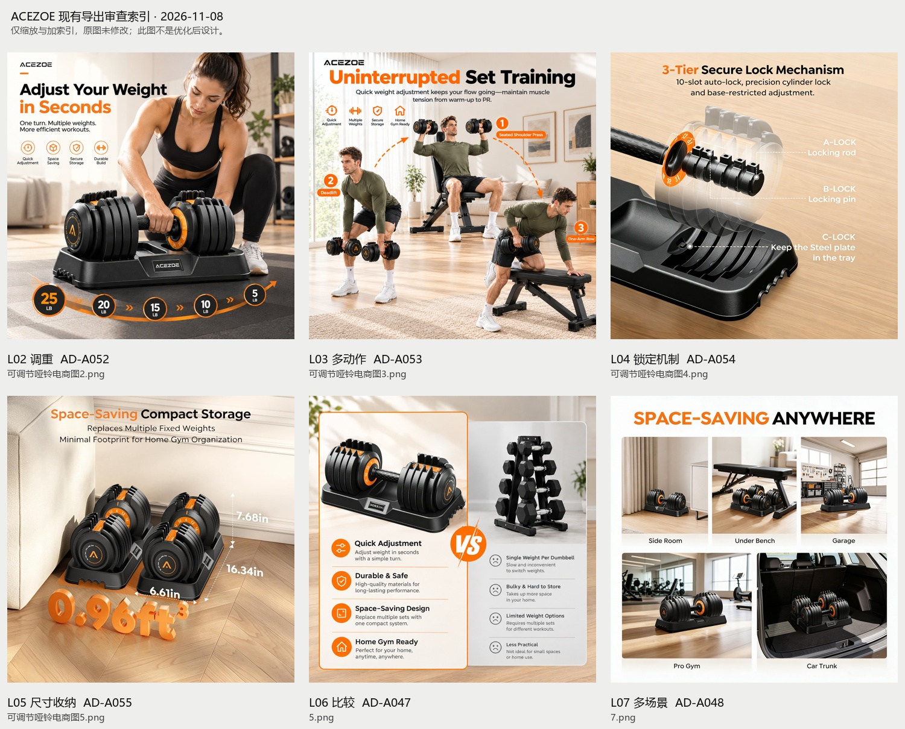

# 可调节哑铃｜Amazon电商视觉案例

更新：2026-11-08。**当前阶段：首轮资料分析与设计审查已完成，待确认优化范围。** 用户已确认保留ACEZOE，优化现有产品的电商视觉；SKU／链接、重量与套装数量待确认。已审查当前57份资料，包含7页PDF、5表Excel、六张次图、三模块A+与13份PSD合并预览，未开始改图。原始资料在提交`6f0abc7`已上传；用户已授权将本轮分析文档提交推送，实际提交与同步结果以Git历史为准。

## 先从这里看

| 任务 | 当前入口 |
| --- | --- |
| 查看首轮审查结论与逐图问题 | [Design Audit Report V01](06_Optimization/Design_Audit/V01/Design_Audit_Report.md) |
| 核对产品、竞品与事实冲突 | [研究核对V01](01_Product_Research/Research_Review_V01.md) |
| 理解源稿、导出与历史版本关系 | [资产关系V01](00_Project_Admin/Asset_Relationships.md) |
| 查看全部历史原始文件 | [原始资料](原始资料/)（保留原五个子目录及根部PDF、Excel） |
| 查看逐文件清单与来源状态 | [Asset Inventory](00_Project_Admin/Asset_Inventory.csv) |
| 理解项目目标与历史设计方向 | [项目简报](PROJECT_BRIEF.md) |
| 查看仓库、本地与远端区别 | [仓库和资料接收检查](00_Project_Admin/Repository_Check.md) |
| 继续上传及目录规划 | [目录与上传说明](00_Project_Admin/Directory_and_Upload_Plan.md) |
| 查看缺口、产品身份和待确认项 | [问题记录](00_Project_Admin/Open_Questions.md) |
| 了解本轮授权、变更与推送状态 | [项目变更记录](00_Project_Admin/Project_Changelog.md) |
| 查看后续阶段与审查方法 | [阶段路线图](06_Optimization/Optimization_Plan/Optimization_Roadmap.md) |

## 已接收的文件

本批共57份，合计156,537,812字节（149.29 MiB）：13份PSD、42张PNG/JPG、1份PDF、1份Excel。文件数量不等于已采用画面数。

| 保留的原目录／文件 | 本批数量 | 当前理解 |
| --- | --- | --- |
| [01 分析](原始资料/01%20分析/) | 6 | 六份PSD合并画面与PDF前六页内容对应；图层未验 |
| [02 Listing](原始资料/02%20Listing/) | 3 | 比较图源、场景PNG与整页拼贴；关联见资产关系表 |
| [03 A+](原始资料/03%20A+/) | 2 | A01、A03合并画面与导出RGB一致；图层及模块类型未验 |
| [04 素材](原始资料/04%20素材/) | 35 | 产品、竞品、场景及生成参考混合；官方身份与权利待确认 |
| [05 导出](原始资料/05%20导出/) | 9 | 导出候选；不等于用户正式定稿或后台通过 |
| [项目研究PDF](原始资料/亚马逊可调节哑铃产品研究项目.pdf) | 1 | 7页逐页渲染阅读；图像型PDF，研究与展示均已纳入 |
| [竞品研究Excel](原始资料/可调哑铃竞品分层分析表.xlsx) | 1 | 5表全部读取；15条评论摘要与50项主观评分，原始证据仍待补 |

## 当前结论与下一步

保留黑白橙、暖色家居和六张次图的基本主题。优先改进：目标SKU与重量/数量口径、无证安全和内部结构宣称、最终白底主图缺口、镜像品牌、不公平比较与A+小屏可读性。0.96ft³按图示可解释为两只包络相加，不直接判错；需要标明对象与尺寸依据。

当前报告已完成可执行审查，不等于产品实测或Amazon后台合规通过。原件未改动，优化设计尚未制作；需要用户选择修改范围，SKU／规格相关内容待补证。用户已明确授权本轮文档提交推送；后续改图范围仍需确认。

[查看A+三模块索引](06_Optimization/Design_Audit/V01/审查图/02_A+三模块审查索引.jpg) · [A+窄屏等比审查模拟（非手机版交付）](06_Optimization/Design_Audit/V01/审查图/03_A+窄屏等比模拟.jpg)

续做先读本README、研究核对、Inventory、Open Questions和Changelog，再按问题ID推进。参考[电商视觉SOP v0.3](../../资料库/SOP制作和规划/电商视觉全流程SOP-v0.3-项目验证版.md)，仅执行当前任务需要的部分。
