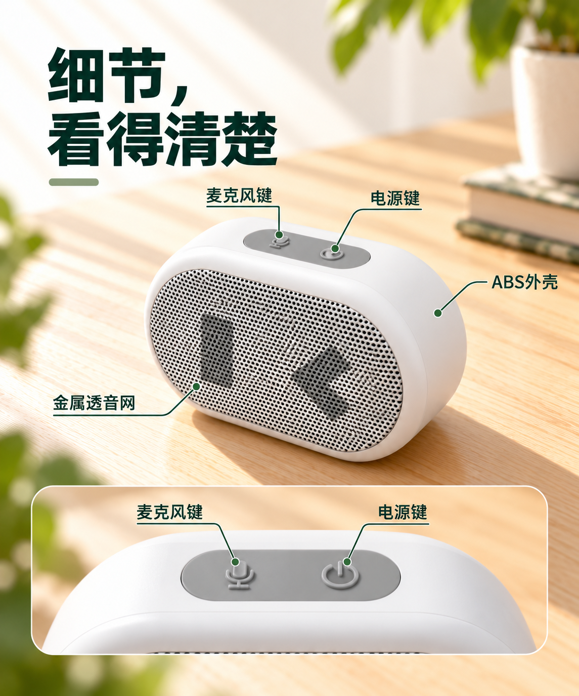
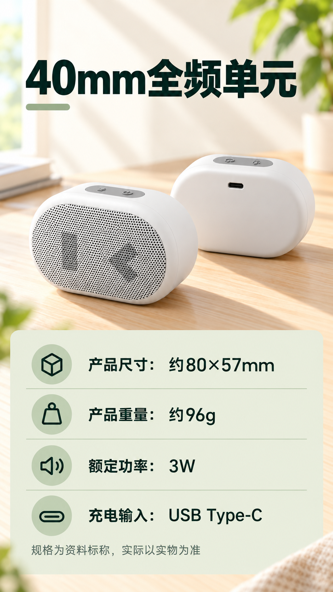

# 小度音箱详情页｜D01–D08 V01候选

根据本套商业审稿意见重生成的[V02候选图](../V02/README.md)已另存；V01仍保留供对照，两轮均待用户审核和选择。逐屏并排入口见[V01/V02版本对照](../版本对照.md)。

按用户要求，Codex 依据[详情页信息架构](../../../项目规划/详情页信息架构.md)从 D01 起顺序生成，每屏都使用上一屏作为视觉参考，并结合已选产品图和对应素材。**全部是 V01 候选，待用户审核和选择，不代表已采用或正式交付。**

D03 在本轮保留初稿和时间线调整稿，D04 以调整稿作为上一屏参考；这只是生成过程，不代表用户已经选择该稿。图像为原始生成 PNG，未完成长页拼接或可编辑 PSD/PSB。生成工具未返回具体图像模型版本；实际输入、原输出文件名与校验值见[生成记录](生成记录.json)。

| 模块 | 内容 | V01 候选 |
| --- | --- | --- |
| D01 | 产品认知与首屏 | [查看首屏](Codex生成-音箱-详情页-D01-首屏-V01.png) |
| D02 | 约96g、轻巧便携 | [查看便携](Codex生成-音箱-详情页-D02-便携-V01.png) |
| D03 | 约10小时播放及条件 | [初稿](Codex生成-音箱-详情页-D03-播放时长-V01-初稿.png) · [时间线调整稿](Codex生成-音箱-详情页-D03-播放时长-V01-时间线调整稿.png) |
| D04 | 手机连接与助手条件 | [查看连接与助手](Codex生成-音箱-详情页-D04-连接与助手-V01.png) |
| D05 | 产品外观、材质与双键 | [查看外观细节](Codex生成-音箱-详情页-D05-外观细节-V01.png) |
| D06 | 亲子、聚会、旅行、运动 | [查看使用场景](Codex生成-音箱-详情页-D06-使用场景-V01.png) |
| D07 | 配置与接口 | [查看配置与接口](Codex生成-音箱-详情页-D07-配置与接口-V01.png) |
| D08 | 选购与使用须知 | [查看选购须知](Codex生成-音箱-详情页-D08-选购须知-V01.png) |

## 连续浏览

以下按阅读顺序展示，D03展示时间线调整稿以对应实际参考链；[D03初稿](Codex生成-音箱-详情页-D03-播放时长-V01-初稿.png)仍保留供比较。两稿均待审核。

## 当前检查范围

- D01–D06 均为 **1145×1374 px**；D07–D08 均为 **941×1671 px**。正式拼接需按目标宽度统一并检查手机端可读性，当前文件并非原方案建议的750 px工作宽。
- 图中文字与产品均为生成内容；正式使用前仍需对照商品资料和实拍核对文字、产品结构及人物一致性。约10小时的70%音量条件保留在D03画面中。
- 产品母版、分层源文件和最终整套审稿记录仍待完成；当前连续浏览不等于已完成长页制作。

[返回制作交付](../../README.md) · [返回项目首页](../../../README.md)
