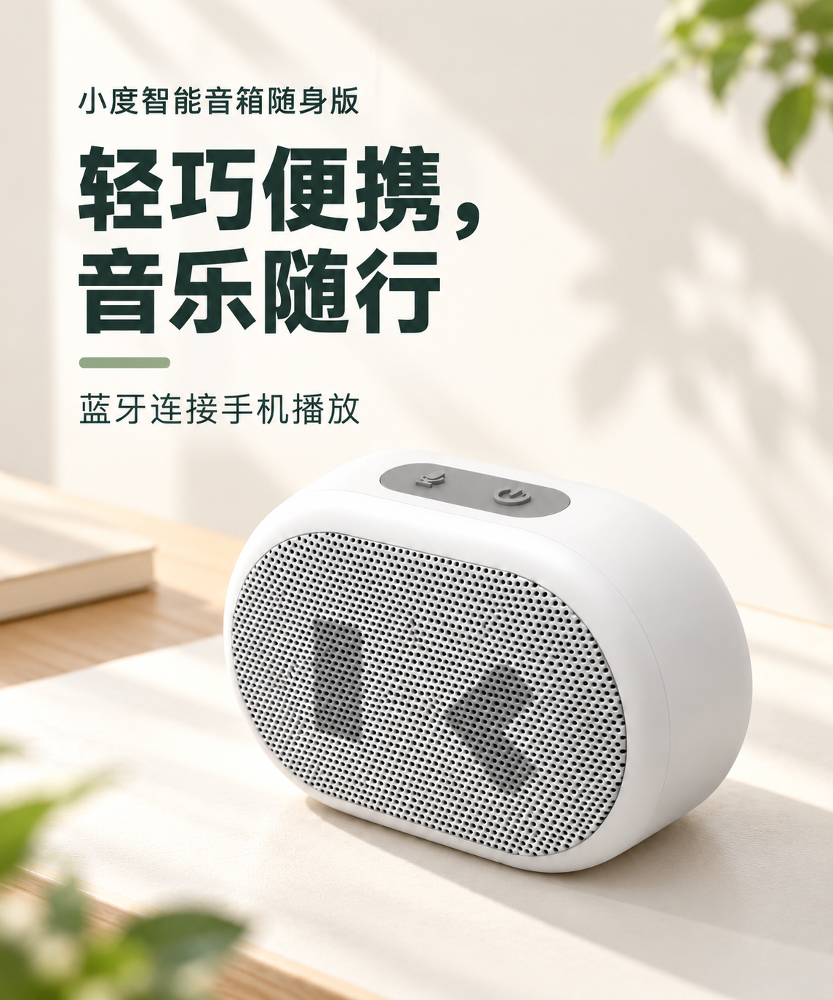
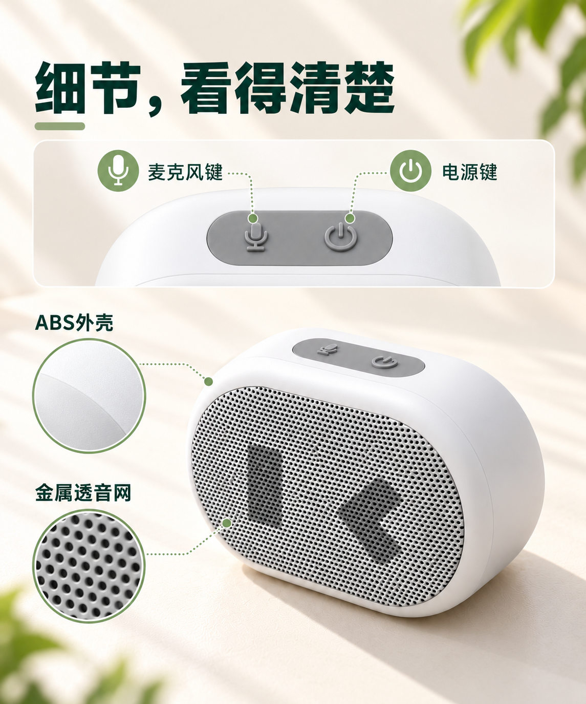
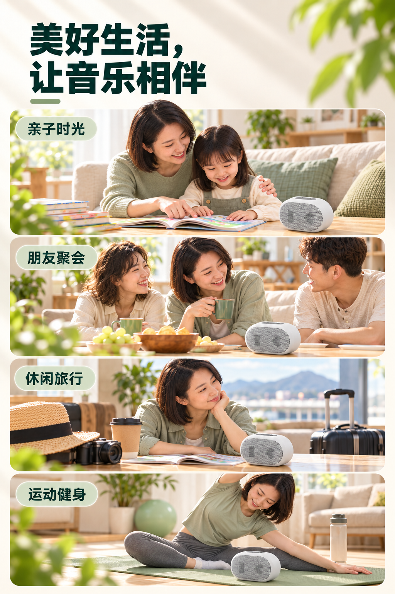
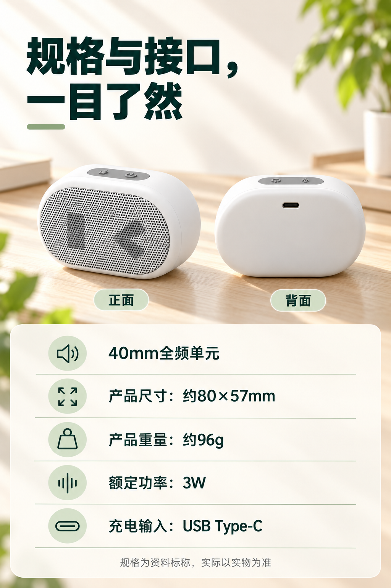

# 小度音箱详情页｜D01–D08 V02候选

依据对[V01候选](../README.md)的商业审稿，按用户要求依次重生成 D01–D08，每屏参考上一屏及产品资料。**本轮全部为 V02 候选，待用户审核和选择，不代表已经采用或正式交付。**逐屏对比见[版本对照](../版本对照.md)。

本轮调整了首屏的产品用途、便携页的人手与产品关系、续航画面的时间线、连接与助手的信息分组、细节页的重复标注、四场景的阅读方式，以及规格和选购须知的组织。D04、D08各保留初稿与修订稿；D05以D04修订稿为上一屏，D08修订稿补充“蓝牙连接”条件。修订稿只反映本轮生成过程，不代表用户已选用。完整提示词、实际引用顺序与文件校验见[生成记录](生成记录.json)。

| 模块 | V02 候选 |
| --- | --- |
| D01 产品认知 | [查看首屏](Codex生成-音箱-详情页-D01-首屏-V02.png) |
| D02 轻巧便携 | [查看便携](Codex生成-音箱-详情页-D02-便携-V02.png) |
| D03 播放时长 | [查看续航](Codex生成-音箱-详情页-D03-播放时长-V02.png) |
| D04 连接与助手 | [初稿](Codex生成-音箱-详情页-D04-连接与助手-V02-初稿.png) · [修订稿](Codex生成-音箱-详情页-D04-连接与助手-V02-修订稿.png) |
| D05 外观细节 | [查看细节](Codex生成-音箱-详情页-D05-外观细节-V02.png) |
| D06 使用场景 | [查看场景](Codex生成-音箱-详情页-D06-使用场景-V02.png) |
| D07 配置与接口 | [查看规格](Codex生成-音箱-详情页-D07-配置与接口-V02.png) |
| D08 选购须知 | [初稿](Codex生成-音箱-详情页-D08-选购须知-V02-初稿.png) · [修订稿](Codex生成-音箱-详情页-D08-选购须知-V02-修订稿.png) |

## 连续浏览

按实际生成参考链依次展示；D04、D08展示本轮修订稿，初稿仍保留在上表，全部待审核。

## 待核对与制作

- D01–D05 原图为 **1145×1374 px**，D06–D07 为 **1024×1536 px**，D08 为 **941×1671 px**。本轮原图仍有不同宽度；实际长页拼接前需统一尺寸并以手机预览检查可读性。
- D05 的材料放大图为生成示意，不是实物微距照片；D02手持尺度、D06人物与产品细节也需对照实拍核实，不能声称完全一致。
- D07涉及的充电接口类型有[待核实疑点](../../../../../素材/产品资料/音箱/规格资料/product-specs.md)；候选图不能作为最终规格依据。
- 目前是原始扁平 PNG；完整长页、可编辑 PSD/PSB、最终文案及整套审核仍待完成。资料标称的续航与条件须在D03同屏保留。

[查看V01候选](../README.md) · [返回项目首页](../../../README.md)
