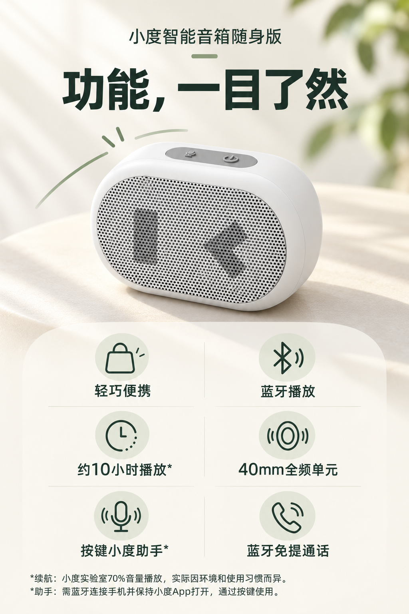

# 小度智能音箱随身版｜功能总览 V01候选

依据用户已审的VI概念和已选产品图生成，供详情页首屏之后使用。**这是一张V01候选图，待用户审核，不代表最终成品。** 文件为1024×1536 px PNG，完整提示词、参考图片顺序和SHA-256见[生成记录](生成记录.json)。

图中展示轻巧便携、蓝牙播放、约10小时播放、40mm全频单元、按键小度助手和蓝牙免提通话。续航与助手的必要条件排在画面底部，普通蓝牙播放与助手所需App条件分别说明。

图中文字和产品为生成图像：正式使用前需对照实拍核对机身、网罩和双键，并用手机尺寸检查标签及底部条件的可读性。当前为扁平PNG，未提供可编辑分层文件。

[返回功能总览](../README.md) · [D01–D08版本对照](../../版本对照.md) · [详情页信息架构](../../../../项目规划/详情页信息架构.md)
