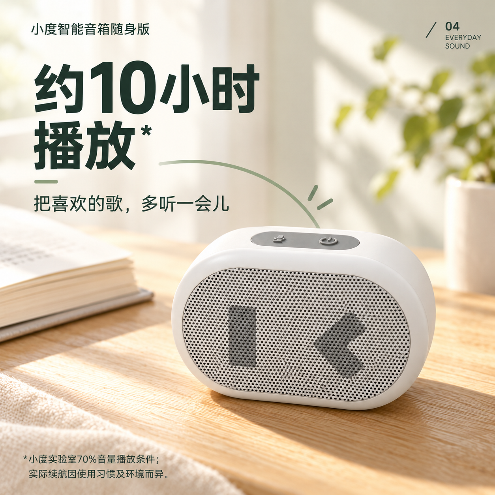
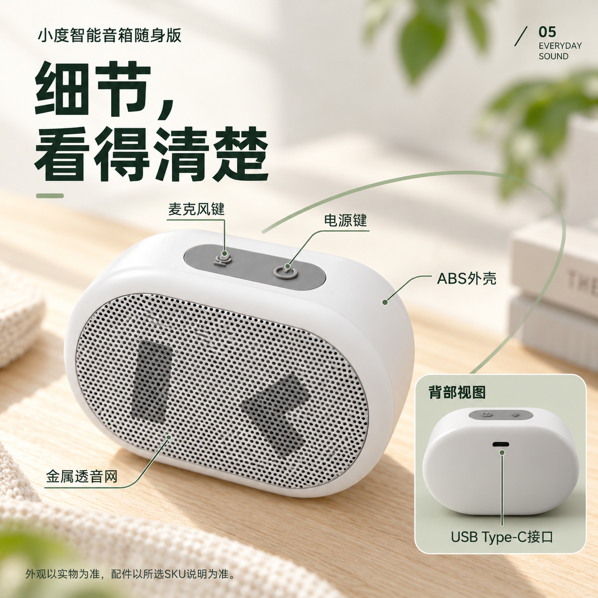

# 小度随身音箱｜04/05概念延展

日期：2026-10-29（Asia/Shanghai）。**04收到图文关系修订反馈，先调研参考；05仍待用户审核。** 本组延续[已通过的01/02/03](../VI概念提案-2026-10-28/README.md)，分别响应[项目大纲](../../项目大纲与最终交付清单.md)中STRATEGY的第四、第五项。沿用清爽亲和的生活数码、自然侧光、深灰绿无衬线气质和鼠尾草绿弧线，不重新选择美术方向。

用户本轮原话：“延续这个视觉方向生成第四第五点的图”。这是本次两张生成的明确授权。原三张的通过记录保持，本组不提前记为用户已认可；也不新增H04/H05正式交付数量。

## 2026-10-29：04修订反馈

用户原话：“04画面与文字的关系不大，先找3c和音箱产品的关于续航宣传的案例图参考”。原04保留为首版过程图，当前暂停重生，先看[续航宣传案例候选](../../参考调研/续航宣传案例候选-2026-10-29.md)。这次反馈针对04的图文机制，不扩大为三张已审方向或05也被否决；05保持待审核。

## 04｜播放时长与条件

- 任务：回应“资料标称能播放多久”，供EC04/D03的正式设计发展。
- 主信息：“约10小时播放*”；副句“把喜欢的歌，多听一会儿”。
- 画面：上左数字与播放信息、下右产品、浅木桌与自然侧光；半开放弧线表现节奏，与已审02居家构图有区别。
- 同图说明：“小度实验室70%音量播放条件；实际续航因使用习惯及环境而异”。保留约数，不表达全天、满音量或无条件保证。
- 状态：用户要求调整图文关系，先调研参考；当前保留为首版过程图，非独立续航实测。

## 05｜外观、双键与接口

- 任务：回应“细节是否看清”，供EC05/D05与D07接口模块发展。
- 主信息：“细节，看得清楚”；以更高观察角度近看顶部与正面，标注麦克风键、电源键、ABS外壳、金属透音网。
- 右下背部小附图只说明同一产品的背部与接口位置；名称“USB Type-C接口”依据参数016，单口位置依据N04。背视两键左右随视角反转。
- 不提供未经核准的长短按教程、精密接口接点或充电性能。底部说明外观与配件按实物/所选SKU核对，不承诺统一配件。
- 状态：待用户审核；生成孔纹、壳体/接口细节仍需在正式制作时用真实素材校准。

## 生成、依据与文件

两张使用 `image_gen.imagegen` 直接生成，未返回具体图像模型版本，不改记为指定版本。均保留原始PNG字节；从工具输出目录复制归档，原输出留在原位置，未执行另行PS排版或重采样。尺寸、字节、SHA256、实际附件顺序与完整执行Prompt见[生成记录](生成记录.json)。

产品结构依据为候选B及已读实拍N02/N04；01/02/03只承担各自光色、字体气质或图形参照。详情限制见[产品规格](../../../../素材/产品资料/音箱/规格资料/product-specs.md)。本次按电商视觉规划与审稿方法检查主次、同图条件和产品一致性；未修改Skill。

这是现有任务的概念延展，不计为两张新增正式营销海报，也不将扁平PNG记为可编辑PSD。项目大纲PDF仍为此前正文快照，本次未重新导出PDF。

[返回参考示范](../README.md) · [项目当前状态](../../README.md#当前任务)
