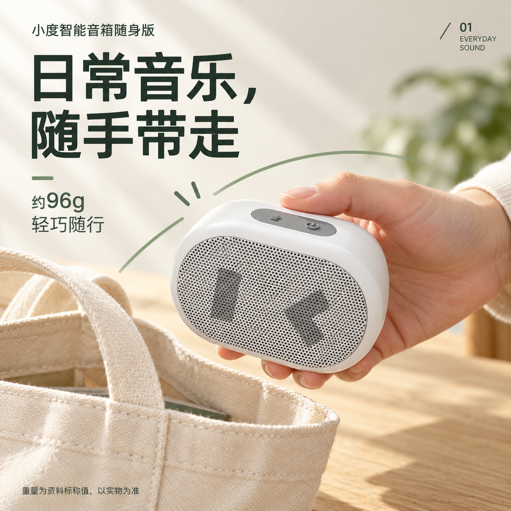
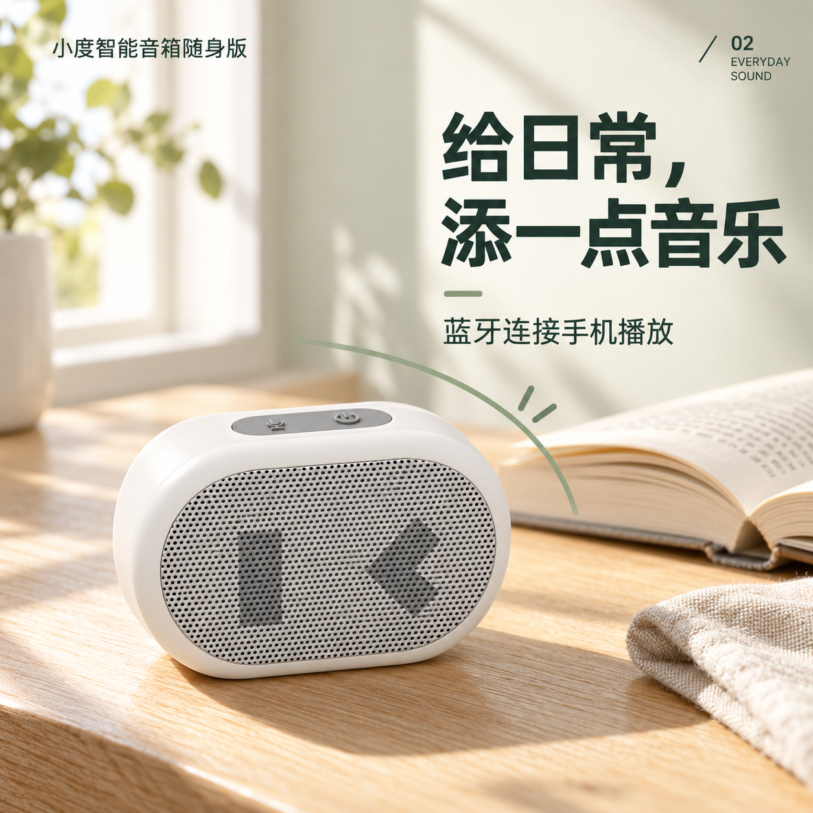
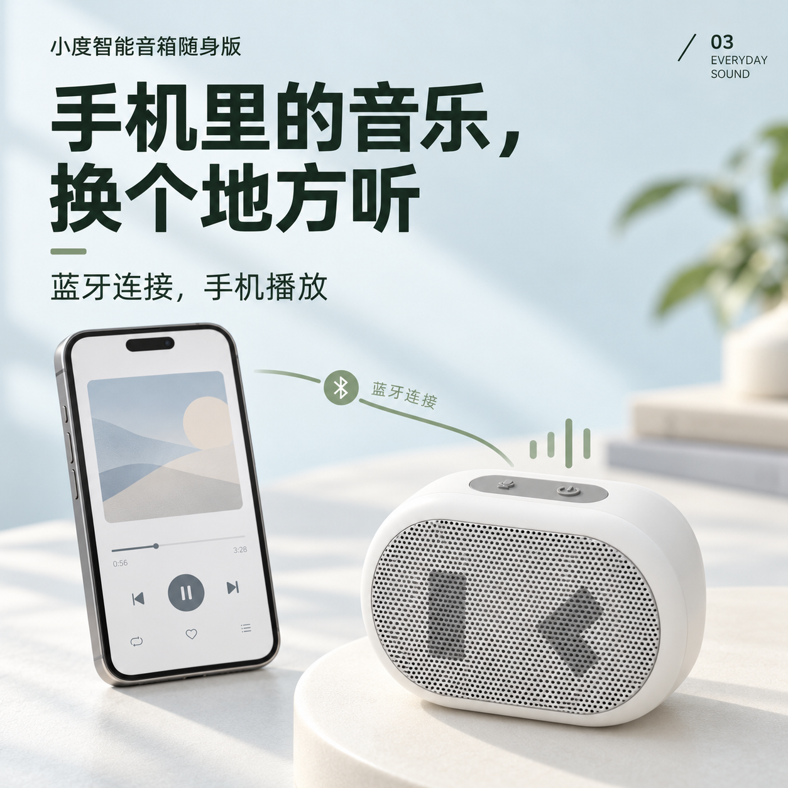

# 小度随身音箱｜三张VI概念参考

日期：2026-10-28。状态：**三张概念效果已获用户审核通过，作为后续正式重做的视觉参照；当前先整理项目大纲与最终交付清单，旧图尚未重做，商业套系尚未定稿。**

用户本轮明确要求：“按这个提案做三张小度智能蓝牙产品vi概念图，我审核参考之后重做之前的成图然后继续完成项目”。这项明确授权覆盖本轮三张概念图，此前默认由用户生图、Codex指导的分工不限制本次执行。

依据：[产品美术方向提案](../../../../任务/商业视觉提案验证/小度随身音箱-美术方向提案-2026-10-28.md)。三张共享“清爽亲和的生活数码”方向、深灰绿中文无衬线气质、灰绿弧线与自然光，分别验证不同画面职责。用户已审核通过三张的概念效果；它们不是小度官方VI，审核通过不等于产品结构母版、可编辑源文件或最终商业套系均已验收。

## 用户审核结论

2026-10-28，用户原话：

> 三张图效果都不错，通过审核。现在整理项目大纲，先理清我最后要交付的东西

审核对象为01便携主视觉、02日常生活场景、03手机音乐连接三张VI概念图。三图的概念效果已通过，后续正式重做以本组为视觉参照；不据此推断逐孔真实性、结构母版、PSD分层或整套最终交付已经通过。下方初步QA校准项保留，正式制作时处理。

## 01｜便携主视觉

- 主张：日常音乐，随手带走。
- 画面：手掌托举产品，帆布包与桌面建立携带情境；重量信息作为次级，保留资料标称说明。
- 本轮审核关注：手持动作是否自然，主体是否吸引人，标题与产品的关系是否合适。

## 02｜日常生活场景

- 主张：给日常，添一点音乐。
- 画面：产品置于左下，书本在后，文字转到右上；侧向日光与真实承托形成安静的日常听音氛围。
- 本轮审核关注：光色、产品触感、空间与文字位置是否符合期望；是否保留这种阅读场景。

## 03｜手机音乐连接

- 主张：手机里的音乐，换个地方听。
- 画面：淡蓝灰空间中，手机与音箱分置两端，用灰绿路径及音乐图形说明蓝牙播放关系；手机界面为生成的通用音乐示意，不是官方App截图。
- 本轮审核关注：连接关系是否容易理解，冷色功能页能否与前两张组成系列，是否认可这种功能图形。

## 实际生成与保存

- 工具：image_gen.imagegen；工具未返回具体模型版本，不另行猜测。
- 三张均为1254×1254 PNG，保留工具原始输出像素；从工具输出目录复制归档，原输出文件继续保留。文件名以“Codex示范”标注来源，不记成用户上传或用户独立制作。
- 外形参照：[电商正面精修候选B](../../制作结果/产品基准图/用户上传-音箱-电商精修-正面-候选B-v01.png)、[实拍顶部N02](../../../../素材/产品资料/音箱/图片/实物照片/音箱-顶部按键-N02.jpg)、[白底N10](../../../../素材/产品资料/音箱/图片/商品宣传/音箱-白底产品主图-N10.png)。生成前已实际打开；N03正面用于额外校核。候选B仍为工作素材，不自动成为结构已全部确认的母版。
- 01先生成，02和03在上述产品参照外，追加01作为系列风格参照；原工具输出名、尺寸、字节数和校验值见[生成记录](生成记录.json)。
- 实际提示词摘要：固定横向圆角浅色ABS机身、细密金属网、左竖块/右折角图案及左麦克风/右电源双键；指定暖白、深灰绿、灰绿与淡蓝灰色彩关系和准确中文；三次分别描述手持、阅读场景、手机连接。完整调用文字保留在本聊天工具记录中，本页摘要不冒充完整逐字提示词。
- 本轮没有修改旧图片、Skill或参考包中的用户选择。

## 初步检查与正式重做时的校准项

三张均已实际独立打开。产品主要轮廓、正面识别图案与双键保持可辨，中文未见明显错字；01托举、02桌面承托、03设备与平台的关系未见明确严重接触错误。这是用户审核前的初步概念检查，保留为后续正式制作的校准依据；用户已通过三张概念效果，商业交付验收仍需基于最终成品。

1. 03音箱相对手机在画面中显得偏大；有前后景差异，不能据PNG精确测量。正式重做时按实物与可靠参照校准尺度。
2. 三张网孔密度、正面图案比例和外壳细节仍有生成差异；正式成图使用统一可靠产品素材及PS合成校正，不把这三张当作结构真值。
3. 图中文字为生成栅格，未提供PSD；字体气质可作为方向参考，不能从PNG认定实际字库、字号或可编辑图层。正式排版按用户可用字库执行。

## 审核后怎样继续

三张概念效果已通过，当前先按用户要求整理项目大纲，明确最终成图、必要产品素材、详情页、尺寸适配、源文件与作品集案例的交付范围和复用关系。

交付范围理清后，再按已通过的视觉方向重做此前成图、统一产品素材并继续套系；旧图重做、详情页、营销适配与整个项目均尚未记为完成。新结果与最终采用版在实际制作及审核后另行记录。

[项目当前任务](../../README.md#当前任务) · [返回参考示范](../README.md)
