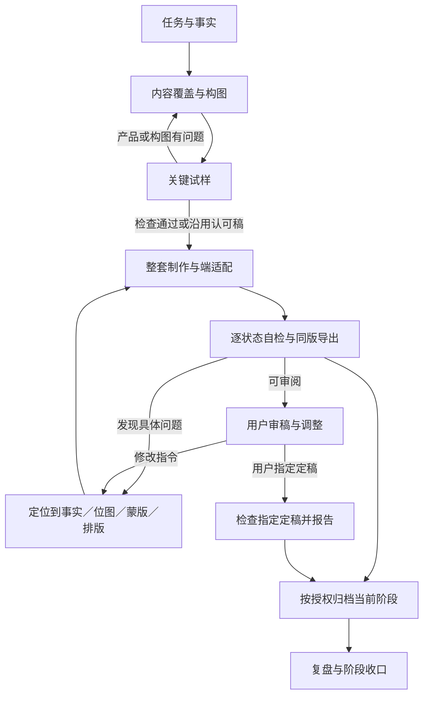

# 电商视觉全流程 SOP v0.3｜项目验证版

更新日期：2026-11-08。**当前推荐工作版本：v0.3，状态为项目验证版。** 继承v0.2的十阶段结构，吸收小度音箱与NED Eric项目的实际经验；本次完成流程、模板与案例回放核对，尚未以v0.3在新项目完整执行，不能称为稳定量产流程或声称已经提升效率。

[快速启动与四份模板](#快速启动) · [阶段总表](#阶段总表) · [出现问题时回到哪里](#出现问题时回到哪里) · [版本与状态](#版本与状态) · [更新说明与验证](电商视觉SOP-v0.3-更新说明与验证.md) · [返回目录](README.md)

## 快速启动

1. 读取项目已有资料、采用稿、用户偏好与当前阶段；先区分整套制作、单图／改稿、仅策划或作品集展示。
2. 将下列模板复制到项目规划或过程目录，填写实际需要的部分，并按保存位置更新SOP及项目资料的相对链接。已有同类表直接沿用字段，不重复建表；单行改字可以在原记录中补一行，无须复制整套模板。
3. 列清本轮必需内容和可选内容，使用内容ID追踪图片、端、比例及状态；缺资料只阻塞依赖该资料的部分。
4. 沿用用户已确认方向，按当前授权推进到可审阅结果。只有实物信息、审美取舍或定稿等需要用户真实判断时才交由用户决定；阶段检查不新增逐步审批。

| 模板 | 保存什么 | 建议位置 |
| --- | --- | --- |
| [01 项目简报与事实表](项目模板-v0.3/01_项目简报与事实表.md) | 目标、范围、分工、事实、素材、规则和研究依据 | 项目规划；后续引用同一份事实表 |
| [02 内容构图与状态覆盖表](项目模板-v0.3/02_内容构图与状态覆盖表.md) | 每图任务、文案、端与状态、试样与覆盖检查 | 项目规划；制作过程中更新 |
| [03 制作反馈与采用记录](项目模板-v0.3/03_制作反馈与采用记录.md) | 实际输入输出、问题定位、修改、用户反馈和采用关系 | 过程记录；按任务合并记录 |
| [04 交付检查与当前版本索引](项目模板-v0.3/04_交付检查与当前版本索引.md) | 当前入口、同版文件、检查、发布状态和阶段收口 | 项目入口引用；交付说明沿用对应字段 |

四份均为可直接复制的Markdown模板，未预填通过结果；可以合并成工作簿或现有项目文档。除机器检查确有需要外，不要求再转成JSON、重复导出报告或新建自动化服务。

新项目启动指令可写：

> 按《电商视觉全流程SOP v0.3》处理【产品／项目】。读取【资料与已有版本位置】，本轮需要【具体交付范围】，用于【平台／站点／语言或作品集】。复用已认可内容，填写必要模板，列齐必需端与状态；先检查高风险试样，再完成授权范围内的制作和同版审阅包。缺失事实不要编造，记录未验证项。实际工具、用户分工及发布授权按本次要求执行。

## 原则与适用范围

贯穿链条：**产品事实与条件 → 购买疑问／表达任务 → 文案与构图 → 实际素材及可编辑排版 → 检查 → 用户判断 → 同版交付。**

- 通用规则约束事实、产品身份、完整性、可读性和交接；尺寸、配色、机位、状态数量与软件按项目确定，不把某个产品的参数写成所有项目标准。
- 整套任务按十阶段组织。局部改稿只执行受影响步骤；仅策划任务交规划与依据，只有Prompt不称成图完成；仅作品集展示优先复用采用素材，平台原图与展示外层分别保存。
- 平台正文、主图、详情页、A+、广告及作品集使用不同容器与规则。A+是Amazon专用称呼；国内任务不套Amazon的字段、资格和画幅。
- 用户负责目标、审美取舍、实际反馈与正式定稿；AI负责读取资料、提出策略、按当前授权制作与自检、整理交付。PS或生图由谁操作按项目决定，真实分工跟随实际记录。
- 已有合格内容直接沿用。关键试样可以用采用稿、草图或现有素材完成，不规定必须新生成几张。单图任务不强制扩为全案。

## 阶段总表

“通过条件”是制作检查；不等于用户批准。发现缺口可继续独立任务，错误不能通过改名或勾选掩盖。

| 阶段 | 开始需要什么 | 最小产出 | 通过条件 | 未通过时 |
| --- | --- | --- | --- | --- |
| 1 任务与分工 | 用户要求、已有文件和当前版本 | 简报、本轮必需／可选交付、实际分工 | 用途、范围和当前目标清楚，关键未知已标记 | 补范围或限定假设；继续不受影响部分 |
| 2 事实与研究 | 实拍、官方／经销商资料、平台与参考 | 事实表、素材索引、必要研究和规则来源 | 宣称有来源与条件，产品身份可识别；缺证据的表达已隔离 | 查依据、补参考或删去无支撑宣称 |
| 3 策略与内容覆盖 | 事实、受众依据或明确假设 | 图组职责、初步文案、内容ID×端／比例×状态清单 | 每项有任务，必需状态全列出，重复有理由 | 补覆盖或重分图组职责 |
| 4 视觉方向与试样 | 认可方向、可用素材、主要风险 | 可执行方向与必要代表画面 | 关键试样产品可信、主次成立、能容纳信息；已有方向已认可则沿用 | 返回方向、素材或具体构图，避免先扩整套 |
| 5 分图文案与素材 | 职责、试样和事实 | 分图文案、素材方案、任务卡 | 主张与画面对应，条件与参数可排，缺素材已有处理路径 | 改文案／构图或补素材，不伪造细节 |
| 6 生成合成与排版 | 任务卡、参考附件、实际工具 | 采用底图、独立文字／图形、源稿与预览 | 原图与排版均已查看，产品结构和文字通过本步检查 | 按问题所在层局部处理；方向根本不符再重制 |
| 7 适配与长页组装 | 合格模块与内容覆盖表 | 各端全部必需状态、整页／切片或比例适配 | 逐状态可打开且内容正确，实际大小可读，无拉伸／意外裁断 | 返回缺失状态或对应模块；不只检查默认首图 |
| 8 自检与用户审稿 | 实际源文件、同版导出和依据 | 自检、用户反馈、修订与定稿对象 | 自检完成可交审阅；采用和正式定稿由用户真实反馈确定 | 修改受影响内容后复查；正式定稿后默认只报告问题 |
| 9 导出归档与同步 | 当前指定版本、交付要求 | 源稿、同版预览、当前索引、归档与远程状态 | 文件存在、版本对应、入口有效；按授权同步并核对结果 | 重导出、补依赖或修链接；本地与远程状态分开写 |
| 10 复盘与收口 | 交付、反馈、生成与修改记录 | 本轮完成范围、可选后续、经验和验证记录 | 用户要求的阶段范围有明确结束点，未来内容有启动条件 | 修正文档与范围；不为凑完整度自动扩项目 |



待审阅版本可以按授权归档；归档不自动变为定稿。用户决定内容制作到此结束时，也可记录阶段收口，保留逐项审阅状态。

## 阶段1—2：范围、事实与研究

先写一段背景：做什么产品、为什么做、给谁看、在哪里用、当前有什么约束、希望得到什么。区分真实委托与概念项目；不把猜测补成客户需求或消费者结论。既有资料可读取就先读取，避免重复向用户索要。

简报明确本轮必需与可选内容、平台／站点／语言、格式、时间和预算约束。画幅待核验就标记，不填默认“行业通用”尺寸。工具不可用时记录实际缺口，先完成可做部分；付费工具、API和模型按当前授权使用，不静默替换或安装服务。

事实表逐项记录来源、日期、对应SKU、数值／原文和适用条件，状态分为资料标称、独立核实、合理推导、待确认／冲突。标称不改为实测；同品牌不代表同款参数、配件或配置。未提供的接口、内部结构、包装与认证不凭图生成补证。

按任务研究同类品、竞品、评价和视觉参考：保留实际看过的来源与范围；评论归纳注明样本与SKU；价格／性能比较先核对可比条件。没有研究时将受众偏好写为假设。视觉参考记录借鉴的构图、光线或信息关系，不将竞品画面混入成品。制作中遇到具体卡点再定向补查，无须重跑所有研究。

平台规则独立于商品事实，注明站点、类目、模块／版位、官方来源和核验日期。真实上架或投放前重验当前规则及账号资格；素材授权、字体和图片公开使用范围按实际用途检查。研究链接不等于图片许可，平台模拟也不是后台通过证据。

## 阶段3—5：策略、覆盖、试样与文案

### 每图先分配任务

从事实提炼主要购买疑问或表达目的，逐项写“读者记住什么、画面如何说明、依据在哪里、与前后图有何不同”。人物和道具辅助理解，不能压过产品或代替卖点证据。统一产品形态、身份与信息层级，允许日夜、材质、角度与景别变化。

文案在图组策略阶段先拟主张，再按图完善标题、说明和必要条件；实际底图出来后调整位置与长度。事实条件紧邻相应主张；没有依据的数值不为排版完整而补写。

### 覆盖表的最小单位

每行对应一份必需内容：**内容ID＋端／比例＋状态**。有语言、市场或SKU差异时加相应字段。使用稳定ID，不以“第几张截图”代替。

- 覆盖“已列入规划、素材已准备、源稿已完成、已渲染、实际看过”各环节；制作中更新同一份表。
- 轮播／热点／不同操作状态逐行列出。共用图片可以引用同一素材，不把多个状态计作多张原创图。
- 辅助裁切不计为独立手机版；必须展示全部内容时，代表性示例不能替代完整集合。只有用户明确缩减范围才移出必需清单。
- 不需要手机、互动或某种比例的项目写“不适用＋原因”，不为填表制造交付。

### 关键试样按风险选择

新整套方向优先检验难点，例如产品主场景、动作近景、窄幅／手机排版；数量由风险决定，不规定必须三张。试样可复用认可图或可读草图。

检查产品结构与尺度、人物／道具主次、机位／动作差异、承托光影以及文案留白。若只换标题仍说不清各图职责，返回内容与构图调整。事实与产品错误先修；审美方向需要用户选择时保留真实反馈，不让AI替用户认可。已认可的方向与合格素材直接沿用。

分图任务卡至少含：任务／用途、主信息及依据、文案与条件、产品身份约束、景别与动作、参考附件职责、制作方式、目标容器、当前版本、检查重点。仅需生成时才写Prompt；只改字时直接指出对象、动作与保存方式。

## 阶段6：素材制作与可编辑排版

1. 选择复用、实拍合成、局部编辑或新生成；保存真实输入、参考顺序、实际结果和采用关系。建议Prompt与真正执行的Prompt分别记录。接口成功／文件返回不等于视觉合格，模型别名不证明后台模型身份。
2. 素材完成后先对照可靠产品图，检查轮廓、颜色、旋钮／按键、标志、连接、配件与比例，以及手势、悬浮、穿插和承托。有产品变形就先处理，不用排字掩盖。
3. 再将文案、条件、图标、箭头、尺寸线与必要遮罩排为独立对象。SVG记录画布与viewBox、稳定ID、图片依赖、字体与许可；PS按实际存在的图层保存。照片嵌入SVG仍是位图，整体场景中产品与阴影不会自动分离。
4. 根据实际底图安排文字与产品避让，按亲密性、对齐、重复、对比组织信息。字号／坐标注明单位与实测或试排性质；宽度不足时调整断行与结构，不靠极小字号硬塞。
5. 输出同版预览并实际查看。字体替换、滤镜或蒙版可能影响导入，浏览器渲染通过只证明该环境；目标编辑器需要时实际打开验证。没有PSD不称交付分层PSD，没有渲染不称视觉自检完成。

产品边缘需要看原尺寸、局部放大与实际展示尺寸；浅／深背景可帮助发现蒙版残边。正常暗面与接触阴影保留，不沿产品轮廓新增粗黑线，也不通过清除所有暗像素让产品失去承托。

## 出现问题时回到哪里

先定位具体对象和所在层，再决定修复；以下是诊断方法，不预判每条黑边都来自同一原因。

| 观察到的问题 | 先核对 | 优先处理 | 修改后复查 |
| --- | --- | --- | --- |
| 参数、型号或条件不一致 | 事实表、SKU、原始来源 | 回阶段2修正事实与受影响文案 | 所有引用该事实的图、语言与字段 |
| 产品轮廓粗黑边／亮边 | 原始位图、透明度蒙版、SVG有无stroke | 蒙版问题修蒙版；位图问题局部编辑；独立描边调整对应对象 | 原图、浅深底、缩放后产品与承托关系 |
| 接触阴影偏厚 | 实物参考、光向、暗部是否在产品内或台面上 | 收窄不合理暗部，保留自然接触；必要时分离控制阴影 | 是否悬浮、底座变薄、反光／木纹突变 |
| 手势／结构／尺度错误 | 可靠产品参照与原生成图 | 局部编辑、可靠产品合成；构图无法成立再重制 | 附加杆件、手指、尺寸关系及受影响边缘 |
| 图组人物／动作重复 | 阶段3每图职责及阶段4试样 | 重分景别、机位或行为，再处理受影响素材 | 每图是否承担不同信息，产品身份仍一致 |
| 文字对比或断行弱 | 实际展示大小、背景明度、字体 | 调文字位置／颜色或独立局部渐变，必要时改文案 | 小尺寸可读性与照片是否过度压暗 |
| 手机／比例／状态缺失 | 内容覆盖表和实际文件集合 | 返回对应状态补制作，不用默认图冒充 | 逐行核对内容、端、状态与导出 |
| 导出仍是旧图、拼接高度改变 | 当前源稿、采用索引、派生关系 | 更新受影响导出及下游衔接，修版本指向 | 模块→整页→切片／互动→连续预览→README |
| 链接失效或版本难找 | 项目入口与真实相对路径 | 修当前索引、嵌入同版图，历史入口清楚标记 | 仓库路径、图片显示与远端提交状态 |

局部修复保存原图、补片、裁切坐标与合成方式，检查羽化和材质连续性。只有无法在现有素材解决时才重生成整图；不把修改建议记录为已经执行。

## 阶段7：端适配、整套与长页

逐行完成覆盖表，按实际容器重排；不把电脑图非等比拉成手机图，不用辅助裁切承诺所有设备安全。先检查每个模块，再看整套阅读顺序、景别重复、参数条件、字体层级与主体识别。

存在轮播／热点／交互时，既看默认状态，也查看全部必需切换结果和静态导出；脚本能点击不证明图文内容正确。手机按项目目标宽度实际渲染，不固定所有项目必须375／390px。

长页检查切片、背景衔接、前后留白及文案位置。连续背景若来自固定母版，应记录取样／延展和后续坐标；前一段高度变动后检查下游衔接，不直接接旧截图。跨版位按信息决定裁切，不能把输出像素或插值等同真实细节。

作品集外层与电商模块分别记录版本；已有夜景／主图不统一染成展示背景色。单列、并排、代表性取样或完整展示按用户范围与阅读目的决定，不将本次NED的排法设为所有项目强制模板。长图、网站和投递短版按实际渠道选择，有需求再制作。

## 阶段8：制作自检、审稿与指定定稿检查

三项检查分别记录结论：

| 检查层 | 看什么 | 不能替代什么 |
| --- | --- | --- |
| 事实与产品 | 参数条件、SKU、外观、配件、结构、动作和来源 | 画面审美与商业表达 |
| 视觉与表达 | 主次、构图、信息任务、区别、实际大小可读性与系列关系 | 用户的审美选择与定稿 |
| 文件与交付 | 尺寸、解码、字体、对象、依赖、版本、状态覆盖与入口 | 平台后台审核、实机或目标编辑器验证 |

制作自检后交用户审阅，默认优先说明最影响理解的三个问题；用户要求全面检查时再展开。问题写成“位置／对象 → 依据与原因 → 修改动作 → 复查方式”。用户提出修改时以当前源文件为准，保留采用稿、修改另存；用户明确要求覆盖或删除旧版时按指定范围执行。

用户指定正式定稿后，绑定具体源文件及对应导出（文件名、版本和修改时间，必要时哈希），AI默认只检查并报告，不静默改版。需修改时按真实修改指令另存候选，再由用户判断。定稿不自动授权发布，归档不代替定稿。

实际未查项目写清原因：如无实物、无后台、无法打开编辑器、字体被替换。没有发现问题时写“在已检查范围内未发现问题”，不承诺绝对无误，也不以脚本通过代替看图。

## 版本与状态

将内容源、排版源、作品集外层及导出文件建立对应关系，允许各层版本不同。例如采用旧版照片并新排文字，只递增受影响层的版本；改名、移动或再次上传不自动产生新制作版。

至少分开保存以下状态，不用一个“完成”字段概括所有结果：

| 维度 | 可用状态示例 |
| --- | --- |
| 制作 | 待资料／策划完成／素材完成／排版完成／导出完成 |
| 质量 | 未检查／有问题／已检查范围通过／有未验证项 |
| 用户判断 | 未审阅／反馈修改／指定采用／暂通过／指定正式定稿 |
| 保存与同步 | 本地保存／已提交未推送／已推送并核对／发布未验证 |
| 范围 | 本轮进行中／本轮范围完成／后续可选 |

状态示例按任务精简，可用表格列或文字说明，不强制建设状态系统。新聊天续做先读当前索引，确认实际存在的文件、采用关系与剩余范围，不依赖记忆猜测。

## 阶段9：同版交付与归档

按实际用途交付，不为目录完整制造空文件。完整视觉审阅包推荐：

```text
交付/
├─ 01_成品与预览/    同版逐图、各端／状态、整页及必要切片
├─ 02_可编辑SVG/     实际SVG或其他真实编辑母版；可分发字体与许可
├─ 03_原始素材/      采用原图、必要派生素材与来源
├─ 04_过程记录/      实际输入输出、修改与集中检查记录
└─ 使用说明.md       看图／改图入口、版本、状态、编辑范围与未查项
```

目录名可沿用已有项目；PS项目按实际PSD／PSB保存，不为套目录改称SVG。“成品”文件夹不代表正式定稿。平台上传素材、带字审阅图与作品集展示图分别标明用途。

每次修改列受影响集合：**源稿／派生素材 → 单模块导出 → 整页／切片 → 互动预览 → 连续预览 → 当前入口**。只更新依赖该修改的部分，核对后再写为同版交付；未重验的部分说明范围，不使用旧检查结论冒充新检查。

项目README维护当前入口和阶段摘要，交付说明维护该包细节；其他文档链接到它们，不在多处复制当前待办。README直接嵌入实际同版图片并提供高清链接，HTML在GitHub不能运行时注明本地打开方式。

按本次及既有有效授权执行归档或推送，核对真实远端提交和目标分支，不强推覆盖他人改动；未推送明确写本地状态。凭据从安全配置读取，不写进模板、记录或仓库。

机械检查按需要使用：尺寸／解码、SVG资源与ID、文件存在性、状态覆盖、链接、版本或哈希对应。现有Amazon JSON检查只代表其明确支持的字段范围；不据此声称检查了国内平台或真实视觉。新增脚本先证明它能发现实际问题，再纳入流程。

## 阶段10：成本、复盘与收口

记录事实、原因和推断的区别。复盘每个主要问题：发生位置、证据、已执行动作、可观察结果、下一次改哪条流程。保留有效取舍，不因出现问题而把整套推倒重来。

有实际数据时，按任务记录请求次数与失败、实际返回文件、采用场景／补片／未采用、供应商费用及人工修复／排版／重导出时间。没记录写“未记录”，不能写零；返回文件数不等于调用次数，补片数不等于独立创意数。供应商账单、币种与费用口径明确后才汇总成本；没有对照不能宣称节省比例、ROI或提升转化。

阶段结束写清：本轮完成内容、当前采用文件、逐项审阅状态、已知缺口、后续可选内容及再次启动条件。用户选择在某段结束不要求补完初始所有设想，也不意味着每份文件已正式定稿。作品集复盘文档与视觉收尾页是不同交付，按实际范围制作。

本版验证分开记录：流程文本／链接检查、历史案例回放、下一项目实用验证。历史经验能支撑规则设计，不能追溯声称旧项目从一开始按v0.3执行；下个项目记录采用／跳过步骤、返工、实际耗时和新问题，再决定保留、简化或修订。

## 技能与工具入口

电商策划、文案、布局、制作与审稿统一使用`ecommerce-visual-strategy`，按平台和任务读取参考，不重复加载旧Amazon独立流程，也不默认额外安装美术方向或审稿技能。技能负责AI执行方法，SOP说明协作与阶段，四份模板承载项目事实与状态。

当前工作区安装入口为`.agents/skills/ecommerce-visual-strategy`，维护源为`AGIC工作流/ecommerce-visual-strategy/skills/ecommerce-visual-strategy`。这些是本工作区路径，新项目先核对实际安装与可用工具。技能包当前版本0.4.1与SOP v0.3分别编号；本次只更新AIGC仓库的SOP与模板，**未修改技能包或同步AI-Skills仓库**，不能声称技能已自动执行新增模板或具备新的自动检查器。

实际生图遵循当前可用imagegen技能或用户指定工具，渲染和源文件编辑遵循实际能力；复制SOP不等于安装生图、PS、后台或无人值守服务。工具、权限和预算无法满足时报告具体缺口，完成独立可做工作。

## 依据与版本历史

- [v0.2试用版](电商视觉全流程SOP-v0.2-试用版.md)、[v0.2待完善记录](电商视觉SOP-v0.2-自检与待完善.md)：保留十阶段、研究、分工与局部任务原则。
- [v0.1早期制作SOP](AIGC产品视觉制作SOP.md)、[小度音箱复盘](../../作品项目/小度音箱/项目复盘/小度智能音箱随身版-项目复盘-2026-11-03.md)：早期制作及商业表达经验。
- [NED全项目阶段复盘](../../作品项目/NED_Eric_Lamp_氛围灯/项目复盘/2026-11-08_阶段复盘.md)：产品边缘、全状态覆盖、可编辑交付、版本入口及范围收口。
- [v0.3更新与验证](电商视觉SOP-v0.3-更新说明与验证.md)：变更映射、历史案例回放和仍待实际验证的事项。
